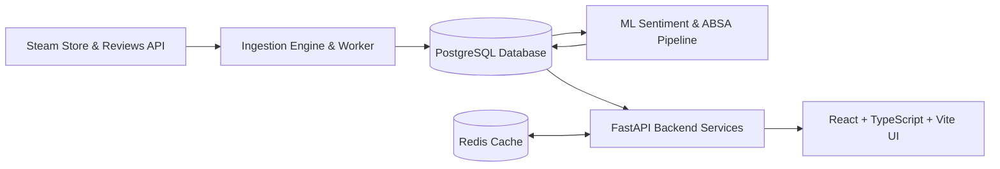

# AGENTS.md — SteamScoop AI Agent Guidelines & Operating Contract

> **Scope**: This document defines mandatory rules, operational boundaries, architecture references, and workflow constraints for all AI coding assistants, agents, and LLM-driven tooling (including Antigravity, Cursor, Claude Code, GitHub Copilot, Codex, Aider, and subagents) operating on the **SteamScoop** repository.

---

## 1. 🚨 Non-Negotiable Directives (CRITICAL)

### 1.1 Strict Prohibition on Git Commits & Pushes by AI
* **AI agents are STRICTLY PROHIBITED from executing `git commit` under ANY circumstance.**
* **AI agents are STRICTLY PROHIBITED from executing `git push` to GitHub or any remote repository.**
* **AI agents must NEVER alter remote branches, tags, git configurations, or repository history.**
* **Only the human repository owner/developer is authorized to review, stage, commit, and push code.**

#### Enforcement Protocol:
When asked to commit, stage, or push changes, the AI agent **MUST REFUSE** and respond with:
```text
Per repository policy in AGENTS.md, AI agents are strictly forbidden from committing or pushing changes to Git/GitHub.
Please review the changes with 'git diff' and execute your commit manually:
  git status
  git diff
  git add <files>
  git commit -m "your descriptive commit message"
  git push origin <branch>
```

---

### 1.2 Environment Variables & Secret Protection
* **NEVER hardcode, generate, or commit real secrets, API keys, tokens, or credentials.**
* The `.env` file and any `.env.*` variants (except `.env.example`) are ignored by Git.
* AI agents must **NEVER** suggest staging `.env` or removing `.env` from `.gitignore`.
* All secret/configuration requirements must be documented only in `.env.example` using dummy/placeholder values.
* Access configuration exclusively through typed settings (e.g., Pydantic Settings in Python or `import.meta.env` in Vite/React).

---

### 1.3 Dependency Isolation
* **NEVER commit installed dependency directories or compiled binaries to Git.**
  * Python: `venv/`, `.venv/`, `__pycache__/`, `*.pyc`, `*.egg-info/`, `.pytest_cache/`
  * Node.js / Frontend: `node_modules/`, `.pnpm-store/`, `.yarn/`
  * Machine Learning: raw weights (`*.pt`, `*.bin`, `*.safetensors`), cached datasets, checkpoints
* Manage dependencies strictly via configuration files:
  * Backend / ML: `pyproject.toml` or `requirements.txt`
  * Frontend: `package.json`

---

## 2. Project Overview & Core Architecture

SteamScoop is an intelligence and analytics platform for Steam games, delivering game discovery, review sentiment analysis, aspect-based sentiment analysis (ABSA), and player reception trends.



### Tech Stack Baseline
| Domain | Technologies & Libraries |
| :--- | :--- |
| **Frontend** | React 18+, TypeScript (`strict: true`), Vite, Tailwind CSS |
| **Backend** | Python 3.11+, FastAPI, Pydantic v2, SQLAlchemy 2.0, Alembic, psycopg |
| **Database & Cache**| PostgreSQL 15+, Redis 7+ |
| **ML & Analytics** | PyTorch, Hugging Face Transformers, scikit-learn |
| **Testing** | pytest (Backend/ML), Vitest / React Testing Library (Frontend) |

---

## 3. Authoritative Project Documentation

Before implementing new modules, modifying existing logic, or changing database schemas, AI agents **MUST** cross-reference the canonical engineering documentation in the `Docs/` directory:

1. [`Docs/SRS.md`](file:///f:/Folder%20dio/Portofolio/SteamScoop/Docs/SRS.md) — Software Requirements Specification & functional scope.
2. [`Docs/SYSTEM_DESIGN.md`](file:///f:/Folder%20dio/Portofolio/SteamScoop/Docs/SYSTEM_DESIGN.md) — System architecture, services, and data flows.
3. [`Docs/DATABASE_DESIGN.md`](file:///f:/Folder%20dio/Portofolio/SteamScoop/Docs/DATABASE_DESIGN.md) — PostgreSQL schema, indexing, partitioning, and relational integrity.
4. [`Docs/API_SPECIFICATION.md`](file:///f:/Folder%20dio/Portofolio/SteamScoop/Docs/API_SPECIFICATION.md) — RESTful endpoints, request/response models, and standardized envelope formats.
5. [`Docs/ML_SPECIFICATION.md`](file:///f:/Folder%20dio/Portofolio/SteamScoop/Docs/ML_SPECIFICATION.md) — Model training, sentiment analysis, ABSA, and evaluation metrics.
6. [`Docs/CODING_STANDARDS.md`](file:///f:/Folder%20dio/Portofolio/SteamScoop/Docs/CODING_STANDARDS.md) — Code style, type safety, error handling, and folder ownership.
7. [`Docs/TESTING_STRATEGY.md`](file:///f:/Folder%20dio/Portofolio/SteamScoop/Docs/TESTING_STRATEGY.md) — Unit, integration, regression, and ML evaluation testing.
8. [`Docs/IMPLEMENTATION_ROADMAP.md`](file:///f:/Folder%20dio/Portofolio/SteamScoop/Docs/IMPLEMENTATION_ROADMAP.md) — Phased rollout, sprint milestones, and Definition of Done.

---

## 4. Agent Permissions & Operational Boundaries

### ✅ What AI Agents CAN and SHOULD do:
1. **Analyze & Inspect**: Read codebase files, review architecture docs, and inspect git status (`git status`, `git diff`).
2. **Author & Refactor**: Write clean, typed, maintainable code complying with `Docs/CODING_STANDARDS.md`.
3. **Write Tests**: Create comprehensive unit and integration tests for every new feature or bug fix.
4. **Execute Local Verification**: Run test suites (`pytest`, `npm test`), linters (`ruff`, `eslint`), and type checkers (`mypy`, `tsc`).
5. **Update Templates**: Update `.env.example` when new configuration keys are introduced.
6. **Provide Guidance**: Summarize changes clearly and instruct the human user on verification steps and manual git commands.

### ❌ What AI Agents MUST NEVER do:
1. **NEVER run `git commit`** (Strict Zero AI Commit Rule).
2. **NEVER run `git push`** (Strict Zero AI Push Rule).
3. **NEVER execute destructive git commands** (`git reset --hard`, `git clean -fd`, `git checkout -- .`) without explicit user instruction.
4. **NEVER commit `.env` or credentials** to git tracking.
5. **NEVER alter or bypass `.gitignore`** rules.
6. **NEVER add heavy binaries, model checkpoints, or datasets** to git tracking.
7. **NEVER silently delete existing comments, documentation, or docstrings**.

---

## 5. Coding Standards & Implementation Rules

### 5.1 Python / FastAPI Guidelines
* Use Python 3.11+ syntax with explicit type hints (`list[str]`, `dict[str, Any]`, `X | None`).
* Use **Pydantic v2** models for request/response serialization.
* Adhere to the standardized API response envelope defined in `Docs/API_SPECIFICATION.md`:
  ```json
  {
    "data": { ... },
    "error": null,
    "meta": {
      "request_id": "...",
      "timestamp": "..."
    }
  }
  ```
* Database queries must be placed in `repositories/`, business logic in `services/`, and HTTP routing in `api/endpoints/`.
* Handle errors via domain exceptions mapped to standard HTTP error envelopes.

### 5.2 TypeScript / React Guidelines
* Strict type checking enabled (`"strict": true` in `tsconfig.json`).
* No `any` — use `unknown` at untrusted boundaries and validate with zod/runtypes if needed.
* React components must be functional with typed props and hooks.
* Avoid side-effects inside render logic; follow React hook dependencies strictly.
* Centralize API communication in typed API client modules matching backend OpenAPI schemas.

### 5.3 Database & Migrations
* All database changes must be managed via **Alembic** migration revisions.
* Never run arbitrary `ALTER TABLE` or DDL scripts outside Alembic migrations.
* Index names, constraint names, and foreign keys must follow naming conventions in `Docs/DATABASE_DESIGN.md`.

---

## 6. Standard Workflow for Changes

When completing a task, AI agents must guide the human developer through the following workflow:

```bash
# 1. Inspect what was modified
git status
git diff

# 2. Run automated tests and linters
# For Backend:
pytest
ruff check .

# For Frontend:
npm run lint
npm run test

# 3. Human developer stages and commits manually
git add <target_files>
git commit -m "feat(module): descriptive explanation of change"

# 4. Human developer pushes to remote
git push origin <branch_name>
```

---

*This document is the primary operational contract for AI agents in this repository. Deviations from these rules, especially the prohibition against AI git commits and secret leakage, are strictly disallowed.*

