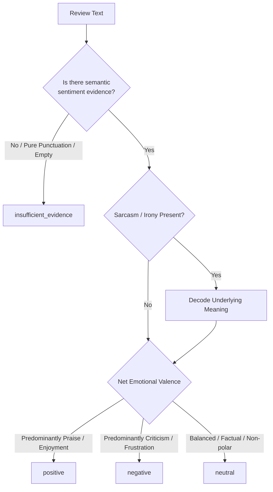

# SteamScoop — NLP Review Annotation Guidelines

**Document:** `ANNOTATION_GUIDELINE.md`  
**Version:** `1.0.0`  
**Status:** Approved Engineering Baseline  
**Scope:** Sentiment Analysis, Aspect-Based Sentiment Analysis (ABSA), and Qualitative Data Quality  

---

## 1. Purpose and Foundational Principles

This guideline defines the authoritative protocol for human annotators, research leads, and LLM-assisted rater systems creating labeled datasets for SteamScoop.

Steam user reviews present unique NLP challenges:
* Informality, gaming slang, abbreviations (`p2w`, `goty`, `mtx`, `fps`, `clunky`), and memes.
* Frequent use of sarcasm, irony, and rhetorical reversals.
* Multi-aspect commentary with mixed polarities in a single review.
* Copypasta, ASCII art, and short uninformative feedback.

### 1.1 Non-Equivalence Principle (Source Signal vs. NLP Sentiment)
Steam provides a binary recommendation signal (`voted_up = true` or `false`).
* **Steam Recommendation (`voted_up`)** is an overarching platform recommendation. A player might recommend a game despite severe flaws ("Still recommending because dev deserves support, but performance is terrible").
* **NLP Text Sentiment** is the objective emotional valence expressed by the written words in the review text.
* **Annotators must judge the text as written.** Do **NOT** assume `voted_up = true` automatically means positive text sentiment, nor `voted_up = false` means negative text sentiment.

---

## 2. Overall Sentiment Classification

Annotators must classify the overall expressed sentiment into one of three primary labels or designate it as insufficient evidence.

### 2.1 Label Definitions

#### 1. `positive`
* **Definition:** The author expresses genuine satisfaction, appreciation, enjoyment, fun, praise, or encouragement to play.
* **Examples:**
  * *"One of the best roguelikes ever made. Flawless combat and stunning art."*
  * *"Short but sweet. Totally worth the five dollars."*
  * *"Instant GOTY. Can't stop playing."*
  * *"Great game!"*

#### 2. `negative`
* **Definition:** The author expresses frustration, disappointment, disapproval, criticism, regret over purchase, or discouragement to play.
* **Examples:**
  * *"Crashes every 15 minutes. Unplayable mess on PC."*
  * *"Greedy microtransactions ruined what could have been a decent game."*
  * *"Boring and repetitive after the first two hours. Refunded."*
  * *"Trash."*

#### 3. `neutral`
* **Definition:** The review is genuinely neutral, matter-of-fact, purely informational, or evenly balanced with no clear positive or negative leaning.
* **Use Sparingly:** Do **NOT** use `neutral` as a catch-all bucket for low confidence or ambiguous text.
* **Examples:**
  * *"It's a standard point-and-click adventure. Took 4 hours to finish all achievements."*
  * *"Linux users note: requires Proton GE 8-25 to launch."*
  * *"The gameplay is okay and the story is okay. Nothing special, but not bad."*

#### 4. `insufficient_evidence` (Exclusion State)
* **Definition:** The text contains zero discernible sentiment or opinion evidence (e.g. pure ASCII emoticons, punctuation marks, random numbers).
* **Examples:**
  * *"."*
  * *"10/10"* (without text explanation; treated as ambiguous rating score without sentiment rationale)
  * *"♥♥♥♥"* (pure profanity filter mask with no context)
  * *"first"*

---

## 3. Complex Text Phenomena & Edge Cases

### 3.1 Sarcasm, Irony, and Meme Reversals
Gamers frequently use exaggerated hyperbole or inverted statements. Annotators must label the **underlying communicative intent**, not literal surface words:

| Review Text | Literal Reading | Correct Annotation | Rationale |
| :--- | :--- | :--- | :--- |
| *"10/10 would crash at the final boss again."* | Positive ("10/10") | **`negative`** | Sarcastic complaint about game-breaking crash. |
| *"Thanks EA for letting me pay \$20 for blue armor."* | Positive ("Thanks") | **`negative`** | Sarcastic condemnation of microtransactions. |
| *"Goodbye social life and sleep schedule."* | Negative literal ("Goodbye") | **`positive`** | Gamer idiom expressing deep addiction and enjoyment. |
| *"Warning: Highly addictive masterpiece."* | Negative literal ("Warning") | **`positive`** | Praise phrased as a humorous alert. |

### 3.2 Mixed Sentiment Reviews
Reviews frequently combine praise and criticism (e.g., *"Amazing graphics and music, but the gameplay is boring and tedious."*).
* **Guiding Rule for Overall Sentiment:** Look at the net conclusion or emphasis.
  * If negative complaints dominate the player's final stance, label `negative`.
  * If praise is the primary thrust despite minor quibbles, label `positive`.
  * If truly 50/50 balanced with no prevailing stance, label `neutral`.
* **Note:** The individual aspect polarities will accurately capture the nuances via ABSA!

### 3.3 Negation Handling
* *"Not bad"* $\rightarrow$ Mild `positive` / `neutral`.
* *"Not good"* $\rightarrow$ `negative`.
* *"Can't recommend enough"* $\rightarrow$ Strongly `positive`.
* *"Hard to recommend"* $\rightarrow$ `negative`.

---

## 4. Aspect-Based Sentiment Analysis (ABSA) Taxonomy

SteamScoop tracks **12 controlled game aspects**. For each aspect mentioned in a review, annotators must identify:
1. **Aspect Key**: Which aspect category is referenced.
2. **Aspect Polarity**: Expressed sentiment toward that aspect (`positive`, `negative`, `neutral`).
3. **Evidence Span**: Exact character substring from the review supporting the judgment.

### 4.1 Controlled Aspect Directory

#### 1. `gameplay`
* **Scope:** Mechanics, combat responsiveness, movement, controls, challenge, pacing, core game loop.
* **Positive Example:** *"Combat feels snappy and responsive."* (`gameplay` $\rightarrow$ `positive`)
* **Negative Example:** *"Controls feel clunky and delayed."* (`gameplay` $\rightarrow$ `negative`)
* **Keywords:** `gameplay`, `combat`, `controls`, `mechanics`, `movement`, `boss`, `challenge`, `difficulty`

#### 2. `story`
* **Scope:** Narrative, plot, characters, dialogue, writing, voice writing, lore, worldbuilding.
* **Positive Example:** *"The emotional storyline brought me to tears."* (`story` $\rightarrow$ `positive`)
* **Negative Example:** *"Dialogue is cringe and plot holes everywhere."* (`story` $\rightarrow$ `negative`)
* **Keywords:** `story`, `plot`, `narrative`, `characters`, `dialogue`, `lore`, `writing`, `cutscenes`

#### 3. `graphics`
* **Scope:** Art direction, visual fidelity, lighting, animation, textures, character models.
* **Positive Example:** *"Stunning pixel art and fluid animations."* (`graphics` $\rightarrow$ `positive`)
* **Negative Example:** *"Textures look like a PS2 game."* (`graphics` $\rightarrow$ `negative`)
* **Keywords:** `graphics`, `visuals`, `art style`, `animation`, `lighting`, `textures`, `models`

#### 4. `audio`
* **Scope:** Original soundtrack (OST), sound effects (SFX), voice acting performance, audio mixing.
* **Positive Example:** *"The soundtrack is an absolute banger."* (`audio` $\rightarrow$ `positive`)
* **Negative Example:** *"Voice acting is completely flat and emotionless."* (`audio` $\rightarrow$ `negative`)
* **Keywords:** `soundtrack`, `music`, `ost`, `audio`, `sfx`, `sound effects`, `voice acting`

#### 5. `performance`
* **Scope:** Framerate (FPS), stuttering, hardware optimization, crashes, game-breaking bugs, memory leaks.
* **Positive Example:** *"Runs at locked 120 FPS on ultra settings."* (`performance` $\rightarrow$ `positive`)
* **Negative Example:** *"Severe microstutters and desktop crashes."* (`performance` $\rightarrow$ `negative`)
* **Keywords:** `performance`, `fps`, `lag`, `stutter`, `crash`, `crashes`, `optimization`, `bug`, `glitch`

#### 6. `content`
* **Scope:** Campaign length, mission variety, replay value, maps, endgame depth, amount of content.
* **Positive Example:** *"Easily 150 hours of content across multiple builds."* (`content` $\rightarrow$ `positive`)
* **Negative Example:** *"Finished the whole game in 90 minutes. Zero replay value."* (`content` $\rightarrow$ `negative`)
* **Keywords:** `content`, `replayability`, `hours`, `length`, `variety`, `endgame`, `repetitive`, `grind`

#### 7. `multiplayer`
* **Scope:** Netcode, server stability, matchmaking speed/fairness, co-op experience, PvP balance, cheaters.
* **Positive Example:** *"Co-op with friends was smooth and lag-free."* (`multiplayer` $\rightarrow$ `positive`)
* **Negative Example:** *"Servers are constantly disconnecting and lobbies are full of cheaters."* (`multiplayer` $\rightarrow$ `negative`)
* **Keywords:** `multiplayer`, `co-op`, `coop`, `pvp`, `servers`, `netcode`, `matchmaking`, `cheaters`, `ping`

#### 8. `monetization`
* **Scope:** Microtransactions (MTX), battle passes, loot boxes, pay-to-win elements, aggressive DLC pricing.
* **Positive Example:** *"Purely cosmetic battle pass, completely fair progression."* (`monetization` $\rightarrow$ `positive`)
* **Negative Example:** *"Aggressive pay-to-win microtransactions ruin the game."* (`monetization` $\rightarrow$ `negative`)
* **Keywords:** `microtransactions`, `mtx`, `battle pass`, `pay to win`, `p2w`, `lootbox`, `dlc`, `cash grab`

#### 9. `price_value`
* **Scope:** Purchase price justification, sale discount value, hours of fun per dollar spent.
* **Positive Example:** *"At \$15, this is the steal of the year."* (`price_value` $\rightarrow$ `positive`)
* **Negative Example:** *"Definitely not worth the full \$70 price tag. Wait for a deep sale."* (`price_value` $\rightarrow$ `negative`)
* **Keywords:** `price`, `worth`, `cost`, `sale`, `discount`, `value`, `overpriced`, `dollars`, `expensive`

#### 10. `support_updates`
* **Scope:** Post-launch patches, developer communication, bug fixes, roadmap transparency, abandonment.
* **Positive Example:** *"Developers listen to community feedback and patch bugs weekly."* (`support_updates` $\rightarrow$ `positive`)
* **Negative Example:** *"Devs took the money and abandoned the early access version."* (`support_updates` $\rightarrow$ `negative`)
* **Keywords:** `updates`, `patch`, `patches`, `developers`, `devs`, `support`, `fixes`, `roadmap`, `abandoned`

#### 11. `accessibility`
* **Scope:** Subtitle readability, colorblind modes, key rebinding, FOV sliders, motion sickness toggles.
* **Positive Example:** *"Excellent accessibility options with extensive subtitle and colorblind settings."* (`accessibility` $\rightarrow$ `positive`)
* **Negative Example:** *"No key rebinding and unreadable tiny UI fonts."* (`accessibility` $\rightarrow$ `negative`)
* **Keywords:** `accessibility`, `subtitles`, `colorblind`, `keybinds`, `fov`, `motion sickness`, `options`

#### 12. `other`
* **Scope:** External launchers (EA App, Ubisoft Connect), anti-cheat kernel drivers (Denuvo, Vanguard), Steam Deck / OS compatibility.
* **Positive Example:** *"Works perfectly out of the box on Steam Deck."* (`other` $\rightarrow$ `positive`)
* **Negative Example:** *"Requires mandatory third-party launcher and invasive kernel anti-cheat."* (`other` $\rightarrow$ `negative`)
* **Keywords:** `launcher`, `anticheat`, `denuvo`, `drm`, `steam deck`, `linux`, `proton`

---

## 5. Evidence Span Annotation Protocol

When annotating an aspect, annotators must select the **minimal continuous span** that justifies the aspect assignment:
* **Span Minimal Rule:** Include only the words conveying the opinion and aspect target.
  * Correct: `[Combat feels snappy and responsive]`
  * Incorrect: `[Yesterday I bought the game on sale and Combat feels snappy and responsive when you play on hard difficulty]`
* **Character Offset Boundaries:** Record `start_char` and `end_char` referenced against the normalized review text.

---

## 6. Inter-Annotator Agreement & Adjudication

To maintain benchmark data integrity:
1. **Double Annotation:** A minimum of 20% of the dataset must be independently labeled by two separate annotators.
2. **Agreement Threshold:**
   * Sentiment Agreement: Target Cohen's Kappa $\kappa \ge 0.75$.
   * Aspect Detection Agreement: Target Macro $F_1 \ge 0.70$.
3. **Adjudication Procedure:** When annotators disagree, a Senior NLP Research Lead adjudicates the final gold-standard label and records the rationale.
4. **Annotator Privacy:** All annotators are assigned randomized pseudonymous IDs (e.g. `annotator_01`). No personal rater data is included in public exports.

