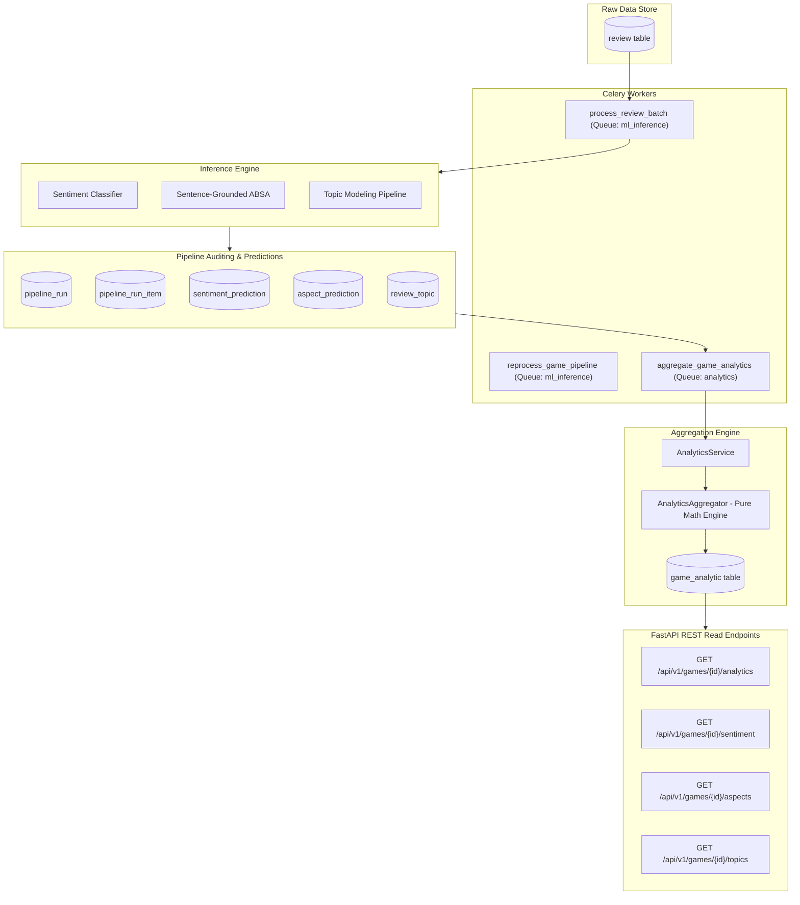

# SteamScoop — Production Data Pipeline and Analytics Engine

**Document:** `Docs/DATA_PIPELINE_AND_ANALYTICS.md`  
**Version:** 1.0  
**Status:** Approved Engineering Specification  
**System Layer:** ML Platform, Data Engineering, and Analytical Aggregation  

---

## 1. Architectural Overview

The SteamScoop Production Data Pipeline bridges normalized, raw Steam customer reviews to downstream machine learning models and high-throughput, version-aware analytical read models.



---

## 2. Core Invariants & Data Integrity

1. **Raw Review Immutability**:
   Raw Steam review content (`Review.review_text`), player recommendation flags (`Review.voted_up`), and author metadata are never overwritten, modified, or scrubbed by ML or analytics pipelines.
2. **Strict Model Version Isolation**:
   Predictions generated by different model releases or taxonomy versions are never silently combined in aggregate buckets. The `model_version_key` composite index on `game_analytic` guarantees total isolation between model generations.
3. **Explicit Denominators**:
   All rates and scores explicitly document and enforce their denominator. Under no circumstance are percentages returned without sample sizes and explicit denominator metadata.
4. **Item-Level Fault Isolation**:
   Inference batch failures are tracked individually in `pipeline_run_item` with diagnostic error codes (`EMPTY_REVIEW_TEXT`, `PREDICTION_MISSING`, `INFERENCE_EXCEPTION`). A corrupted review never crashes a batch or leaves pipeline runs in undefined states.
5. **Durable Watermarks & Idempotent Persistence**:
   Upserts to `sentiment_prediction`, `aspect_prediction`, and `game_analytic` use unique constraint conflict handling and explicit currency flag management (`is_current = TRUE`).

---

## 3. Batch Inference Execution Engine

### 3.1 Model Tasks & Classifiers

| Task | Default Production Model | Output Schema | Currency Rule |
| :--- | :--- | :--- | :--- |
| **Sentiment Analysis** | `TfidfLogisticRegression` (sublinear TF-IDF + Calibrated Logistic Regression) | `SentimentPrediction`: `label` (`positive`, `negative`, `neutral`), `confidence` $\in [0, 1]$, `probabilities` JSONB | Partial unique index: `ix_sentiment_prediction_current` on `(review_id) WHERE is_current = TRUE`. |
| **Aspect-Based Sentiment (ABSA)** | `SentenceGroundedTfidfABSA` (sentence-segmented multi-label detector) | `AspectPrediction`: `aspect_id`, `sentiment_label`, `confidence`, `evidence_text`, `start_offset`, `end_offset` | Unique constraint: `(review_id, aspect_id, ml_model_id, pipeline_run_id)`. |
| **Topic Modeling** | `NMFTopicModel` (Non-Negative Matrix Factorization with coherence optimization) | `Topic`: `topic_key`, `label`, `keywords`, `representative_terms`. `ReviewTopic`: `score`, `is_primary` | Partial unique index: `ix_review_topic_primary` on `(review_id, pipeline_run_id) WHERE is_primary = TRUE`. |

### 3.2 Pipeline Run Tracking & Item Outcomes

Every batch inference invocation registers a `PipelineRun` record:
- `pipeline_type`: `"sentiment"`, `"absa"`, or `"topic"`
- `status`: `"running"` $\to$ `"succeeded"` or `"failed"`
- `model_version_snapshot`: Immutable string key (e.g. `steamscoop-sentiment-default@v1.0.0`)
- `input_count`, `success_count`, `failure_count`
- Diagnostic item logs in `pipeline_run_item`:
  ```sql
  SELECT item_key, status, error_code, error_message 
  FROM pipeline_run_item 
  WHERE pipeline_run_id = :run_id AND status = 'failed';
  ```

### 3.3 Reprocessing & Backfill Workflows

When model artifacts are upgraded or failed items require re-evaluation:
1. `InferencePipelineService.reprocess_failed_items(failed_pipeline_run_id)` identifies unpredicted or failed review IDs from `pipeline_run_item`.
2. A new `PipelineRun` is spawned targeting only those specific reviews.
3. Upon success, new predictions are upserted with `is_current = True`, and `aggregate_game_analytics` refreshes the impacted time buckets.

---

## 4. Analytics Aggregation Engine & Mathematical Specifications

### 4.1 Time Bucketing Strategy

The aggregation engine generates contiguous, non-overlapping intervals $[T_{\text{start}}, T_{\text{end}})$:
- **`day`**: $[D, D + 1\text{ day})$
- **`week`**: Aligns to Monday 00:00:00 UTC through following Monday 00:00:00 UTC ($[W, W + 7\text{ days})$)
- **`month`**: Aligns to 1st of month 00:00:00 UTC through 1st of next month ($[M, M + 1\text{ month})$)

### 4.2 Review Volume & Player Recommendation Metrics

- $N = \text{review\_count}$: Total reviews within the bucket window.
- $R_{\text{rec}} = \text{steam\_recommended\_count}$: Reviews where `voted_up == True`.
- $R_{\text{not\_rec}} = \text{steam\_not\_recommended\_count}$: Reviews where `voted_up == False`.
- Invariant constraint:
  $$R_{\text{rec}} + R_{\text{not\_rec}} \le N$$
- Steam Recommendation Rate:
  $$\text{steam\_recommendation\_rate} = \frac{R_{\text{rec}}}{R_{\text{rec}} + R_{\text{not\_rec}}} \quad (\text{if } R_{\text{rec}} + R_{\text{not\_rec}} > 0, \text{ else } \text{None})$$

### 4.3 Sentiment Distribution & Net Score

- $P = \text{positive\_count}$: Classified positive predictions.
- $M = \text{negative\_count}$: Classified negative predictions.
- $U = \text{neutral\_count}$: Classified neutral predictions.
- $C = \text{classified\_count} = P + M + U$.
- $X = \text{unclassified\_count} = N - C$ (captures unpredicted, abstained, or low-confidence reviews).
- Invariant constraint:
  $$P + M + U \le N$$
- **Classified Sentiment Rates** (Denominator = $C$):
  $$\text{positive\_rate} = \frac{P}{C}, \quad \text{negative\_rate} = \frac{M}{C}, \quad \text{neutral\_rate} = \frac{U}{C}$$
- **Coverage & Abstention Rates** (Denominator = $N$):
  $$\text{coverage\_rate} = \frac{C}{N}, \quad \text{unclassified\_rate} = \frac{X}{N}$$
- **Normalized Net Sentiment Score** (Scale: $[-1.0, +1.0]$):
  $$\text{sentiment\_score} = \frac{P - M}{C} \quad (\text{if } C > 0, \text{ else } \text{None})$$

### 4.4 Aspect-Level Sentiment & Distribution

For each discrete aspect $A$ in the controlled taxonomy:
- $M_A = \text{mention\_count}$: Total predicted mentions of aspect $A$.
- $P_A, M_A^{\text{neg}}, U_A$: Positive, negative, and neutral mentions ($P_A + M_A^{\text{neg}} + U_A = M_A$).
- **Aspect Polarity Rates** (Denominator = $M_A$):
  $$\text{positive\_rate}_A = \frac{P_A}{M_A}, \quad \text{negative\_rate}_A = \frac{M_A^{\text{neg}}}{M_A}, \quad \text{neutral\_rate}_A = \frac{U_A}{M_A}$$
- **Aspect Sentiment Score**:
  $$\text{aspect\_sentiment\_score}_A = \frac{P_A - M_A^{\text{neg}}}{M_A} \in [-1.0, +1.0]$$
- **Aspect Prevalence**:
  $$\text{prevalence}_A = \frac{M_A}{N} \quad (\text{if } N > 0, \text{ else } 0.0)$$

### 4.5 Topic Prevalence & Outliers

- Topics are assigned with primary indicator (`is_primary = TRUE`) to avoid multi-count distortion.
- **Topic Prevalence** (Denominator = $T_{\text{total}} = \text{total\_assigned\_reviews}$):
  $$\text{prevalence}_T = \frac{N_T}{T_{\text{total}}}$$
- **Outlier Rate**:
  $$\text{outlier\_rate} = \frac{N_{\text{outlier}}}{T_{\text{total}}}$$

---

## 5. Background Worker Operations (Celery & Redis)

Tasks are registered in `app.workers.tasks` and isolated into dedicated worker queues:

```python
task_routes = {
    "app.workers.tasks.ingest_game_reviews": {"queue": "ingestion"},
    "app.workers.tasks.cancel_ingestion_job": {"queue": "ingestion"},
    "app.workers.tasks.process_review_batch": {"queue": "ml_inference"},
    "app.workers.tasks.aggregate_game_analytics": {"queue": "analytics"},
    "app.workers.tasks.reprocess_game_pipeline": {"queue": "ml_inference"},
}
```

### Retry Handling & Operational Resilience
- **Database Transient Failures**: Handled with exponential backoff on `OperationalError` and `DatabaseError`:
  $$\text{delay} = \min(15 \times 2^{\text{retries}}, 180\text{ seconds})$$
- **Worker Crashes & Reconnects**: Enforced via `task_acks_late=True` and `task_reject_on_worker_lost=True` in Celery configuration.

---

## 6. Public API Read Models

| Endpoint | Purpose | Key Query Parameters |
| :--- | :--- | :--- |
| `GET /api/v1/games/{id}/analytics` | Time-series points for charts and trends | `period` (`day`/`week`/`month`), `from`, `to`, `model_version` |
| `GET /api/v1/games/{id}/sentiment` | Overall sentiment distribution, rates, coverage, and score | `from`, `to`, `model_version`, `include_trend` |
| `GET /api/v1/games/{id}/aspects` | Aspect breakdown, polarities, and sentiment scores | `from`, `to`, `limit`, `sort` (`mentions_desc`, `negative_rate_desc`) |
| `GET /api/v1/games/{id}/topics` | Discovered topics, representative keywords, and prevalence | `limit`, `include_outliers`, `model_version` |

---

## 7. Verification & Automated Test Evidence

The pipeline and analytics engine are validated through three layers of testing:
1. **Mathematical Accuracy Unit Tests** (`apps/api/tests/unit/analytics/test_aggregator.py`):
   Compares manually computed ground truth values for sentiment distribution, denominators, aspect scores, and topic prevalence against aggregator outputs.
2. **Pipeline Lifecycle & Fault Isolation Unit Tests** (`apps/api/tests/unit/test_inference_pipeline_service.py`):
   Validates batch chunking, item-level diagnostic tracking, corpus size thresholds, and reprocessing of failed items.
3. **End-to-End Integration Tests** (`apps/api/tests/integration/test_pipeline_and_analytics_integration.py`):
   Tests full flow against live PostgreSQL database: seeding reviews $\to$ executing NLP pipelines $\to$ persisting predictions $\to$ calculating temporal aggregates $\to$ serving verified REST responses.

