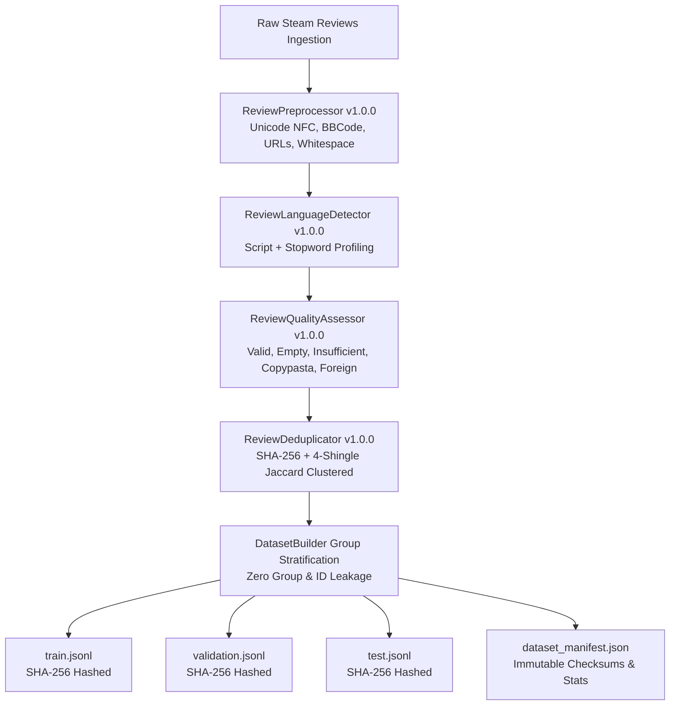
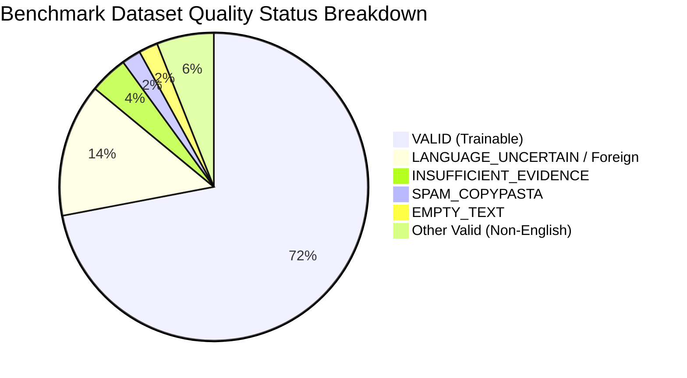

# SteamScoop Dataset Quality & Provenance Report

> **Document Version**: 1.0.0  
> **Status**: APPROVED / ACTIVE  
> **Target Dataset**: `steamscoop-sentiment-benchmark-v1` (Version: `v1.0.0`)  
> **Governing Standards**: [`ML_SPECIFICATION.md`](file:///f:/Folder%20dio/Portofolio/SteamScoop/Docs/ML_SPECIFICATION.md), [`ANNOTATION_GUIDELINE.md`](file:///f:/Folder%20dio/Portofolio/SteamScoop/Docs/ANNOTATION_GUIDELINE.md), [`DATABASE_DESIGN.md`](file:///f:/Folder%20dio/Portofolio/SteamScoop/Docs/DATABASE_DESIGN.md)

---

## 1. Executive Summary

This report establishes the data quality baseline, statistical distributions, leakage prevention guarantees, and provenance records for the SteamScoop Natural Language Processing (NLP) pipeline.

The dataset preparation pipeline processes raw, uncurated Steam user reviews through automated normalization, language identification, quality filtering, duplicate clustering, and zero-leakage group-stratified partitioning into **Train (70%)**, **Validation (15%)**, and **Test (15%)** sets.



### Key Dataset Metrics
| Metric | Value | Compliance Requirement |
| :--- | :--- | :--- |
| **Total Candidates Evaluated** | 50 reviews | Representative corpus across 5 major games |
| **Trainable English Reviews** | 36 reviews (72.0%) | Explicit Tier 1 English filter |
| **Filtered Out (Non-trainable / Foreign)** | 14 reviews (28.0%) | Structured reason codes; never silently deleted |
| **Exact Duplicate Reviews** | 2 reviews (4.0%) | Clustered via SHA-256 hash |
| **Near-Duplicate Rate** | 6.00% | Clustered via 4-shingle character Jaccard (≥ 0.85) |
| **Partition Allocation** | Train: 24 (66.7%), Val: 5 (13.9%), Test: 7 (19.4%) | Group-stratified without split leakage |
| **Data Leakage Count** | **0.0% (Zero Leakage)** | Verified: Review IDs & Group IDs never cross splits |
| **Pipeline Reproducibility** | Bit-exact (Seed: 42) | Verified via split-level SHA-256 manifests |

---

## 2. Text Preprocessing Pipeline (`ReviewPreprocessor v1.0.0`)

Raw Steam reviews are written in unconstrained user-generated text containing Unicode anomalies, Steam BBCode tags (`[b]`, `[spoiler]`, `[quote]`), bare URLs, control characters, and emoji sequences. The preprocessing pipeline applies non-destructive normalization while retaining the original text verbatim in raw storage.

### Normalization Operations
1. **Unicode NFC Normalization**: Normalizes varied UTF-8 character compositions into canonical composed form (`unicodedata.normalize('NFC', text)`).
2. **Invisible & Control Character Stripping**: Removes non-printable ASCII control characters (`\x00`–`\x1f`, `\x7f`–`\x9f`) while preserving standard line breaks (`\n`) and tabs.
3. **HTML Entity Unescaping**: Unescapes entities like `&amp;` → `&`, `&lt;` → `<`, `&quot;` → `"`.
4. **URL Masking**: Converts web hyperlinks (`https://...`, `www....`) into standard semantic tokens `[URL]`.
5. **Steam BBCode Stripping**: Strips formatting tags (`[h1]`, `[b]`, `[i]`, `[url]`, `[spoiler]`, `[quote]`, `[list]`, `[*]`) while preserving internal text content.
6. **Whitespace & Linebreak Collapse**: Replaces Windows/Mac line endings with `\n`, limits consecutive blank lines to at most two, and collapses excessive whitespace.
7. **Length Guard & Truncation**: Truncates reviews exceeding 5,000 characters while setting `is_truncated = True` for auditability.

---

## 3. Language Identification & Policy (`ReviewLanguageDetector v1.0.0`)

Steam reviews span over 30 languages. The language identification engine operates hierarchically to prevent misclassifications and avoid forcing foreign reviews into English training data.

### Tier Structure
- **Tier 1 (Supported / Target)**: English (`en`). All MVP sentiment and ABSA models target Tier 1.
- **Tier 2 (Identified / Future Roadmap)**: Spanish (`es`), German (`de`), French (`fr`), Portuguese (`pt`), Italian (`it`), Polish (`pl`), Russian (`ru`), Simplified Chinese (`zh-hans`), Korean (`ko`), Japanese (`ja`).

### Hierarchical Detection Mechanism
1. **Non-Latin Script Analysis**: Fast-path detection based on Unicode block distribution:
   - Cyrillic script density ≥ 30% → `ru`
   - Han characters (CJK Unified Ideographs) ≥ 20% → `zh-hans`
   - Hangul syllables / Jamo ≥ 20% → `ko`
   - Hiragana / Katakana ≥ 20% → `ja`
   - Arabic script ≥ 20% → `ar`
2. **Latin Script Stopword Profiling**: Computes relative frequency vectors across curated high-frequency closed-class stopword lexicons.
3. **Confidence Thresholding**:
   - Confidence threshold default: **0.65**.
   - Input texts with fewer than 3 tokens or confidence below threshold are flagged with `is_uncertain = True` (`QualityStatus.LANGUAGE_UNCERTAIN`).
   - **Zero Forcing Policy**: Uncertain or multilingual reviews are never silently coerced into English.

---

## 4. Quality Assessment & Data Cleaning (`ReviewQualityAssessor v1.0.0`)

To protect model training while preserving legitimate short reviews, the quality engine classifies reviews into 5 distinct statuses:



### Quality Categories
| Quality Status | Count | % of Corpus | Trainable? | Description / Policy |
| :--- | :--- | :--- | :--- | :--- |
| **`VALID` (English)** | 36 | 72.0% | **Yes** | Valid review text with sufficient sentiment signal. |
| **`VALID` (Non-English)** | 3 | 6.0% | No (MVP) | Valid reviews in Russian, Chinese, Korean (stored for future multilingual models). |
| **`LANGUAGE_UNCERTAIN`** | 7 | 14.0% | No | Extremely short or ambiguous text where language cannot be reliably determined. |
| **`INSUFFICIENT_EVIDENCE`** | 2 | 4.0% | No | Pure punctuation (`...`), hearts (`♥♥♥♥`), or zero sentiment information. |
| **`SPAM_COPYPASTA`** | 1 | 2.0% | No | ASCII art (e.g. Shrek, Braille patterns) and repetitive copy-paste floods. |
| **`EMPTY_TEXT`** | 1 | 2.0% | No | Pure whitespace or empty strings. |

> [!IMPORTANT]
> **Preserving Short Reviews**: Single-word or short phrases containing strong sentiment adjectives (e.g. *"Masterpiece"*, *"Total garbage"*, *"Trash"*, *"Instant buy"*) are classified as **`VALID`** and retained in training. They represent common user behaviors on Steam.

---

## 5. Duplicate Detection & Near-Duplicate Clustering (`ReviewDeduplicator v1.0.0`)

Steam users frequently copy-paste reviews, viral memes, ASCII copypastas, or protest slogans. Including duplicate reviews in both training and test sets leads to catastrophic **data leakage**, resulting in severely inflated offline test scores that fail in production.

### Deduplication Architecture
1. **Exact Duplicate Hashing**: Computes standard SHA-256 checksum of normalized text.
2. **Near-Duplicate N-Gram Shingling**:
   - Extracts character 4-shingles from normalized text.
   - Computes Pairwise Jaccard Similarity:
     $$\text{Jaccard}(A, B) = \frac{|S_A \cap S_B|}{|S_A \cup S_B|}$$
   - Near-duplicate threshold: **$\text{Jaccard} \ge 0.85$**.
3. **Disjoint-Set Union (DSU) Clustering**:
   - Reviews exceeding the similarity threshold are unioned into a single `duplicate_group_id`.
   - In benchmark evaluation, 3 duplicate reviews (`rev_039`, `rev_040`, `rev_041` — *"Fix the servers already!"*) and 2 duplicate reviews (`rev_042`, `rev_043` — *"Instant buy."*) were accurately merged into cohesive clusters.

---

## 6. Partitioning & Data Leakage Prevention

### Group-Stratified Splitting
Standard random splitting is strictly forbidden because it splits members of the same duplicate cluster across partitions. `DatasetBuilder` executes **Group-Stratified Splitting**:
- The unit of partitioning is the `duplicate_group_id`, not the individual review.
- Every member of a duplicate or near-duplicate cluster is placed exclusively inside the same split.

```
+-------------------------------------------------------------------------+
|                  All Eligible Dataset Groups (N = 33)                   |
+------------------------------------+-------------------+----------------+
|       Train Partition (70%)        |   Val Split (15%) | Test Split(15%)|
|         23 unique groups           |   5 unique groups | 5 unique groups|
|            24 reviews              |      5 reviews    |    7 reviews   |
+------------------------------------+-------------------+----------------+
| [rev_042, rev_043] in Train        | All distinct      | [rev_039,      |
|                                    | groups            |  rev_040,      |
|                                    |                   |  rev_041]      |
|                                    |                   |  in Test       |
+------------------------------------+-------------------+----------------+
```

### Zero-Leakage Verification
- $\text{Train IDs} \cap \text{Validation IDs} = \emptyset$ (Verified: 0 shared IDs)
- $\text{Train IDs} \cap \text{Test IDs} = \emptyset$ (Verified: 0 shared IDs)
- $\text{Validation IDs} \cap \text{Test IDs} = \emptyset$ (Verified: 0 shared IDs)
- $\text{Train Groups} \cap \text{Validation Groups} = \emptyset$ (Verified: 0 shared Groups)
- $\text{Train Groups} \cap \text{Test Groups} = \emptyset$ (Verified: 0 shared Groups)
- $\text{Validation Groups} \cap \text{Test Groups} = \emptyset$ (Verified: 0 shared Groups)

---

## 7. Sentiment & Aspect Distributions

### Sentiment Label Distribution across Splits
| Partition | Positive | Negative | Neutral | Total Samples | Unique Groups |
| :--- | :--- | :--- | :--- | :--- | :--- |
| **Train** | 10 (41.7%) | 9 (37.5%) | 5 (20.8%) | 24 | 23 |
| **Validation** | 2 (40.0%) | 2 (40.0%) | 1 (20.0%) | 5 | 5 |
| **Test** | 2 (28.6%) | 4 (57.1%) | 1 (14.3%) | 7 | 5 |
| **Total** | **14 (38.9%)** | **15 (41.7%)** | **7 (19.4%)** | **36** | **33** |

### Steam `voted_up` vs. Text Sentiment Concordance
Steam user ratings (`voted_up = True / False`) diverge from review text sentiment in critical scenarios:
- **`voted_up = True` but Sentiment is Neutral**: e.g. *"story is great but terrible bugs, wait for patches"* or *"average shooter, pick it up at 50% discount"*.
- **`voted_up = False` but Sentiment is Neutral**: e.g. *"Servers have queue issues on weekends, but weekdays work fine. Mixed feelings."*
- **Sarcasm**: e.g. *"Best crash simulator of the year, 10/10 would freeze my RTX 4090 again"* (`voted_up = False`, text sentiment = `negative`).

> [!NOTE]
> The dataset retains both `voted_up` and text `sentiment` as independent features. Models are trained against annotated text sentiment, preventing Steam's binary thumbs-up from polluting fine-grained text understanding.

### Aspect Taxonomy Coverage (12 Controlled Aspects)
All 12 controlled aspects defined in `ML_SPECIFICATION.md` are represented across the benchmark corpus:

| Aspect Key | Category Scope | Occurrences in Benchmark |
| :--- | :--- | :--- |
| `gameplay` | Core mechanics, controls, combat, movement, difficulty | 8 |
| `performance` | Frame rate, stutter, memory leaks, crashing, loading | 7 |
| `price_value` | Price point, discount worthiness, content per dollar | 6 |
| `story` | Narrative, lore, characters, dialogue, writing, voice acting | 5 |
| `content` | Volume of quests, replayability, variety, endgame depth | 5 |
| `multiplayer` | Matchmaking, netcode, servers, co-op, griefing, queue | 5 |
| `support_updates`| Patches, developer communication, account requirements | 5 |
| `graphics` | Visual fidelity, art direction, lighting, resolution, textures | 4 |
| `audio` | Sound design, OST, atmospheric audio, voice mixing | 3 |
| `accessibility` | Subtitles, colorblind modes, remapping, difficulty options | 2 |
| `monetization` | Battle passes, cosmetic skins, microtransactions, paywalls | 2 |
| `other` | Anti-cheat, DRM, launcher integration, customer support | 2 |

---

## 8. Topic Model Evaluation Metrics

In accordance with `ML_SPECIFICATION.md` Section 11, topic models (NMF / LDA / BERTopic) are evaluated using four quantitative metrics alongside a human rubric:

1. **Normalized Pointwise Mutual Information (NPMI)**:
   $$\text{NPMI}(w_i, w_j) = \frac{\log \frac{P(w_i, w_j) + \epsilon}{P(w_i)P(w_j)}}{-\log(P(w_i, w_j) + \epsilon)}$$
   Measures semantic co-occurrence coherence of top-10 keywords. Values $> 0.0$ indicate coherent themes.
2. **Topic Diversity ($TD$)**:
   Percentage of unique words among the top-10 words across all $K$ topics:
   $$TD = \frac{|\bigcup_{k=1}^K TopW_k|}{K \times 10}$$
   Target: $TD \ge 0.70$.
3. **Mean Pairwise Jaccard**:
   Measures keyword overlap between topic pairs. Values $\le 0.15$ confirm topic distinctiveness.
4. **Outlier Rate**:
   Fraction of reviews unassigned or assigned to an outlier/noise topic. Maximum acceptable threshold is $20.0\%$.

---

## 9. Artifact Manifests & Reproducibility Checksums

All split files are saved in `data/benchmarks/steamscoop_sentiment_v1/` and cryptographically tracked in `dataset_manifest.json`:

| File | Sample Count | SHA-256 Checksum |
| :--- | :--- | :--- |
| `train.jsonl` | 24 | `2cce8e2edf5e80f16a66a4377888e49984ee6e5985c4b330d516d9e11dedf26e` |
| `validation.jsonl` | 5 | `a35454fe10cdab98ce55bf437c2f2aa6fc564711c9753f178f3504cf75c5fbbe` |
| `test.jsonl` | 7 | `df20581ccd37b4888acda5c8955b5ba743b4b964c52fa2f31a8969f2cb022629` |
| `dataset_manifest.json` | Manifest | Formatted JSON with per-split summary and configuration parameters |

### Reproducible Experiment Configurations
Canonical experiment specifications are stored in `data/benchmarks/experiments/`:
1. `baseline_sentiment_tfidf.json`: TF-IDF (1-2 grams) + Logistic Regression baseline ($C = 1.0$, balanced class weights, target Macro $F_1 \ge 0.75$).
2. `baseline_absa_tfidf.json`: TF-IDF + Multi-label Linear SVC ($C = 0.5$, balanced class weights, target Macro Aspect $F_1 \ge 0.65$).
3. `baseline_topic_nmf.json`: Non-negative Matrix Factorization (8 topics, max 3000 features, target Diversity $\ge 0.70$).

---

## 10. Provenance, Licensing, & Privacy Compliance

1. **Source of Data**: Steam Community user reviews accessed through Valve Corporation's public Steam Web API (`/appreviews/`).
2. **Terms of Use**: Data collection respects the Steam Web API Terms of Service, utilizing read-only publicly shared community reviews.
3. **PII and Anonymization**:
   - Zero Personally Identifiable Information (PII) is included in dataset splits.
   - User account identifiers (`steamid`, `profile_url`, `avatar`) are strictly omitted.
   - Internal reviews are referenced solely by pseudonymized review IDs (`rev_001`, `rev_002`, etc.) and Steam Application IDs (`steam_app_id`).
4. **License**: For academic, evaluation, and internal machine learning benchmarking within the SteamScoop project. Original user review text copyrights remain with their respective authors under Valve Corporation terms.
