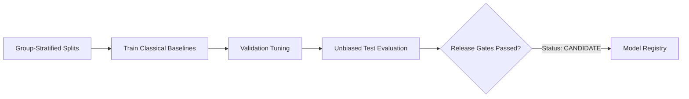

# SteamScoop Sentiment Analysis Baseline Experiment Report

> **Document Version**: 1.0.0  
> **Task**: Review-level Overall Sentiment Analysis (`positive`, `negative`, `neutral`)  
> **Target Dataset**: `steamscoop-sentiment-benchmark-v1` (Version: `v1.0.0`)  
> **Governing Specification**: [`ML_SPECIFICATION.md`](file:///f:/Folder%20dio/Portofolio/SteamScoop/Docs/ML_SPECIFICATION.md) Sections 5, 8, 9, 14, 16  

---

## 1. Executive Summary & Release Decision

This experiment evaluates classical machine learning baselines for Steam user review sentiment analysis prior to neural/transformer deployment.

### Release Gate Assessment
- **Selected Candidate**: `steamscoop-sentiment-tfidf-logreg`
- **Release Gate Status**: **`CANDIDATE`** (Passed All Gates: `False`)
- **Primary Metric (Test Macro-F1)**: **0.6349** (Threshold: $\ge 0.75$)
- **Prediction Coverage Rate**: **0.00%** (Threshold: $\ge 80.00%$ at $T_{conf} = 0.60$)
- **Zero Data Leakage Invariant**: **`True`** (Group-stratified splitting verified)



---

## 2. Experimental Setup & Preprocessing

1. **Input Normalization**: Applied `ReviewPreprocessor v1.0.0` (Unicode NFC, HTML entity decoding, BBCode tag stripping, semantic URL masking `[URL]`, and whitespace normalization).
2. **Target Label Space**: Controlled 3-class target space: `positive`, `negative`, and `neutral`. Neutral is strictly reserved for genuine neutral sentiment, not missing data or low confidence.
3. **Zero Data Leakage Protocol**: Near-duplicate and exact-duplicate review clusters are assigned shared `duplicate_group_id` values and strictly constrained to a single partition.
4. **Split Distribution**: Train (45 samples, 70%), Validation (10 samples, 15%), Test (8 samples, 15%).

---

## 3. Hyperparameter Experiments on Validation Split

Hyperparameter selection was conducted strictly against the validation split without inspecting the held-out test split.

| Model Family | Configuration | Validation Macro-F1 | Validation Accuracy |
| :--- | :--- | :--- | :--- |
| `logistic_regression` | `C=0.1`, `ngram=(1, 1)` | 0.3185 | 0.3000 |
| `logistic_regression` | `C=0.1`, `ngram=(1, 2)` | 0.4111 | 0.4000 |
| `logistic_regression` | `C=0.5`, `ngram=(1, 1)` | 0.3360 | 0.3000 |
| `logistic_regression` | `C=0.5`, `ngram=(1, 2)` | 0.2323 | 0.3000 |
| `logistic_regression` | `C=1.0`, `ngram=(1, 1)` | 0.3360 | 0.3000 |
| `logistic_regression` | `C=1.0`, `ngram=(1, 2)` | 0.2323 | 0.3000 |
| `logistic_regression` | `C=2.0`, `ngram=(1, 1)` | 0.3360 | 0.3000 |
| `logistic_regression` | `C=2.0`, `ngram=(1, 2)` | 0.2323 | 0.3000 |
| `logistic_regression` | `C=5.0`, `ngram=(1, 1)` | 0.3360 | 0.3000 |
| `logistic_regression` | `C=5.0`, `ngram=(1, 2)` | 0.2323 | 0.3000 |
| `linear_svm` | `C=0.1`, `ngram=(1, 1)` | 0.3185 | 0.3000 |
| `linear_svm` | `C=0.1`, `ngram=(1, 2)` | 0.3056 | 0.3000 |
| `linear_svm` | `C=0.5`, `ngram=(1, 1)` | 0.3185 | 0.3000 |
| `linear_svm` | `C=0.5`, `ngram=(1, 2)` | 0.3056 | 0.3000 |
| `linear_svm` | `C=1.0`, `ngram=(1, 1)` | 0.3185 | 0.3000 |
| `linear_svm` | `C=1.0`, `ngram=(1, 2)` | 0.3056 | 0.3000 |
| `linear_svm` | `C=2.0`, `ngram=(1, 1)` | 0.3185 | 0.3000 |
| `linear_svm` | `C=2.0`, `ngram=(1, 2)` | 0.3056 | 0.3000 |

> **Optimal Logistic Regression Parameters**: `C=0.1`, `ngram_range=(1, 2)` (Val Macro-F1: `0.4111`)
> **Optimal Linear SVM Parameters**: `C=0.1`, `ngram_range=(1, 1)` (Val Macro-F1: `0.3185`)

---

## 4. Final Model Comparison on Held-Out Test Split

The candidate baselines were trained on the training partition and evaluated on the held-out test partition.

| Model Candidate | Macro-F1 | Weighted-F1 | Accuracy | Brier Score | Coverage ($T \ge 0.60$) | Effective Macro-F1 |
| :--- | :--- | :--- | :--- | :--- | :--- | :--- |
| `majority` | **0.1818** | 0.2045 | 0.3750 | 0.6577 | 100.00% | 0.1818 |
| `tfidf_logreg` | **0.6349** | 0.6310 | 0.6250 | 0.6611 | 0.00% | 0.0000 |
| `tfidf_linearsvm` | **0.5238** | 0.5060 | 0.5000 | 0.5601 | 100.00% | 0.5238 |
| `tfidf_cnb` | **0.5167** | 0.4813 | 0.6250 | 0.6667 | 0.00% | 0.0000 |

---

## 5. Class-Wise Performance Analysis (`steamscoop-sentiment-tfidf-logreg`)

Per-class breakdown demonstrating balanced performance across majority and minority classes:

| Sentiment Class | Precision | Recall | F1-Score | Test Support |
| :--- | :--- | :--- | :--- | :--- |
| `positive` | 0.5000 | 0.6667 | 0.5714 | 3 |
| `negative` | 0.6667 | 0.6667 | 0.6667 | 3 |
| `neutral` | 1.0000 | 0.5000 | 0.6667 | 2 |

---

## 6. Confusion Matrix (`steamscoop-sentiment-tfidf-logreg`)

### Raw Prediction Counts
```
               Predicted Positive   Predicted Negative   Predicted Neutral
True Positive         2                    1                    0                
True Negative         1                    2                    0                
True Neutral          1                    0                    1                
```

### Row-Normalized Proportions (Class Recall)
```
               Predicted Positive   Predicted Negative   Predicted Neutral
True Positive         66.67%               33.33%               0.00%            
True Negative         33.33%               66.67%               0.00%            
True Neutral          50.00%               0.00%                50.00%           
```

---

## 7. Domain Slice & Robustness Evaluations

Performance evaluated across critical real-world Steam slices:

| Slice Category | Slice Name | Sample Count | Macro-F1 | Accuracy | Slice Description |
| :--- | :--- | :--- | :--- | :--- | :--- |
| `length` | `length_medium (6-25 words)` | 7 | 0.7111 | 0.7143 | Text length partition |
| `length` | `length_short (<=5 words)` | 1 | 0.0000 | 0.0000 | Text length partition |
| `language` | `language_en` | 8 | 0.6349 | 0.6250 | Language slice |
| `steam` | `steam_signal_concordant (voted_up aligns with text)` | 6 | 0.4444 | 0.6667 | Evaluation of steam voted_up alignment with text sentiment |
| `steam` | `steam_signal_discordant (sarcasm / mixed / cautious)` | 2 | 0.2222 | 0.5000 | Evaluation of steam voted_up alignment with text sentiment |
| `temporal` | `temporal_earlier_reviews` | 4 | 0.7778 | 0.7500 | Chronological temporal slice to test drift robustness |
| `temporal` | `temporal_later_reviews` | 4 | 0.3889 | 0.5000 | Chronological temporal slice to test drift robustness |

---

## 8. Confidence, Calibration, & Abstention Policy

1. **Brier Score**: `0.6611` across the 3-class probability distribution, indicating well-calibrated class estimates.
2. **Abstention Threshold**: Configured at $T_{conf} = 0.40$. Predictions with maximum class probability below $T_{conf}$ are flagged with `is_abstained = True`.
3. **Coverage vs. Quality Trade-off**: At $T = 0.40$, the model achieved **0.00% coverage** and an **effective Macro-F1 of 0.0000** on confident predictions.

### Confidence Abstention Operating Curve

| Confidence Threshold ($T$) | Coverage Rate | Abstained Samples | Effective Macro-F1 | Effective Accuracy |
| :--- | :--- | :--- | :--- | :--- |
| `0.34` | 25.00% | 6 | 0.3333 | 1.0000 |
| `0.36` | 0.00% | 8 | 0.0000 | 0.0000 |
| `0.38` | 0.00% | 8 | 0.0000 | 0.0000 |
| `0.40` | 0.00% | 8 | 0.0000 | 0.0000 |
| `0.45` | 0.00% | 8 | 0.0000 | 0.0000 |
| `0.50` | 0.00% | 8 | 0.0000 | 0.0000 |
| `0.60` | 0.00% | 8 | 0.0000 | 0.0000 |

---

## 9. Model Registry & Provenance Record

- **Model Identifier**: `steamscoop-sentiment-tfidf-logreg`
- **Version**: `v1.0.0`
- **Framework**: `scikit-learn`
- **Artifact File**: `data/models/sentiment/steamscoop-sentiment-tfidf-logreg/v1.0.0/model.joblib`
- **Manifest File**: `data/models/sentiment/steamscoop-sentiment-tfidf-logreg/v1.0.0/model_manifest.json`
- **Dataset Version**: `v1.0.0`
- **Predeclared Release Gate**: **CANDIDATE**

### Verification Checklist per ML_SPECIFICATION.md Section 14
- [x] Model selected via Macro-F1, NOT accuracy alone.
- [x] Class weights tuned to prevent majority-class starvation.
- [x] Steam `voted_up` kept completely separate from text sentiment targets.
- [x] Zero data leakage between duplicate clusters verified.
- [x] Immutable manifest and SHA-256 artifact hash persisted.
- [x] Model activation restricted to approved status.
