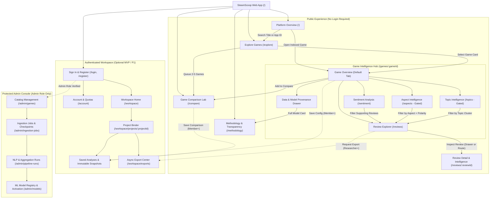
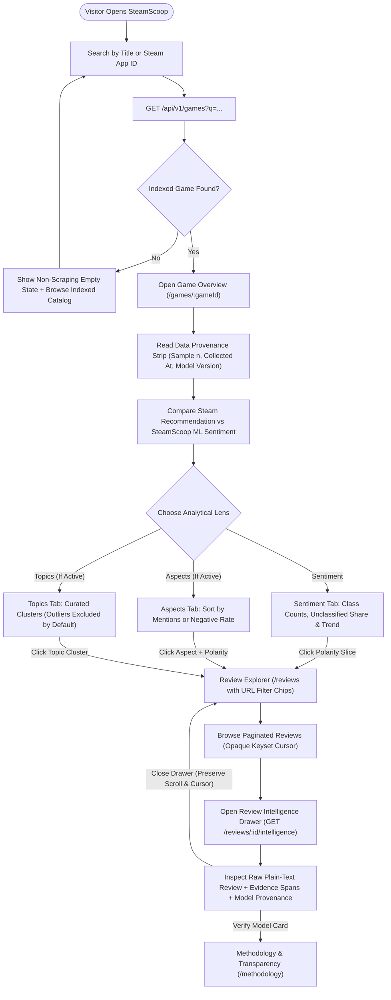
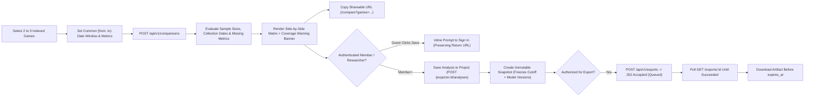

# SteamScoop — UI/UX & Design System Specification

**Document:** `design.md`  
**Version:** 1.0.0  
**Status:** Implementation-Ready UI/UX & Design System Baseline (Fulfilling `IMPLEMENTATION_ROADMAP.md` Milestone 0 `UI_UX_GUIDELINES.md`)  
**Product:** SteamScoop — *Understand Games Through Data.*  
**Frontend Stack:** React 18+, TypeScript (`strict: true`), Vite, Tailwind CSS, TanStack Query, Apache ECharts

---

## 1. Design Overview

### 1.1 Purpose of the Design Specification

This document is the authoritative UI/UX, information architecture, data visualization, interaction, accessibility, and design-system specification for **SteamScoop**. It supersedes preliminary UI notes and fulfills the Milestone 0 (`M0-03` through `M0-08`) design deliverable (`UI_UX_GUIDELINES.md`) required by `Docs/IMPLEMENTATION_ROADMAP.md` before detailed frontend implementation begins.

Frontend engineers, product stakeholders, QA engineers, and AI coding agents MUST use this specification as the single source of truth when building `apps/web`. Every layout, component contract, chart configuration, and state transition defined here is strictly grounded in the existing backend architecture, PostgreSQL schema, ML pipeline constraints, and `/api/v1` HTTP contracts established across:

- `Docs/SteamScoop_PRD.md` — Product vision, modules, target audiences, and analytical disclaimers.
- `Docs/SRS.md` — Functional (`FR-*`), non-functional (`NFR-*`), and business rule (`BR-*`) requirements.
- `Docs/SYSTEM_DESIGN.md` — Modular monolith topology, Redis caching, Celery worker queues, and RBAC boundaries.
- `Docs/DATABASE_DESIGN.md` — Authoritative PostgreSQL entities, columns, nullability, and privacy exclusions.
- `Docs/API_SPECIFICATION.md` — Versioned `/api/v1` endpoints, request/response envelopes, pagination, and error codes.
- `Docs/ML_SPECIFICATION.md` — Sentiment, ABSA, and topic modeling contracts, evaluation gates, and versioning rules.
- `Docs/CODING_STANDARDS.md` — TypeScript/React architecture, `snake_case` to `camelCase` mapping, and security rules.
- `Docs/TESTING_STRATEGY.md` — Vitest, React Testing Library, Playwright E2E journeys, and release gates.
- `Docs/IMPLEMENTATION_ROADMAP.md` — Phased MVP rollout (`P0`, `P1`, `P2`) and Definition of Done.

### 1.2 Product Vision and Design Objectives

SteamScoop is a public **Game Intelligence and Research Platform** that transforms unstructured Steam player reviews into structured, inspectable, and reproducible analytical insights. Rather than replacing Steam Store pages or reducing complex player discourse to a single opaque rating, SteamScoop provides an analytical lens over collected review corpora.

The user interface must accomplish six core objectives:

1. **Accelerate Discovery:** Enable any visitor to locate indexed Steam games by title or Steam App ID and immediately understand whether analytical data is available, partial, or unindexed—without triggering background ingestion.
2. **Separate Observation from Inference:** Maintain an unmistakable visual and terminological boundary between observed source data from Steam (`voted_up` binary recommendation, helpful votes, playtime) and machine-learning predictions generated by SteamScoop (3-class text sentiment, aspect polarity, and topic clusters).
3. **Connect Aggregates to Evidence:** Allow seamless drill-down from high-level distributions, temporal trends, aspects, and topics directly into the underlying player review texts that produced them.
4. **Enable Rigorous Comparison:** Support side-by-side comparison of 2 to 5 indexed games under unified metric definitions and explicit time windows while surfacing differences in sample sizes, collection coverage, and languages.
5. **Support Reproducible Research:** Provide optional authenticated workspaces where students, developers, and researchers can organize game cohorts, save filter configurations, capture immutable analytical snapshots, and generate quota-governed CSV/JSON exports.
6. **Institutionalize Trust & Transparency:** Surface collection timestamps, analysis timestamps, sample denominators (`n`), sampling methodology (temporal quota sampling plus weekly incremental refresh), model versions, and analytical limitations directly alongside every visualization.

### 1.3 Core UX Principles

SteamScoop's user experience is governed by eight foundational commitments (expanded into enforceable engineering rules in Section 2):

- **Clarity Over Decoration:** Every pixel serves comprehension, orientation, or analytical comparison.
- **Evidence-Based Presentation:** Aggregate claims never float without sample counts, denominators, and links to source reviews.
- **Progressive Disclosure:** High-signal summaries appear first; granular breakdowns, model metadata, and raw reviews expand on demand.
- **Consistency of Metrics:** Identical formulas, polarity encodings, and `[from, to)` date semantics apply across every view.
- **Data Transparency:** Users always know *what* corpus they are viewing, *when* it was collected, and *which* model analyzed it.
- **Accessibility by Construction:** WCAG 2.2 Level AA compliance, keyboard operability, non-color polarity encoding, and tabular chart alternatives are built into base components.
- **Public-First Experience:** Core discovery, game analytics, review exploration, comparison, and methodology require zero authentication.
- **Honest Representation of Uncertainty:** Missing data is never zero, model confidence is never presented as objective certainty, and unvalidated ML modules remain explicitly gated.

### 1.4 Design Philosophy: "Observatory Slate & Signal"

SteamScoop sits at the intersection of **PC gaming culture**, **software product diagnostics**, and **academic NLP research**. Its visual and structural philosophy—**Observatory Slate & Signal**—draws inspiration from scientific observatories, editorial data journalism, and precision telemetry tools:

- **Editorial Hierarchy, Not Widget Soup:** Pages are structured around analytical questions (*"How does player text sentiment diverge from binary thumbs-up recommendations?"*, *"Which game aspects drive negative feedback?"*), not uniform grids of identically sized KPI boxes.
- **Calm Surfaces, Chromatic Discipline:** Surfaces use neutral cool-slate tones so chromatic color carries strict semantic meaning—distinguishing observed Steam recommendations, predicted NLP polarities, and multi-game comparison series without visual noise.
- **Gaming Context Without Arcade Clichés:** Official Steam header capsules (`460×215` aspect ratio) provide rich visual identity in catalog cards and game headers, anchored by clean typographic grids, monospace technical identifiers, and zero neon glow, glassmorphism, or decorative gradients.
- **Dual-Audience Ergonomics:** Casual players can scan a Game Overview in 15 seconds via plain-language summaries and clear visual bars, while researchers and indie developers can inspect exact denominators, filter multi-dimensional review facets, lock model versions in snapshots, and verify evaluation metrics.

### 1.5 Target Users and Their Needs

SteamScoop must serve six distinct user groups without fragmenting into separate products (`Docs/SteamScoop_PRD.md` §4, `Docs/SRS.md` §2.2):

| User Group | Primary Analytical Objective | Domain & ML Literacy | Core UX & Interface Needs | Primary Views Used |
| :--- | :--- | :--- | :--- | :--- |
| **Players** | Understand what the community praises or criticizes before buying or returning to a game. | Low ML literacy; high familiarity with Steam Store reviews. | Plain-language explanations, clear separation of Steam thumbs-up vs. text sentiment, scannable top aspects, fast review filtering. | Platform Overview, Explore Games, Game Overview, Review Explorer. |
| **Game Developers (Indie & Studio)** | Diagnose recurring player complaints, monitor post-patch sentiment shifts, and benchmark competitors. | Moderate-to-high technical literacy; pragmatic focus on actionable issues. | Aspect-level negative rate sorting, weekly/daily temporal trend charts, supporting review evidence snippets, multi-game comparison. | Game Overview, Aspect Intelligence, Sentiment Analysis, Review Explorer, Comparison Lab. |
| **Students & Academic Researchers** | Conduct structured, reproducible studies on game design, player reception, or applied NLP. | Moderate-to-high analytical literacy; strict need for methodological rigor. | Exact sample sizes (`n`), `[from, to)` date controls, model version attribution, saved workspace analyses, immutable snapshots, CSV/JSON exports. | All Game Analytics tabs, Comparison Lab, Research Workspace, Methodology Center. |
| **Lecturers & Educators** | Demonstrate real-world NLP pipelines, sampling trade-offs, and sentiment/ABSA limitations in coursework. | High conceptual literacy; needs clear pedagogical framing (including projector legibility). | High-contrast Light Mode option, inspectable model cards (Macro F1, confusion caveats), clear explanations of temporal quota sampling vs. random sampling. | Methodology & Transparency, Game Overview, Review Detail / Intelligence. |
| **Game Teams & Communities** | Compare reception across genre peers or franchise entries using consistent rules. | Mixed analytical literacy; high engagement with shareable links. | Shareable URL query parameters, side-by-side comparison metrics, clear warnings when sample coverage differs across games. | Game Comparison Lab, Explore Games, Game Overview. |
| **Platform Administrators** | Maintain controlled catalog indexing, monitor Steam ingestion health, and govern active ML models. | High operational and engineering literacy. | Dense operational tables, durable PostgreSQL job/batch/checkpoint inspection, safe retry/cancel controls, high-friction model activation modals. | Administrative Dashboard (`/admin/*`). |

---

## 2. Design Principles

Every frontend pull request and design review MUST evaluate compliance against these eight actionable principles.

### 2.1 Clarity Over Decoration
- **Rule:** Every visual element on an analytical page must encode data, establish hierarchy, or afford interaction.
- **UI Mandate:** Use whitespace, 1px structural borders, and typographic contrast to separate sections. Restrict Steam game artwork to structured containers (catalog thumbnails and compact game identity headers) without full-bleed blurred background art behind charts.
- **Anti-Pattern:** Decorative sparklines with unlabeled axes, glowing neon borders, animated background meshes, or multi-stop gradients on chart bars.

### 2.2 Evidence-Based Presentation
- **Rule:** No percentage, rate, or analytical label may appear without its sample context and a path to underlying evidence (`BR-037`, `FR-TIME-003`, `FR-ABSA-008`).
- **UI Mandate:** Every percentage MUST display its count and denominator inline or immediately adjacent—for example: `68.3% Positive (2,800 of 4,100 classified reviews; 100 unclassified)`. Every sentiment, aspect, and topic breakdown MUST provide a one-click action (`Inspect supporting reviews →`) that opens Review Explorer pre-filtered to that exact slice.
- **Anti-Pattern:** Displaying `"78% Positive"` in isolation or rendering summary assertions that cannot be verified against stored reviews.

### 2.3 Progressive Disclosure
- **Rule:** Present high-level orientation first and reveal technical depth incrementally so casual players are never overwhelmed and researchers are never blocked.
- **UI Mandate:** Structure analytical views in three tiers:
  1. **Tier 1 (Scan):** Plain-language headline metric, visual distribution bar, sample badge, and freshness indicator.
  2. **Tier 2 (Explore):** Interactive temporal breakdown, aspect/topic sorting, facet filters, and inline metric explainer popovers (`?`).
  3. **Tier 3 (Verify):** Individual review intelligence drawers, accessible raw data tables beneath charts, and full model/dataset cards in Methodology.
- **Anti-Pattern:** Dumping raw JSON metadata, 12-filter form grids, or model evaluation tables onto the primary viewport above the fold.

### 2.4 Consistency of Metrics
- **Rule:** A named metric MUST use the exact same calculation, denominator rule, time-window convention, and visual encoding on every page (`Docs/API_SPECIFICATION.md` §7.3–7.11).
- **UI Mandate:**
  - Date filters uniformly apply **inclusive start (`from`) and exclusive end (`to`)** semantics (`created_at >= from AND created_at < to`).
  - **Steam Recommendation** (`voted_up`) and **SteamScoop Sentiment** (`positive | negative | neutral`) use dedicated, non-overlapping color tokens, badges, and labels across Game Cards, Game Overview, Review Explorer, and Comparison Lab.
  - Playtime stored in integer minutes (`steam_playtime_at_review`) is consistently formatted in hours to one decimal place (`12.4 hrs at review`, or `< 0.1 hrs` for 1–5 minutes; `Not recorded` when `null`).
- **Anti-Pattern:** Computing client-side ad-hoc percentages that include `unclassified` reviews in the denominator on one page while excluding them on another.

### 2.5 Data Transparency
- **Rule:** Collection freshness and analytical freshness are separate system events (`Docs/API_SPECIFICATION.md` §14.3) and MUST be communicated separately.
- **UI Mandate:** Display both **Last Collected** (`collected_at` / `watermark_at`) and **Last Analyzed** (`computed_at` + `model_version`) in the Game Data Provenance Strip. Explicitly badge sampled datasets (`Sampled corpus · Temporal quota + weekly incremental`) so users never mistake a 4,200-review sample for all reviews ever posted on Steam (`FR-ING-017`).
- **Anti-Pattern:** Using an ambiguous `"Last updated: 2 days ago"` label without specifying whether reviews were fetched or ML aggregates were recomputed, or omitting timezone context.

### 2.6 Accessibility by Construction
- **Rule:** Analytical interfaces must be operable and understandable across visual, motor, and cognitive abilities, targeting **WCAG 2.2 Level AA** (a strict superset of `NFR-UX-008` WCAG 2.1 AA).
- **UI Mandate:** Pair every color-coded polarity with text labels, distinct icons, and Apache ECharts `aria.decal` patterns. Provide keyboard-accessible tabular views (`View chart data as table`) for all charts, maintain `>= 4.5:1` text contrast and `>= 3:1` graphical mark contrast in both Dark and Light modes, and honor `prefers-reduced-motion: reduce`.
- **Anti-Pattern:** Relying on red/green bars alone to convey sentiment, or trapping metric definitions inside hover-only mouse tooltips.

### 2.7 Public-First Experience
- **Rule:** Unauthenticated guests are first-class citizens (`FR-PUB-001` through `FR-PUB-008`), and public browsing is strictly read-only (`FR-GAME-006`, `FR-ING-014`).
- **UI Mandate:** Never gate Game Overview, Sentiment, Aspects, Topics, Review Explorer, Comparison Lab, or Methodology behind sign-up modals or blurred paywalls. Authenticated features (`Save to Workspace`, `Export CSV/JSON`) appear as secondary contextual actions that gracefully explain account requirements only when clicked. Public search for an unindexed game MUST display an informative static state—never a `"Fetch from Steam now"` button for guests.
- **Anti-Pattern:** Prompting guests to register on initial page load or implying that searching a title queues background scraping.

### 2.8 Honest Representation of Analytical Uncertainty
- **Rule:** Machine-learning outputs are probabilistic text estimates over self-selected reviews, never objective measurements of game quality (`BR-066`, `BR-067`, `Docs/ML_SPECIFICATION.md` §2.4).
- **UI Mandate:**
  - Never invent or display a composite `"SteamScoop Game Score"`, letter grade, or ranked leaderboard.
  - Render missing metrics as `Unavailable` or `Not analyzed`—never `0` or `0%` (`BR-045`).
  - Keep `unclassified` / `unsupported` / `pending` review counts explicitly separate from `neutral` sentiment (`BR-038`, `BR-039`).
  - Suppress percentage rates or display prominent low-sample warnings when a slice denominator falls below statistical readability thresholds (see Section 8.12).
  - Hide or render explicit `Feature Unavailable` states for ABSA or Topic Modeling whenever a capability has not passed its ML release gate (`Docs/IMPLEMENTATION_ROADMAP.md` M4/M5 Scope Control).
- **Anti-Pattern:** Displaying `"Confidence: 94% certain"`, treating BERTopic cluster `-1` outliers as a named topic, or implying a game update *caused* a sentiment change (`FR-TIME-006`).

---

## 3. Information Architecture

### 3.1 Global Navigation Model

SteamScoop uses a **two-tier navigation architecture** optimized to maximize horizontal canvas width for charts and comparison matrices while preserving clear orientation:

1. **Global Top Navigation Bar (`AppNavbar`, height `56px`, sticky top):** Persistent across all public and member routes. Contains brand identity (`SteamScoop`), global quick-search trigger (`Ctrl+K` / `/` shortcut), primary public links (`Overview`, `Explore Games`, `Compare`, `Methodology`), theme toggle, and right-aligned session controls (`Sign In` for guests; `Workspace` link + User Menu for authenticated users; `Admin Console` badge link exclusively when `user.roles` includes `admin`).
2. **Contextual Sub-Navigation:**
   - **Game Analytical Context (`/games/:gameId/*`):** A horizontal sticky sub-navigation tab bar directly beneath the compact `GameIdentityHeader`, switching seamlessly among `Overview`, `Sentiment`, `Aspects` *(conditional)*, `Topics` *(conditional)*, `Reviews`, and `Data & Methodology` (provenance drawer/anchor).
   - **Research Workspace Context (`/workspace/*`):** A left `240px` workspace rail navigating `Projects`, `Saved Analyses`, and `Exports`.
   - **Administrative Context (`/admin/*`):** An isolated operational shell with a distinct top environment/role indicator banner and a fixed `240px` left operational sidebar so administrators never confuse privileged mutation screens with public read-only views.

### 3.2 Public Navigation

Available to all users (`Guest` and above) without login:

- **Overview (`/`)** — Platform introduction, prominent game search (Title or Steam App ID), recently updated indexed games, analytical capability guide, and active methodology/model transparency summary.
- **Explore Games (`/explore`)** — Searchable, filterable, sortable directory of indexed catalog games with data-readiness indicators.
- **Compare (`/compare`)** — Side-by-side multi-game comparison lab (`2–5` indexed games) with shared date-window and metric selectors; includes a lightweight persistent comparison tray badge (`Compare (2)`) in the navbar when games have been queued during browsing.
- **Methodology (`/methodology`)** — Public documentation of Steam review collection, 10-bucket temporal quota sampling, weekly incremental sync, active ML model cards, evaluation metrics, taxonomy definitions, privacy exclusions, and analytical limitations.

**Contextual Game Sub-Navigation (`/games/:gameId`):**
1. `Overview` (`/games/:gameId`) — `P0`
2. `Sentiment` (`/games/:gameId/sentiment`) — `P0/P1`
3. `Aspects` (`/games/:gameId/aspects`) — `P1` *(Capability-gated: rendered in sub-nav only when an active `absa` model is published; if disabled globally, omitted from nav; if enabled globally but uncomputed for a specific game, shown with a muted indicator leading to an honest `Unavailable for this game` state).*
4. `Topics` (`/games/:gameId/topics`) — `P1` *(Capability-gated: rendered only when topic modeling has passed human-interpretability release gates).*
5. `Reviews` (`/games/:gameId/reviews`) — `P0` *(with slide-over or route drill-down to `/reviews/:reviewId`).*
6. `Provenance & Models` *(opens the contextual `ProvenanceDrawer` for the current game or links directly to `/methodology#models`).*

### 3.3 Authenticated Navigation (`P1` — Optional MVP Scope)

When account functionality (`POST /auth/login`, `GET /auth/me`) is enabled (`Docs/API_SPECIFICATION.md` §6.5):

- **Workspace (`/workspace`)** — Personal dashboard of accessible research projects (`GET /projects`), recent saved analyses, and active export jobs.
- **Project Detail (`/workspace/projects/:projectId`)** — Scoped workspace containing:
  - `Selected Games` (`GET /projects/{id}/games`)
  - `Saved Analyses` (`GET /projects/{id}/analyses`)
  - `Snapshots` (`GET /projects/{id}/analyses/{analysis_id}/snapshots`)
  - `Project Settings & Access` (`PATCH /projects/{id}`, plus `P2` collaborator management)
- **Exports (`/workspace/exports`)** — Asynchronous export request history, status polling, download triggers, and expiry timestamps.
- **Account (`/account`)** — User profile (`display_name`, `email`, verification status), assigned RBAC roles (`Member`, `Researcher`, `Admin`), quota overview, and session logout.

If authentication is disabled in an initial public-only pilot (`404 FEATURE_DISABLED` on `/auth/*`), all workspace/account navigation items and contextual `Save` / `Export` buttons are cleanly hidden via runtime feature configuration rather than showing broken links.

### 3.4 Administrative Navigation (`Admin` Role Only)

Accessible under `/admin/*` strictly for authenticated users with the `admin` role (enforced independently by FastAPI RBAC on every `/api/v1/admin/*` request):

- **Admin Overview / Operational Health (`/admin`)** — Summary of active/failed ingestion jobs, recent NLP pipeline runs, and active model versions derived from admin list endpoints.
- **Game Catalog (`/admin/games`)** — Controlled catalog registry (`pending`, `indexed`, `failed`, `disabled`), add game by `steam_app_id`, toggle `is_active`, trigger metadata refresh, or enqueue historical/incremental ingestion.
- **Ingestion Jobs (`/admin/ingestion-jobs`)** — Filterable job queue (`queued`, `running`, `retrying`, `succeeded`, `partial`, `failed`, `cancelled`) and `/admin/ingestion-jobs/:jobId` detail drawer/page showing batch counters, checkpoints, watermarks, and retry/cancel actions.
- **Pipeline Runs (`/admin/pipeline-runs`)** — NLP (`sentiment`, `absa`, `topic`, `full_nlp`) and `aggregation` execution runs, input/success/failure counts, and error summaries.
- **Model Registry (`/admin/models`)** — Registered `ml_model` artifacts, task types, evaluation metrics JSON, `is_active` flags, and controlled model version activation.
- *(Deferred `P2` Admin Routes — Pending Backend API Contracts: User & Role Management, Audit Log Viewer; see Section 19).*

### 3.5 Route and Page Hierarchy Specification

| Route Path | Page Title | Access | Priority | Primary `/api/v1` Dependencies | Shareable URL Query Params |
| :--- | :--- | :--- | :---: | :--- | :--- |
| `/` | Platform Overview | Public | `P0` | `GET /games`, `GET /methodology`, `GET /methodology/models` | — |
| `/explore` | Explore Games | Public | `P0` | `GET /games` | `q`, `genre`, `sort`, `cursor` |
| `/games/:gameId` | Game Overview | Public | `P0` | `GET /games/{id}`, `GET /games/{id}/overview`, `GET /games/{id}/analytics` | `from`, `to`, `period`, `model` |
| `/games/:gameId/sentiment` | Sentiment Analysis | Public | `P0/P1` | `GET /games/{id}`, `GET /games/{id}/sentiment`, `GET /games/{id}/analytics` | `from`, `to`, `period`, `model` |
| `/games/:gameId/aspects` | Aspect Intelligence | Public | `P1` | `GET /games/{id}`, `GET /games/{id}/aspects`, `GET /games/{id}/reviews` | `from`, `to`, `sort`, `aspect`, `model` |
| `/games/:gameId/topics` | Topic Intelligence | Public | `P1` | `GET /games/{id}`, `GET /games/{id}/topics`, `GET /games/{id}/reviews` | `topic_id`, `outliers`, `model` |
| `/games/:gameId/reviews` | Review Explorer | Public | `P0` | `GET /games/{id}`, `GET /games/{id}/reviews` | `sentiment`, `steam_recommended`, `language`, `aspect`, `topic_id`, `from`, `to`, `sort`, `cursor`, `review_id` (drawer) |
| `/reviews/:reviewId` | Review Detail & Intelligence | Public | `P0` | `GET /reviews/{id}`, `GET /reviews/{id}/intelligence`, `GET /games/{game_id}` | `return_to` (validated relative path) |
| `/compare` | Game Comparison Lab | Public | `P1` | `POST /comparisons`, `GET /games` (picker) | `games` (comma-separated 2–5 UUIDs), `from`, `to`, `metrics`, `model` |
| `/methodology` | Methodology & Transparency | Public | `P0` | `GET /methodology`, `GET /methodology/models`, `GET /methodology/datasets` | `section` / hash anchors |
| `/login`, `/register` | Sign In / Create Account | Public | `P1` | `POST /auth/login`, `POST /auth/register`, `GET /auth/me` | `redirect` (same-origin relative path only) |
| `/account` | Account Settings | Member+ | `P1` | `GET /auth/me`, `POST /auth/logout` | — |
| `/workspace` | Research Workspace | Member+ | `P1` | `GET /projects`, `POST /projects` | `cursor` |
| `/workspace/projects/:projectId` | Project Detail | Project Member | `P1` | `GET /projects/{id}`, `/games`, `/analyses`, `/snapshots` | `tab` (`games`, `analyses`, `snapshots`, `exports`) |
| `/workspace/exports` | Export Center | Member / Researcher | `P1` | `POST /exports`, `GET /exports/{id}`, `GET /exports/{id}/download`, `DELETE /exports/{id}` | `status` |
| `/admin/games` | Admin: Game Catalog | Admin | `P1` | `GET/POST/PATCH /admin/games`, `metadata-refresh`, `ingestion-jobs` | `status`, `q`, `page` |
| `/admin/ingestion-jobs` | Admin: Ingestion Jobs | Admin | `P0` | `GET /admin/ingestion-jobs`, `GET/cancel/retry /admin/ingestion-jobs/{id}` | `status`, `job_type`, `game_id`, `from`, `to`, `cursor` |
| `/admin/pipeline-runs` | Admin: Pipeline Runs | Admin | `P1` | `GET /admin/pipeline-runs`, `GET /admin/pipeline-runs/{id}` | `pipeline_type`, `status`, `game_id` |
| `/admin/models` | Admin: Model Registry | Admin | `P1` | `GET /admin/models`, `POST /admin/models/{id}/activate` | `task`, `status` |

### 3.6 Navigation Behavior

1. **Active Route Indication:** Active primary and sub-navigation links render a `2px` bottom accent bar (`--accent-primary`), high-contrast text (`--text-primary`), and `aria-current="page"`.
2. **Home Anchor:** Clicking the `SteamScoop` wordmark/logo from any public or workspace route navigates to `/`. Inside `/admin/*`, clicking `SteamScoop Admin` navigates to `/admin`, while an explicit `Exit to Public App ↗` action returns to `/`.
3. **URL State Synchronization:** Non-sensitive analytical parameters (`q`, `genre`, `from`, `to`, `period`, `sentiment`, `steam_recommended`, `language`, `aspect`, `topic_id`, `sort`, `games`) synchronize bidirectionally with URL search parameters via `replace` for typing/debouncing and `push` for discrete filter selections, preserving natural browser Back/Forward navigation. Never place credentials, tokens, or private user emails in URLs.
4. **Scoped Parameter Inheritance:** Switching tabs within `/games/:gameId/*` (e.g., from `Overview` to `Sentiment` or `Aspects`) preserves compatible active `from`, `to`, and `model` query parameters so the user's analytical time window does not unexpectedly reset.
5. **Responsive Collapse:** Below `768px` (`md`), top-level links collapse into an accessible slide-over navigation drawer (`aria-expanded`, focus-trapped, `Escape` dismissible), while the Game Sub-Navigation bar becomes a horizontally scrollable tab strip with scroll-fade affordances and active-tab auto-centering.

### 3.7 Breadcrumbs and Contextual Navigation

Breadcrumbs render immediately above page titles on all nested routes (`depth >= 2`), omitted on top-level landing pages (`/`, `/explore`, `/compare`, `/methodology`):

- **Game Analytics Tabs:** `Explore Games` `/explore` `/` `[Game Name]` `/games/:gameId` `/` `Aspect Intelligence` (current)
- **Review Detail (Standalone Route):** `Explore Games` `/` `[Game Name]` `/` `Reviews` (restores prior filter query string if navigated from Explorer) `/` `Review #76561190...`
- **Workspace Project:** `Workspace` `/workspace` `/` `[Project Name]` `/workspace/projects/:projectId` `/` `[Saved Analysis Name]`
- **Admin Detail:** `Admin` `/admin` `/` `Ingestion Jobs` `/admin/ingestion-jobs` `/` `Job 9bb4b74d`

### 3.8 Information Architecture Diagram



---

## 4. User Personas and User Journeys

### 4.1 Representative Personas

#### Persona 1: Maya — Discerning PC Player
- **Profile:** Plays strategy and action RPGs on Steam; skeptical of review-bombing and one-line meme reviews.
- **Goals:** Quickly verify whether a game with `"Mixed"` Steam recommendations suffers from fixable launch performance issues or fundamental gameplay flaws.
- **Pain Points:** Scrolling through hundreds of Steam reviews manually; confusing overall store ratings with recent patch states.
- **Design Implications:** Needs an immediate side-by-side comparison of Steam Recommendation vs. SteamScoop Text Sentiment, top aspect bars with plain-language labels, and one-click filtering to read recent performance reviews.

#### Persona 2: Reza — Indie Studio Lead Developer
- **Profile:** Co-founder of a 6-person indie studio tracking post-update reception for their own title and three genre benchmarks.
- **Goals:** Pinpoint whether negative sentiment spiked after a balance patch, isolate complaints by aspect (`Performance`, `Difficulty`, `Pricing`), and inspect concrete player quotes.
- **Pain Points:** Aggregate thumbs-up/down hides negative feedback buried inside positive recommendations (*"Recommended, BUT framerate stutters in Act 3"*).
- **Design Implications:** Relies on ABSA negative-rate sorting, weekly temporal trend charts with sample volume context, and multi-game Comparison Lab.

#### Persona 3: Arif — Undergraduate Game Development Student
- **Profile:** Final-year student writing a thesis comparing combat mechanics and difficulty perception across four Souls-like games.
- **Goals:** Construct a reproducible multi-game comparison over a fixed 12-month window, save filter configurations, take immutable snapshots for thesis citations, and export structured CSV summaries.
- **Pain Points:** Losing complex filter states across browser sessions; inability to cite exact dataset collection dates or NLP model versions in academic papers.
- **Design Implications:** Requires shareable URL parameters, Research Workspace projects, immutable `analysis_snapshot` records, provenance citations, and CSV export with embedded metadata manifests.

#### Persona 4: Dr. Sari — Lecturer & NLP Educator
- **Profile:** University faculty teaching Game Analytics and Applied NLP; uses SteamScoop live in lecture halls.
- **Goals:** Walk students through real-world discrepancies between self-reported binary ratings (`voted_up`) and transformer/linear text classifiers, examine macro-F1 model cards, and illustrate sampling bias.
- **Pain Points:** Black-box AI dashboards that hide class definitions, omit denominators, or struggle on classroom projectors.
- **Design Implications:** Requires high-contrast Light Mode, transparent Methodology & Model Cards (`GET /methodology/models`), explicit `unclassified` counts, and clear explanations of 10-bucket temporal quota sampling.

#### Persona 5: Kenji — Gaming Community Coordinator
- **Profile:** Moderates a multi-game co-op community Discord; shares analytical summaries when members debate which co-op title has healthier ongoing update reception.
- **Goals:** Build a 3-game comparison and paste a clean URL into Discord that opens the exact same view for everyone without requiring them to create accounts.
- **Pain Points:** Login walls blocking shared links; misleading comparisons between a 5,000-review veteran title and a 120-review new release.
- **Design Implications:** Public-first URL state encoding (`/compare?games=...&from=...&to=...`) and prominent sample-size/collection-window asymmetry banners.

#### Persona 6: Dimas — Platform Operations Administrator
- **Profile:** Backend/ML engineer maintaining SteamScoop's catalog, Celery workers, and model promotions.
- **Goals:** Register target Steam App IDs, monitor weekly incremental syncs, diagnose `429` or `partial` ingestion batches via PostgreSQL checkpoints, verify NLP pipeline failure rates, and activate newly approved model versions safely.
- **Pain Points:** Ambiguous job states, accidental duplicate job triggers, or activating an unapproved model without seeing evaluation metrics.
- **Design Implications:** Needs dense `/admin` tables, durable checkpoint/watermark inspection drawers, `409 ACTIVE_JOB_EXISTS` conflict prevention in UI, and explicit confirmation dialogs for state-mutating actions.

### 4.2 Primary User Journeys

#### Journey 1: Discover a Game (`P0`)
1. **Entry:** User lands on `/` or `/explore` and focuses the search bar (`/` keyboard shortcut or click).
2. **Input:** User types a game title (`"Hades"`) or numeric Steam App ID (`"1145360"`). Input is debounced (`300ms`) and queries `GET /api/v1/games?q=...`.
3. **Branch A — Indexed Game Found:** Results display game cards with header capsule, `steam_app_id`, genres, release date, and an `Indexed` readiness badge. Clicking opens `/games/:gameId`.
4. **Branch B — No Indexed Match:** UI displays a clear `No indexed games match` state explaining that SteamScoop analyzes a curated catalog and **never triggers live Steam scraping from public searches**, offering buttons to clear filters or browse all indexed games.

#### Journey 2: Explore Game Analytics (`P0`)
1. **Entry:** User opens `/games/:gameId`.
2. **System Fetch:** Parallel TanStack Query requests fetch `GET /games/{id}`, `GET /games/{id}/overview`, and `GET /games/{id}/analytics?period=week`.
3. **Inspection:** User scans the `GameIdentityHeader`, reads the `DataProvenanceStrip` (sample size `n`, `collected_at`, `model_version`, sampled notice), compares the side-by-side **Steam Recommendation** card against the **SteamScoop ML Sentiment** card, and inspects the weekly Review Volume + Sentiment Trend chart.
4. **Refinement:** User adjusts the date selector (`Last 6 Months`, `Last 12 Months`, or custom `[from, to)`) and interval (`day | week | month`); URL params update and charts transition smoothly without full-page reload.

#### Journey 3: Investigate Sentiment (`P0/P1`)
1. **Entry:** From Game Overview, user clicks `Sentiment` tab (`/games/:gameId/sentiment`, inheriting `from`/`to`).
2. **Inspection:** User examines the 3-class sentiment breakdown (`positive`, `negative`, `neutral`) alongside the explicit `unclassified` count and denominator formula, reviews temporal shifts, and checks where text sentiment diverges from Steam thumbs-up/down.
3. **Drill-down:** User clicks the `Negative` bar segment or `View 1,100 negative reviews →`, navigating directly to `/games/:gameId/reviews?sentiment=negative&from=...&to=...`.

#### Journey 4: Examine Aspects and Topics (`P1` — Capability-Gated)
1. **Entry:** User selects `Aspects` (`/games/:gameId/aspects`) or `Topics` (`/games/:gameId/topics`).
2. **Aspects Flow:** Left panel displays versioned taxonomy aspects sorted by `mentions_desc` or `negative_rate_desc` (`GET /games/{id}/aspects`). Clicking `Performance & Stability` populates the right-hand Inspector with positive/negative/neutral counts, multi-aspect denominator note, and preview reviews, with a button to open all matching reviews in Review Explorer.
3. **Topics Flow:** User browses curated topic clusters (`GET /games/{id}/topics?include_outliers=false`), reads representative keyword pills and human-reviewed topic descriptions, and clicks a cluster to inspect assigned reviews while seeing a clear banner that topics are algorithmic groupings rather than ground-truth labels.

#### Journey 5: Read Supporting Reviews & Review Intelligence (`P0`)
1. **Entry:** User arrives at `/games/:gameId/reviews` (either directly or pre-filtered from a chart).
2. **Filtering & Paging:** Active filter chips clearly show applied constraints (e.g., `Aspect: Performance`, `Sentiment: Negative`). User sorts by `votes_up_desc` or `created_at_desc` and steps through pages via opaque cursor pagination (`Next Page →`).
3. **Detail Inspection:** Clicking `Inspect intelligence` on a review card opens the `InspectorDrawer` (fetching `GET /reviews/{id}` and `GET /reviews/{id}/intelligence`) while keeping the Review Explorer list mounted underneath—or opens `/reviews/:reviewId` in a new tab. User inspects separate Steam metadata (`voted_up`, `votes_up`, playtime, Early Access flag) and ML predictions (overall sentiment confidence, detected aspect polarities/evidence, topic memberships, model versions). Closing the drawer returns focus to the triggering card with scroll position and cursor intact.

#### Journey 6: Compare Multiple Games (`P1`)
1. **Entry:** User clicks `+ Compare` on 2 to 5 Game Cards/Headers (populating the navbar Compare Tray) or navigates directly to `/compare` and adds games via the inline `GameSearchPicker`.
2. **Configuration:** User sets a shared `[from, to)` period and selects comparison metrics (`review_volume`, `steam_recommendation`, `model_sentiment`, `aspect_sentiment`), issuing `POST /api/v1/comparisons`.
3. **Analysis & Caveats:** UI renders aligned side-by-side metrics and grouped ECharts bars. An automatic **Comparability & Coverage Banner** highlights sample size disparities (e.g., `4,800 vs. 310 reviews`), differing collection dates, or missing aspect coverage (shown as `Unavailable`, never `0%`). User copies the shareable URL.

#### Journey 7: Save Research Configurations & Export Data (`P1`)
1. **Entry:** Authenticated `Member` or `Researcher` clicks `Save Analysis` from Review Explorer or Comparison Lab.
2. **Save & Snapshot:** User selects or creates a private `Research Project` (`POST /projects`), saves the structured `query_config` (`POST /projects/{id}/analyses`), and optionally triggers `Capture Immutable Snapshot` (`POST .../snapshots`) to freeze `data_cutoff_at`, `model_versions`, and `result_summary` for academic citation.
3. **Async Export:** A user with export permissions (`Researcher` / policy-authorized role) clicks `Export Dataset`, reviews allowlisted fields, privacy exclusions, row quota, and artifact expiry rules in a modal, and submits `POST /exports`. Receiving `202 Accepted` (`status: "queued"`), the UI tracks progress in `/workspace/exports` (`queued` → `running` → `succeeded`) and exposes a secure `Download CSV` action (`GET /exports/{id}/download`) until `expires_at`.

#### Journey 8: Verify Methodology and Dataset Provenance (`P0`)
1. **Entry:** From any chart header or `DataProvenanceStrip`, user clicks the `Model: sentiment-1.0.0` pill or `Methodology & Limitations` link.
2. **Contextual Verification:** A lightweight `ProvenanceDrawer` immediately summarizes collection date, sampling strategy, denominator formula, and active model version.
3. **Full Inspection:** Clicking `Open Full Methodology & Model Cards` navigates to `/methodology`, where live data from `GET /methodology`, `GET /methodology/models`, and `GET /methodology/datasets` presents sampling bucket rules, language scope, Macro F1 / per-class evaluation metrics, and known limitations.

### 4.3 User Journey Flowcharts

#### Diagram A: Public Analytical Drill-Down & Evidence Verification Journey



#### Diagram B: Multi-Game Comparison & Research Reproducibility Journey



---

## 5. Page-by-Page UI/UX Specifications

> **Architectural Anti-Monotony Mandate:** Every page in SteamScoop serves a distinct cognitive task—ranging from search-first discovery to master-detail aspect diagnostics, long-form review reading, multi-column benchmarking, academic technical documentation, and high-density admin operations. Pages MUST NOT reuse a generic 4-KPI-plus-2-chart dashboard template. Each page below specifies a purpose-built spatial structure.

---

### 5.1 Platform Overview / Global Dashboard (`/`)

- **Page Purpose:** Introduce SteamScoop's analytical mission, provide immediate friction-free game lookup, surface recently updated indexed games, and ground visitors in how SteamScoop's sampled review intelligence works—without displaying misleading or unbacked platform-wide aggregate scores.
- **Target User:** All visitors (`Guest`, `Member`, `Researcher`), especially first-time players, students, and developers.
- **Content Hierarchy:**
  1. Product identity, concise value proposition (*"Understand Steam games through player review intelligence"*), and prominent search command bar.
  2. Scope & source attribution notice (analysis uses sampled public Steam reviews; independent of Valve).
  3. Recently Updated / Indexed Games showcase (`GET /games?sort=recently_updated&limit=8`).
  4. Analytical Capabilities & Workflow Bento (3 structured cards explaining *Sentiment vs. Steam Thumbs-Up*, *Aspect & Topic Discovery*, and *Multi-Game Comparison*).
  5. Live Methodology & Active Model Transparency Strip (`GET /methodology`, `GET /methodology/models`).
  *(Note on Platform-Wide KPIs: `Docs/SteamScoop_PRD.md` §6.1 mentions global totals, whereas `Docs/API_SPECIFICATION.md` v1.0 exposes no `/platform/summary` endpoint and `design(1).md` §5.1 prohibits unqualified platform-wide sentiment scores. P0 therefore uses an Editorial Discovery Portal layout backed strictly by existing endpoints; optional P1 catalog counters are documented in Section 17 & Section 19).*
- **Layout Structure (Editorial Discovery Portal Layout):**
  ```text
  +-----------------------------------------------------------------------------------+
  | AppNavbar: [SteamScoop]   Overview  Explore  Compare  Methodology   [Theme][Login]|
  +-----------------------------------------------------------------------------------+
  | HERO FOCAL ZONE (Centered max-w-3xl, generous vertical breathing room)            |
  |   Eyebrow: PUBLIC GAME INTELLIGENCE & RESEARCH PLATFORM                           |
  |   H1: Understand Games Through Player Review Data                                 |
  |   Search Command Input: [ Search indexed games by title or Steam App ID...  (/) ] |
  |   Quick Chips: Browse All Indexed -> | Compare Games -> | How Sampling Works ->   |
  +-----------------------------------------------------------------------------------+
  | RECENTLY INDEXED & UPDATED GAMES (4-col responsive catalog grid, max-w-7xl)       |
  |   [GameCard 1]        [GameCard 2]        [GameCard 3]        [GameCard 4]        |
  +-----------------------------------------------------------------------------------+
  | ANALYTICAL PILLARS & METHODOLOGY TRANSPARENCY (Asymmetric 7-col / 5-col split)    |
  |   Left (7 cols): 3-Step Analytical Lens (Source vs ML | Aspects | Evidence)       |
  |   Right (5 cols): Live Pipeline Provenance Card (Sampling policy, Active Models,  |
  |                   Supported Languages, Link to Full Methodology Center)           |
  +-----------------------------------------------------------------------------------+
  | Footer: Steam Attribution Disclaimer | Privacy & Retention | Methodology | Status |
  +-----------------------------------------------------------------------------------+
  ```
- **Main Components:** `AppNavbar`, `GameSearchCommand` (hero variant with instant dropdown preview), `GameCard` grid, `CapabilityOverviewPanel`, `LiveMethodologySummaryCard`, `AppFooter`.
- **Primary & Secondary Actions:**
  - *Primary:* Search by game title or numeric Steam App ID and open a game's intelligence hub; navigate to `Explore Games`.
  - *Secondary:* Open `Game Comparison Lab`, inspect `Methodology & Transparency`, queue two featured games directly into comparison.
- **Data Dependencies:**
  - `GET /api/v1/games?sort=recently_updated&limit=8` (featured/recently updated indexed games).
  - `GET /api/v1/methodology` (sampling policy, refresh cadence, coverage disclaimers).
  - `GET /api/v1/methodology/models` (currently `active` models and supported languages).
- **Interactions:**
  - Typing in the hero search bar (`>= 2` characters or numeric App ID) opens an accessible combobox listbox showing up to 6 matching indexed games (`Enter` navigates to selected game or `/explore?q=...`).
  - Clicking `+ Compare` on any featured `GameCard` adds it to the session Comparison Tray with toast/badge confirmation.
- **UI States:**
  - *Initial / Success:* Hero search immediately interactive; featured grid and live methodology card populated.
  - *Loading:* Hero search is interactive immediately (zero skeleton blocking input); featured cards show 4 `GameCardSkeleton` placeholders; methodology card shows subtle text-line skeletons.
  - *Empty Catalog:* Featured section renders `AnalyticalEmptyState`: *"No games have been published to the public catalog yet."* Hero search and Methodology remain accessible.
  - *Partial Data:* If `/methodology/models` fails or returns no active models while `/games` succeeds, render the featured games normally and show a muted `"Model registry summary temporarily unavailable"` notice in the right column.
  - *Stale Data:* Featured cards show individual `metadata_fetched_at` / collection dates without implying live real-time Steam sync.
  - *Error:* Inline `ErrorBanner` inside the failed section with `Retry` button; never crash the full landing page if one secondary query fails.
- **Responsive Behavior:**
  - *Desktop (`>= 1024px`):* 4-column game grid; 7/5 asymmetric bottom split.
  - *Tablet (`768px–1023px`):* 2-column game grid; stacked full-width analytical pillars above live methodology card.
  - *Mobile (`< 768px`):* Full-width hero search (`48px` touch height); horizontal snap-scroll rail or 1-column stack of 4 featured cards; compact accordion for analytical pillars.

---

### 5.2 Explore Games (`/explore`)

- **Page Purpose:** Enable systematic discovery, searching, genre filtering, and sorting across all Steam games in SteamScoop's catalog while clearly communicating each game's indexing and analytical readiness.
- **Target User:** Players browsing titles, developers locating genre peers, researchers building comparison cohorts.
- **Content Hierarchy:**
  1. Page header with search input, genre selector, sort control, and view-mode toggle (`Grid` / `Compact Table`).
  2. Active query/filter bar with clear-all action and public read-only catalog notice.
  3. Results grid/table displaying Steam capsule art, title, `steam_app_id`, genres, release date, `is_free` badge, and explicit data readiness indicator.
  4. Cursor pagination controls (`Load More` / `Next Page`).
- **Layout Structure (Command Toolbar + Responsive Catalog Grid/Table):**
  ```text
  +-----------------------------------------------------------------------------------+
  | Page Header: Explore Indexed Games                                                |
  | [ Search by Title or Steam App ID (e.g. 1091500)... ] [Genre v] [Sort v] [Grid|Tbl]|
  | Active Chips: [Genre: RPG x] [Sort: Recently Updated]          [Clear Filters]    |
  +-----------------------------------------------------------------------------------+
  | CATALOG RESULTS (3-col Desktop Grid OR Dense Analytical Table)                    |
  | +-----------------------+  +-----------------------+  +-----------------------+   |
  | | [460x215 Capsule Img] |  | [460x215 Capsule Img] |  | [460x215 Capsule Img] |   |
  | | Game Title    #AppID  |  | Game Title    #AppID  |  | Game Title    #AppID  |   |
  | | Action, RPG · 2024    |  | Strategy · Free       |  | Indie, Co-op · 2023   |   |
  | | [Indexed · Ready]     |  | [Indexed · Partial]   |  | [Indexed · 0 Reviews] |   |
  | | [Open]   [+ Compare]  |  | [Open]   [+ Compare]  |  | [Open]                |   |
  | +-----------------------+  +-----------------------+  +-----------------------+   |
  +-----------------------------------------------------------------------------------+
  | Cursor Pagination: Showing 20 games                  [<- Previous] [Next Page ->] |
  +-----------------------------------------------------------------------------------+
  ```
- **Main Components:** `GameSearchCommand`, `SelectControl` (`genre`, `sort`), `ActiveFilterBar`, `GameCard` (or `AnalyticalDataTable` in compact mode), `DataReadinessBadge`, `CursorPaginationBar`.
- **Primary & Secondary Actions:**
  - *Primary:* Search/filter games, open Game Overview (`/games/:gameId`).
  - *Secondary:* Toggle `+ Compare` on eligible indexed games, open external Steam Store page (`https://store.steampowered.com/app/{steam_app_id}` with external-link icon), switch between card grid and compact table view.
- **Data Dependencies:**
  - `GET /api/v1/games` — Query params: `q`, `genre`, `sort` (`recently_updated`, `name_asc`, `name_desc`), `limit` (default `24` for 3/2-col divisibility, max `100`), `cursor`.
  - Response fields (`Docs/API_SPECIFICATION.md` §7.1 & `Docs/DATABASE_DESIGN.md` §5.1): `id`, `steam_app_id`, `name`, `header_image_url`, `genres`, `release_date`, `catalog_status` (plus optional summary fields if exposed; never invent price or unstored Steam tags).
- **Distinguishing Catalog & Data Readiness States (`FR-GAME-005`):**
  Every catalog item MUST distinguish four readiness states clearly:
  1. **Analytics Ready (`indexed` with processed aggregates):** Emerald dot + `"Analytics Ready"`; `+ Compare` enabled.
  2. **Partial / Processing (`indexed`, reviews collected, NLP/aggregates incomplete or insufficient):** Amber dot + `"Partial Data"`; opens Game Overview with partial notices.
  3. **No Reviews Collected (`indexed`, `0` collected reviews):** Neutral slate dot + `"0 Collected Reviews"`; `+ Compare` disabled with tooltip explaining reason.
  4. **Known, Not Yet Indexed (`catalog_status = 'pending'`, if returned by search per `FR-GAME-005`):** Dashed zinc badge + `"Not Yet Indexed"`; explains no review dataset has been collected and never triggers background ingestion (`FR-GAME-006`).
- **Interactions:**
  - Debounced search (`300ms`) resets `cursor` to initial page and updates `?q=` in the URL.
  - Numeric-only queries (e.g., `730` or `1245620`) show an explicit helper hint `"Matching Steam App ID or title: 730"`.
- **UI States:**
  - *Loading:* 6 or 9 `GameCardSkeleton` cards preserving exact `460:215` image aspect-ratio containers (`aspect-[460/215]`) to guarantee zero Cumulative Layout Shift (CLS).
  - *No Results:* Displays the exact query/genre combination that matched zero games, explains that SteamScoop only searches its curated database without querying Steam live, and provides a `Reset search & filters` button.
  - *Invalid Cursor (`400 INVALID_CURSOR` / `CURSOR_EXPIRED`):* Automatically clears the stale `cursor` param, reloads the first page of current filters, and shows a non-blocking toast `"Pagination session refreshed."`
  - *Error / Rate Limited (`429`):* Preserves typed search input and renders `ErrorBanner` or `RateLimitNotice` with retry countdown.
- **Responsive Behavior:**
  - *Desktop (`>= 1280px`):* 3-column card grid (or full-width 6-column compact table).
  - *Laptop/Tablet (`768px–1279px`):* 2-column card grid; filter controls wrap cleanly into 2 rows.
  - *Mobile (`< 768px`):* 1-column horizontal-media card list (`96px` thumbnail left + metadata right) to let users scan 5–6 games per screen without endless scrolling; genre & sort collapse into a `Filter & Sort` bottom sheet.

---

### 5.3 Game Overview (`/games/:gameId`)

- **Page Purpose:** Provide an authoritative, trustworthy executive summary of one game's collected Steam reviews, contrasting observed Steam recommendations with predicted SteamScoop ML sentiment, illustrating temporal review dynamics, and linking to deeper intelligence modules.
- **Target User:** Players, indie developers, students, researchers.
- **Content Hierarchy:**
  1. Breadcrumb + `GameIdentityHeader` (Steam capsule, title, `steam_app_id`, developers, publishers, genres, release date, `Free to Play` badge when `is_free = true`, external Steam Store link, `+ Compare`, `Save to Workspace`).
  2. Sticky `GameSubNav` (`Overview` [active], `Sentiment`, `Aspects`, `Topics`, `Reviews`, `Provenance`).
  3. `DataProvenanceStrip` (Collected review count `n`, collection timestamp `collected_at`, sampling policy badge, active `model_version`, date scope selector `[from, to)`).
  4. **Twin-Signal Headline Comparison (`DualSignalSummary`):** Side-by-side structurally separated cards for **Observed Steam Recommendation (`voted_up`)** vs. **Predicted SteamScoop Text Sentiment (`positive | neutral | negative` + `unclassified`)**—never merged into a single score.
  5. **Synchronized Temporal Trend Panel:** Combined review volume bars + positive/negative rate trajectories across `day | week | month` buckets (`GET /games/{id}/analytics`).
  6. **Intelligence Preview Split (Conditional):** Left preview of top 5 mentioned Aspects (`GET /games/{id}/aspects?limit=5`); Right preview of top 5 discovered Topics (`GET /games/{id}/topics?limit=5`)—or clean `Capability Unavailable` / `Explore Reviews` cards if ABSA/Topics are gated off.
  7. Inline Methodology & Non-Representativeness Limitation Notice.
- **Layout Structure (Identity Banner + Twin-Signal Split + Chronological Canvas):**
  ```text
  +-----------------------------------------------------------------------------------+
  | Explore Games / Example Game                                                      |
  | +---------------+  EXAMPLE GAME  [App ID: 123456] [Free]    [+ Compare] [Steam ↗] |
  | | 460x215 Steam |  Dev: Studio X · Pub: Pub Y · Released: 2024-05-01              |
  | | Header Image  |  Genres: [Action] [RPG] · Categories: [Single-player] [Co-op]   |
  | +---------------+                                                                 |
  +-----------------------------------------------------------------------------------+
  | Sticky Sub-Nav: [*Overview*]  [Sentiment]  [Aspects]  [Topics]  [Reviews]    [i]  |
  +-----------------------------------------------------------------------------------+
  | Provenance Strip: 4,200 Collected Reviews (Sampled) · Collected Nov 1, 2026 UTC   |
  |                   Model: sentiment-1.0.0 · Scope: [All Time / Custom Date v]      |
  +-----------------------------------------------------------------------------------+
  | +---------------------------------------+ +-------------------------------------+ |
  | | OBSERVED SOURCE SIGNAL (STEAM)        | | PREDICTED TEXT SENTIMENT (ML MODEL) | |
  | | Steam Recommendation (voted_up)       | | SteamScoop NLP Sentiment (v1.0.0)   | |
  | | 78.6% Recommended                     | | 68.3% Positive (of classified)      | |
  | | [================ Cobalt / Amber ===] | | [========== Teal / Slate / Rose ==] | |
  | | 3,300 Rec · 900 Not Rec (n = 4,200)   | | 2,800 Pos · 200 Neu · 1,100 Neg     | |
  | |                                       | | + 100 Unclassified (n = 4,200 total)| |
  | +---------------------------------------+ +-------------------------------------+ |
  +-----------------------------------------------------------------------------------+
  | TEMPORAL REVIEW VOLUME & SENTIMENT TREND              [Day | *Week* | Month]      |
  |   Top Pane: Positive Rate (ML Teal) vs Steam Rec Rate (Cobalt Dashed)             |
  |   Bottom Pane: Collected Review Volume per Week (n bars)                          |
  |   [▸ View chart data as accessible table]                                         |
  +-----------------------------------------------------------------------------------+
  | +---------------------------------------+ +-------------------------------------+ |
  | | TOP DISCUSSED ASPECTS (Preview)       | | RECURRING TOPICS (Preview)          | |
  | | Performance  [===---------] 540 ment. | | "Frame drops in city" · 312 reviews | |
  | | Gameplay     [=========---] 890 ment. | | "Combat build variety" · 284 reviews| |
  | | [Open Aspect Intelligence ->]         | | [Open Topic Intelligence ->]        | |
  | +---------------------------------------+ +-------------------------------------+ |
  | Limitation Notice: Self-selected sampled corpus; ML predictions != quality score. |
  +-----------------------------------------------------------------------------------+
  ```
- **Main Components:** `BreadcrumbTrail`, `GameIdentityHeader`, `ContextualTabs`, `DataProvenanceStrip`, `DateScopeSelector`, `DualSignalSummary`, `TemporalTrendChart` (ECharts), `AspectPreviewCard`, `TopicPreviewCard`, `MethodologyNotice`.
- **Primary & Secondary Actions:**
  - *Primary:* Change `[from, to)` date range or `day | week | month` aggregation period; drill down into `Sentiment`, `Aspects`, `Topics`, or `Reviews`.
  - *Secondary:* Add game to `Compare` tray; `Save Overview Config` to Research Workspace (`Member+`); open `ProvenanceDrawer`; visit external Steam Store page.
- **Data Dependencies:**
  - `GET /api/v1/games/{game_id}` (metadata & `data_coverage`).
  - `GET /api/v1/games/{game_id}/overview` (`review_count`, `steam_recommendation`, `model_sentiment`, `coverage`).
  - `GET /api/v1/games/{game_id}/analytics?period=week&from=...&to=...` (time-bucketed series).
  - Optional non-blocking previews: `GET /api/v1/games/{game_id}/aspects?limit=5` and `GET /api/v1/games/{game_id}/topics?limit=5` (only requested if capability flags are active).
- **Interactions:**
  - Clicking either segment of the Steam Recommendation bar opens `/games/:gameId/reviews?steam_recommended=true|false`.
  - Clicking Positive/Neutral/Negative/Unclassified on the ML Sentiment card opens `/games/:gameId/reviews?sentiment=positive|neutral|negative|unclassified`.
  - Clicking a time bucket on the temporal chart offers a quick action popover: `"Inspect 120 reviews from Oct 5 – Oct 12, 2026 →"`.
- **UI States:**
  - *Loading:* Render `GameIdentityHeader` as soon as `/games/{id}` resolves so the user has immediate title confirmation while analytics skeletons hold exact card heights.
  - *Zero Collected Reviews (`review_count === 0`):* Display `GameIdentityHeader` + a full-width `AnalyticalEmptyState` explaining that metadata is indexed (`catalog_status = "indexed"`) but review collection has not yet populated records. Hide empty chart axes.
  - *Reviews Collected, NLP Pending (`unclassified_count === review_count`):* Render the **Observed Steam Recommendation** card and volume timeline normally; render the **ML Sentiment** card in an explicit `Processing / Pending Inference` state rather than `0%`.
  - *Partial Capabilities:* If ABSA or Topic Modeling returns `404 FEATURE_DISABLED` or has zero outputs, replace that preview panel cleanly with a `DisabledFeatureCard` or expand the remaining panel—never show broken errors.
  - *Stale Data:* If `collected_at` exceeds the expected weekly refresh cadence (e.g., `> 10 days` old), `FreshnessBadge` shifts to subtle amber `"Collection > 7d ago · Showing last committed snapshot"`.
  - *Not Found (`404 RESOURCE_NOT_FOUND`):* Dedicated `NotFoundState` with link back to `/explore`.
- **Responsive Behavior:**
  - *Desktop (`>= 1024px`):* Side-by-side 6/6 Twin-Signal cards and 6/6 Aspect/Topic preview cards.
  - *Tablet (`768px–1023px`):* Compact header stacks actions below metadata; Twin-Signal cards remain 2-column if width allows (`>= 820px`) or stack cleanly at `768px` so denominators never wrap awkwardly.
  - *Mobile (`< 768px`):* Capsule image full-width top (`aspect-[460/215]`); sticky horizontal-scroll sub-nav; stacked Twin-Signal cards; temporal chart switches date-axis labels to compact `MM/DD` ticks with touch-drag tooltip scrubbing.

---

### 5.4 Sentiment Analysis (`/games/:gameId/sentiment`)

- **Page Purpose:** Provide rigorous inspection of predicted review-level text sentiment (`positive`, `negative`, `neutral`) and `unclassified` coverage over time, clarifying class definitions, denominators, confidence caveats, and divergence from binary Steam recommendations.
- **Target User:** Researchers, developers tracking post-release reception shifts, students studying NLP sentiment classification.
- **Content Hierarchy:**
  1. Shared `GameIdentityHeader` (compact collapsed variant on sub-tabs) + `GameSubNav` (`Sentiment` active) + `DataProvenanceStrip` with `[from, to)`, `period`, and `model_version` controls.
  2. **4-Part Corpus Breakdown Strip:** Explicit cards for `Positive`, `Neutral`, `Negative`, and `Unclassified / Excluded`—showing exact review counts, `% of classified` (`positive + neutral + negative`), and `% of total collected` (`review_count`).
  3. **Sentiment Composition & Steam Alignment Panel (2-column asymmetric `5/7`):**
     - Left (`5 cols`): Stacked proportion chart + explicit denominator & class definition legend (`What counts as Neutral vs. Unclassified?`).
     - Right (`7 cols`): **Source vs. Prediction Context Callout** comparing Steam `recommended_count` (`voted_up = true`) with ML `positive_count` and providing quick-filter links for cross-examination (e.g., `Recommended on Steam + Negative ML Sentiment` in Review Explorer!).
  4. **Full-Width Temporal Sentiment Trajectory:** Multi-series ECharts view toggleable between `Stacked Counts` (absolute review volume by sentiment class per bucket) and `100% Class Proportions` (with volume bar subplot underneath).
  5. **Model Provenance & Evaluation Summary Footer:** Displays `model_version`, supported languages, confidence threshold policy (if documented by `/methodology/models`), and link to supporting reviews.
- **Layout Structure (Analytical Deep-Dive Layout):**
  - Distinct from Game Overview: uses a compact 1-row game bar at top, dedicates full horizontal space to a 4-segment corpus accounting strip, an asymmetric composition/divergence workspace, and a tall (`380px`) dual-mode temporal chart with interactive brush zoom.
- **Main Components:** `CompactGameHeader`, `DataProvenanceStrip`, `CorpusAccountingStrip` (4 linked cards), `SentimentDistributionChart`, `DivergenceQuickLinksPanel`, `SentimentTimelineChart`, `ModelAttributionCard`.
- **Primary & Secondary Actions:**
  - *Primary:* Filter date window `[from, to)` and bucket interval (`day | week | month`); toggle chart mode (`Counts` vs. `% Share`); click any class or discordant slice (e.g., `Steam Thumbs-Up + Negative Text`) to open `Review Explorer` with both `steam_recommended=true` and `sentiment=negative` applied!
  - *Secondary:* Switch published `model_version` (if multiple approved historical sentiment versions exist); expand accessible data table; `Save Sentiment View` to Workspace.
- **Data Dependencies:**
  - `GET /api/v1/games/{game_id}/sentiment?from=...&to=...&include_trend=true&model_version=...`
  - `GET /api/v1/games/{game_id}/analytics?period=week&from=...&to=...&model_version=...`
  - `GET /api/v1/methodology/models` (for class schema, supported languages, and confidence calibration notes).
- **Interactions:**
  - Clicking any of the 4 `CorpusAccountingStrip` cards filters the inline supporting-review CTA or navigates directly to `/games/:gameId/reviews?sentiment=<label>&from=...&to=...`.
  - Hovering or keyboard-tabbing (`Tab` through chart summary table or time-bucket selector) inspects exact bucket counts (`period_start`, `period_end`, `positive_count`, `negative_count`, `neutral_count`, `review_count`).
- **UI States:**
  - *Binary-Model Adaptation:* Per `Docs/ML_SPECIFICATION.md` §2.3, if the active sentiment model only declares a 2-class schema (`positive`, `negative`) without `neutral`, the `Neutral` slot displays `Not in model schema` rather than `0 (0.0%)`!
  - *Insufficient Bucket Sample:* Time buckets with `< 10` classified reviews dim percentage trend markers and display a dashed line segment + tooltip warning `"Small sample (n = 6); interpret percentage cautiously"`.
  - *Empty Window:* If `[from, to)` contains `0` collected reviews, display an inline empty state with a single-click `Reset to full collection range` button.
  - *Loading / Stale / Error:* Skeleton matching 4-card strip + chart container; stale banner if `computed_at` lags behind `collected_at`; sanitized error banner with `Retry`.
- **Responsive Behavior:**
  - *Desktop (`>= 1024px`):* 4-column accounting strip; 5/7 split; full-width timeline with brush slider.
  - *Tablet (`768px–1023px`):* 2×2 accounting grid; stacked composition and divergence panels; timeline maintains dual-pane height.
  - *Mobile (`< 768px`):* 2×2 compact accounting grid; touch-friendly segmented control (`Counts` / `%`); brush zoom replaced by preset range pills (`3M`, `6M`, `1Y`, `All`) to avoid scroll-hijacking on touchscreens.

---

### 5.5 Aspect Intelligence (`/games/:gameId/aspects`)

- **Page Purpose:** Identify which specific game dimensions (e.g., `Gameplay`, `Performance & Stability`, `Story & Narrative`, `Price & Value`) players discuss most frequently and quantify the positive, neutral, and negative sentiment expressed toward each aspect (`Docs/ML_SPECIFICATION.md` §6, `Docs/API_SPECIFICATION.md` §7.6).
- **Target User:** Game developers diagnosing strengths/pain points, players checking specific concerns (e.g., technical stability), researchers performing fine-grained reception analysis.
- **Content Hierarchy:**
  1. Compact `GameIdentityHeader` + `GameSubNav` (`Aspects` active) + `DataProvenanceStrip` showing `taxonomy_version` (e.g., `aspects-1.0`), `model_version` (`absa-1.0.0`), and `[from, to)` scope.
  2. **Multi-Aspect Accounting Disclosure Banner:** Explicit concise explanation that *one review may mention zero, one, or multiple aspects; therefore aspect mention counts do not sum to total collected reviews (`FR-ABSA-006`, `FR-ABSA-008`).*
  3. **Master-Detail Split Workbench (`7 columns / 5 columns`):**
     - **Left Master Panel (`7 cols`):** Sortable Aspect Matrix (`Sort by: Most Mentioned | Highest Negative Rate | Highest Positive Rate`) rendering horizontal diverging/stacked polarity bars + exact `mention_count` for each aspect in the active taxonomy.
     - **Right Sticky Detail Inspector (`5 cols`):** Inspects the currently selected aspect (defaults to top-ranked aspect): displays `display_name`, taxonomy scope description, exact `positive_count`, `neutral_count`, `negative_count`, `negative_rate` with denominator (`410 / 540 aspect mentions`), and 3 representative review snippets fetched from `GET /games/{id}/reviews?aspect=<aspect_key>` with a primary CTA `Explore all 540 Performance reviews →`.
- **Layout Structure (Master-Detail Split Workbench Layout):**
  ```text
  +-----------------------------------------------------------------------------------+
  | Compact Game Header + Sub-Nav [*Aspects*]                                         |
  | Provenance: Taxonomy aspects-1.0 · Model absa-1.0.0 · [Date Window v]             |
  | Info: Reviews may discuss 0 or multiple aspects; mention counts != total reviews. |
  +-----------------------------------------------------------------------------------+
  | LEFT MASTER: ASPECT RANKING (7 cols)     | RIGHT INSPECTOR: SELECTED ASPECT (5c)  |
  | Sort: [*Mentions* | Neg Rate | Pos Rate] | [Sticky Panel]                         |
  |                                          | PERFORMANCE & STABILITY (aspect_key)   |
  | > Performance   [==Pos|Neu|======Neg===] | "FPS, stutter, crashes, optimization"  |
  |   540 mentions · 75.9% Negative   [Sel]  |                                        |
  |                                          | Mentions: 540   Neg Rate: 75.9%        |
  |   Gameplay      [========Pos==|Neu|=Neg] | Pos: 70 (13.0%) | Neu: 60 | Neg: 410   |
  |   890 mentions · 81.2% Positive          |                                        |
  |                                          | SUPPORTING REVIEW EVIDENCE (Preview)   |
  |   Story         [=======Pos===|Neu|=Neg] | - "Combat is great, but frame rate..." |
  |   310 mentions · 74.2% Positive          | - "Stutters every time particles..."   |
  |                                          |                                        |
  |   Audio         [=========Pos==|N|Neg]   | [Filter Reviews: Performance (540) ->] |
  |   195 mentions · 88.7% Positive          | [Filter Negative Only (410) ->]        |
  |                                          |                                        |
  |   Accessibility (0 detected mentions)    |                                        |
  +------------------------------------------+----------------------------------------+
  ```
- **Main Components:** `DataProvenanceStrip`, `MethodologyNotice` (multi-aspect rule), `AspectDivergingBarChart` / `SelectableAspectList`, `AspectDetailInspector`, `ReviewSnippetCard`.
- **Primary & Secondary Actions:**
  - *Primary:* Sort aspects (`mentions_desc`, `negative_rate_desc`, `positive_rate_desc`); select an aspect row/bar to inspect its polarity breakdown and evidence reviews; jump to `Review Explorer` pre-filtered by `aspect` (and optionally `sentiment=negative` or `positive`).
  - *Secondary:* Toggle display of zero-mention taxonomy aspects (`Show 0-mention aspects`); inspect full taxonomy definitions modal/link to `/methodology#aspects`; `Save Aspect View` to Workspace.
- **Data Dependencies:**
  - `GET /api/v1/games/{game_id}/aspects?from=...&to=...&sort=mentions_desc&limit=20&model_version=...`
  - `GET /api/v1/games/{game_id}/reviews?aspect={selected_aspect_key}&limit=3&from=...&to=...` (for the selected aspect's supporting evidence preview).
  - **Dynamic Taxonomy Mandate:** Display names (`display_name`) and keys (`aspect_key`) MUST be rendered dynamically from the API response rather than hardcoded client enums so taxonomy updates (`aspects-1.0` → `aspects-1.1`) never break the UI (see Section 19 regarding PRD vs. ML Spec initial aspect list reconciliation).
- **Interactions:**
  - Keyboard `ArrowUp` / `ArrowDown` or `Tab` + `Enter` on aspect rows updates the right-hand `AspectDetailInspector` without losing scroll position (`aria-selected="true"`).
  - Aspects with `0` detected mentions are visually distinct from `ABSA Unavailable`: `0 detected mentions` renders a muted row `"0 detected mentions in selected period"` (`FR-ABSA-006`, `FR-ABSA-007`).
- **UI States:**
  - *Capability Disabled / Gate Not Met (`404 FEATURE_DISABLED`):* Renders full-width `DisabledFeatureState` explaining that Aspect-Based Sentiment Analysis is currently inactive pending model evaluation release gates, offering direct navigation to `Sentiment` and `Review Explorer`.
  - *No Mentions in Date Range:* Explains no aspect mentions were detected in `[from, to)` and offers `Reset date filter`.
  - *Small Mention Count (`mention_count < 15`):* Displays raw counts (`4 Pos · 1 Neu · 7 Neg`) and badges the rate `"Low sample (n = 12 mentions)"`, preventing noisy sorting at the top of `Highest Negative Rate` unless user toggles `"Include < 15 mentions in rate sort"`.
  - *Loading / Partial / Error:* Independent loading skeleton on right inspector when switching selected aspect so the left master chart never flashes.
- **Responsive Behavior:**
  - *Desktop (`>= 1024px`):* 7-column left master + 5-column sticky right inspector.
  - *Tablet (`768px–1023px`):* Full-width master list/chart; selecting an aspect opens the `AspectDetailInspector` in a right slide-over `InspectorDrawer` (`420px`).
  - *Mobile (`< 768px`):* Compact stacked aspect cards (Aspect title + mention count + horizontal stacked mini-bar); tapping any card opens a bottom-sheet `InspectorDrawer` with polarity counts and `View Matching Reviews` CTA.

---

### 5.6 Topic Intelligence (`/games/:gameId/topics`)

- **Page Purpose:** Surface machine-discovered recurring discussion themes across a game's review corpus (`Docs/ML_SPECIFICATION.md` §7, `Docs/API_SPECIFICATION.md` §7.7) to uncover emergent, game-specific issues or praise (e.g., *"Late-game boss difficulty spike"*, *"Server queue disconnects"*) that cross-cut predefined ABSA categories.
- **Target User:** Researchers exploring emergent discourse, game developers hunting unanticipated post-patch themes, curious players.
- **Content Hierarchy:**
  1. Compact `GameIdentityHeader` + `GameSubNav` (`Topics` active) + `DataProvenanceStrip` (`topic_model` version, corpus scope, generation timestamp, total corpus size).
  2. **Algorithmic Interpretation & Version Warning Banner:** Mandatory plain-language disclosure (`FR-TOPIC-006`, `Docs/API_SPECIFICATION.md` §7.7) stating that topics are unsupervised/semi-supervised text clusters whose labels are curated interpretations—not objective ground-truth categories—and that topic IDs are strictly specific to the active `model_version`.
  3. **Corpus Coverage & Outlier Accounting Bar:** Shows `% of eligible corpus assigned to named topics` vs. `% assigned to Outlier/Unclustered noise (`is_outlier = true`)`, with an opt-in checkbox `Include unclustered/outlier bucket` (unchecked by default per `Docs/API_SPECIFICATION.md` §7.7 `include_outliers=false` and `Docs/DATABASE_DESIGN.md` §14.3).
  4. **Exploratory Cluster Directory + Corpus Reader (`6 columns / 6 columns`):**
     - **Left (`6 cols`):** Ranked Topic Cluster Cards/Bars showing human-reviewed `label`, `review_count`, corpus prevalence `%` (with denominator), and top `representative_terms` keyword pills.
     - **Right (`6 cols`):** Selected Topic Reader displaying curator `description`, full `representative_terms` list, model version badge, and representative reviews (`GET /games/{id}/reviews?topic_id={id}&model_version={ver}`) with deep-link to `Review Explorer`.
- **Layout Structure (Cluster Directory + Corpus Reader Layout):**
  - Unlike Aspect Intelligence's diverging positive/negative polarity bars, Topic Intelligence uses **single-hue prevalence bars + semantic keyword pill clusters + prose topic descriptions**, emphasizing thematic exploration rather than binary polarity.
- **Main Components:** `DataProvenanceStrip`, `MethodologyNotice` (topic interpretation & version-specificity notice), `OutlierCoverageBar`, `TopicClusterCard`, `KeywordPillGroup`, `TopicCorpusReader`.
- **Primary & Secondary Actions:**
  - *Primary:* Select a topic cluster to inspect its curator description, keywords, and representative reviews; open `Review Explorer` filtered to `topic_id` + `model_version`.
  - *Secondary:* Toggle `Include outlier bucket` (`include_outliers=true`, rendering the outlier row with a distinct muted `"Unclustered / Noise (Not a coherent theme)"` badge); search/filter visible topic labels client-side when `> 10` topics exist.
- **Data Dependencies:**
  - `GET /api/v1/games/{game_id}/topics?limit=20&include_outliers=false&model_version=...`
  - `GET /api/v1/games/{game_id}/reviews?topic_id={uuid}&model_version={version}&limit=5`
  - *(Note on Topic Trends: `Docs/DATABASE_DESIGN.md` §8.1 stores `game_analytic.topic_summary`, while `Docs/API_SPECIFICATION.md` §7.4/§7.7 does not yet expose a per-topic time series array. Topic prevalence is P1 baseline; temporal topic trends are gated on exposing bucketed `topic_summary` in API—see Section 8.6 & Section 19).*
- **Interactions:**
  - Selecting a topic updates `?topic_id=` in the URL (always paired with `model_version` so shared URLs never resolve against an incompatible retrained topic model!).
  - If a shared URL references a `topic_id` from a deprecated or superseded `model_version` that is no longer available, display a graceful `"This topic belonged to an earlier topic model version"` state and show current topics.
- **UI States:**
  - *Capability Disabled / Gate Not Met:* Explicit `DisabledFeatureState` when topic modeling has not passed coherence, stability, and human-interpretability review gates (`Docs/ML_SPECIFICATION.md` §9.7).
  - *Insufficient Corpus Size:* When a game has fewer eligible reviews than the topic model's minimum corpus threshold (`Docs/ML_SPECIFICATION.md` §7.4), render `InsufficientDataState`: *"Topic discovery requires a larger review sample to form stable clusters (currently 42 eligible reviews)."*
  - *Loading / Partial / Error:* Skeleton topic cards + right reader placeholder; sanitized error recovery.
- **Responsive Behavior:**
  - *Desktop (`>= 1024px`):* Balanced 6/6 two-column directory + reader.
  - *Tablet & Mobile (`< 1024px`):* Single-column ranked topic cards with inline expandable accordion or slide-up drawer for representative reviews and `Open in Review Explorer` CTA.

---

### 5.7 Review Explorer (`/games/:gameId/reviews`)

- **Page Purpose:** Enable transparent, multi-dimensional reading, filtering, and sorting of individual player reviews—serving as the evidentiary backbone for every aggregate chart in SteamScoop (`Docs/API_SPECIFICATION.md` §7.8, `Docs/SRS.md` §3.6).
- **Target User:** Players reading real quotes, developers investigating bug/balance reports, researchers auditing NLP predictions against raw text.
- **Content Hierarchy:**
  1. Compact `GameIdentityHeader` + `GameSubNav` (`Reviews` active) + `DataProvenanceStrip`.
  2. **Persistent Left Facet Filter Rail (`280px` Desktop):** Structured into two visually separated filter groups:
     - *Group A — Steam Source Filters:* `Steam Recommendation` (`All`, `Recommended`, `Not Recommended`), `Language` (`All`, `en`, etc.), `Posted Date Window` (`from` inclusive, `to` exclusive).
     - *Group B — SteamScoop ML Filters:* `Predicted Sentiment` (`All`, `Positive`, `Neutral`, `Negative`, `Unclassified`), `Aspect` *(shown when ABSA active)*, `Topic` *(shown when Topic model active)*, `Model Version`.
  3. **Right Analytical Reading Stream (`flex-1`, max readable prose width `76ch` inside structured cards):**
     - Top Stream Toolbar: Active Filter Chips + `Clear all filters`, `Sort by` (`Newest first: created_at_desc`, `Oldest first: created_at_asc`, `Most helpful: votes_up_desc`), `+ Save Filter to Workspace` (`Member+`), `Export Filtered Slice` (`Researcher+`).
     - Vertical stack of `ReviewCard` items, each strictly separating **Observed Steam Record** (top metadata header) from **Untrusted Plain-Text Review Body** (middle) and **SteamScoop ML Predictions** (bottom analytical footer).
     - Bottom `CursorPaginationBar` (`<- Previous Page` via client cursor stack, `Next Page ->` via `meta.pagination.next_cursor`, `Page size: 20 | 50`).
- **Layout Structure (Faceted Research Reader Layout):**
  ```text
  +-----------------------------------------------------------------------------------+
  | Compact Game Header + Sub-Nav [*Reviews*]                                         |
  +--------------------------+--------------------------------------------------------+
  | FILTER RAIL (280px)      | STREAM TOOLBAR                                         |
  |                          | Chips: [Sentiment: Negative x] [Aspect: Performance x] |
  | STEAM SOURCE FIELDS      | [Clear All]        Sort: [Most Helpful (votes_up) v]   |
  | Recommendation:          +--------------------------------------------------------+
  |  ( ) All                 | REVIEW CARD #1                                         |
  |  (o) Recommended         | [Steam: Thumbs Up · Recommended]  Oct 12, 2026 UTC     |
  |  ( ) Not Recommended     | Language: English · 14 Helpful · 18.5 hrs at review*   |
  | Language: [English   v]  | ------------------------------------------------------ |
  | Date From: [2026-01-01]  | "Combat loop is super responsive, but framerate drops  |
  | Date To:   [2026-11-01]  |  to 20 FPS whenever rain starts in Chapter 3..."       |
  |                          | ------------------------------------------------------ |
  | STEAMSCOOP PREDICTIONS   | ML Predictions (sentiment-1.0.0 · absa-1.0.0):         |
  | ML Sentiment:            | [ML: Negative (0.86)]  [Gameplay: +] [Performance: -]  |
  |  [ ] Positive            |                            [Inspect Intelligence ->]   |
  |  [ ] Neutral             +--------------------------------------------------------+
  |  [x] Negative            | REVIEW CARD #2 ...                                     |
  |  [ ] Unclassified        +--------------------------------------------------------+
  | Aspect: [Performance v]  | Cursor Pagination: 20 per page   [<- Prev] [Next ->]   |
  +--------------------------+--------------------------------------------------------+
  ```
- **Main Components:** `FilterPanel` (dual-source grouped), `ActiveFilterBar`, `SelectControl` (`sort`), `ReviewCard`, `SignalBadge` (Steam vs. ML), `CursorPaginationBar`, `InspectorDrawer` (for inline Review Detail).
- **Primary & Secondary Actions:**
  - *Primary:* Apply/combine source and ML filters; sort reviews; paginate via opaque cursor; click `Inspect Intelligence` on any review to view full prediction details.
  - *Secondary:* Click an aspect or topic tag on a `ReviewCard` to filter the stream by that tag; `Reset all filters`; `Save Analysis` (`Member+`); `Request Export` (`Researcher+`).
- **Data Dependencies & Strict Privacy/Security Rules:**
  - `GET /api/v1/games/{game_id}/reviews` — Supported query params strictly follow `Docs/API_SPECIFICATION.md` §7.8: `limit` (`1..100`, default `20`), `cursor`, `language`, `steam_recommended`, `sentiment`, `aspect`, `topic_id`, `from`, `to`, `sort` (`created_at_desc`, `created_at_asc`, `votes_up_desc`), `model_version`.
  - *(Deferred Filter Note: Playtime range, helpful-vote range, and free-text keyword search mentioned in `PRD` §6.3 are NOT supported by `GET /games/{id}/reviews` in `API_SPECIFICATION.md` v1.0 or `DATABASE_DESIGN.md` indexes; they MUST NOT be rendered as broken UI controls in MVP and are tracked as `P2` in Section 17 & Section 19).*
  - **Untrusted Text Rendering:** `review_text` MUST be rendered as escaped plain text (`white-space: pre-line` with collapsed excessive blank lines and `Read full review` expansion past 8 lines)—NEVER injected via `dangerouslySetInnerHTML`.
  - **Zero Author Exposure (`NFR-PRIV-002`, `DATABASE_DESIGN.md` §5.2):** Never display or reserve UI slots for Steam username, avatar, profile link, or `SteamID`. Because Steam review URLs require `steamid` (which SteamScoop intentionally strips), source attribution links to the game's Steam Store page (`store.steampowered.com/app/{steam_app_id}`) while displaying `Steam Review ID: #76561190...` as plain monospace reference text.
- **Interactions:**
  - Changing any filter or sort resets `cursor` to `undefined` (page 1) and clears the client-side previous-cursor history stack so invalid cursor errors (`400 INVALID_CURSOR`) never occur.
  - Clicking `Inspect Intelligence` opens the right-hand `InspectorDrawer` (`?review_id=<uuid>` appended to URL) on Desktop/Tablet, preserving scroll offset and loaded review list underneath; `Ctrl/Cmd + Click` or `"Open standalone page ↗"` opens `/reviews/:reviewId`.
- **UI States:**
  - *Missing / Unprocessed ML Prediction (`sentiment === null` or `unclassified`):* Top Steam header and `review_text` render normally; bottom ML zone displays a calm neutral badge `"ML Prediction Unavailable (Pending processing or unsupported language)"` (`FR-REV-009`, `FR-REV-010`).
  - *No Matching Reviews:* Keeps the left `FilterPanel` and `ActiveFilterBar` interactive so the user can remove individual restrictive chips (`Remove "Aspect: Accessibility"`) or `Reset all filters`.
  - *Cursor Expired (`400 CURSOR_EXPIRED`):* Offers one-click `"Reload from first page with current filters"`.
  - *Loading / Rate Limited (`429`) / Error:* Skeleton review cards during initial fetch; subtle top progress bar + dimmed list (`keepPreviousData` / `placeholderData` in TanStack Query) when paging or toggling filters.
- **Responsive Behavior:**
  - *Desktop (`>= 1024px`):* Persistent `280px` sticky left filter rail + right reading column.
  - *Tablet & Mobile (`< 1024px`):* Filter rail collapses into a sticky top `Filters (N active)` button that opens a full-height slide-over/bottom-sheet drawer with a sticky bottom `"Show Matching Reviews"` button; active filter chips remain horizontally scrollable above the stream.

---

### 5.8 Review Detail / Review Intelligence (`/reviews/:reviewId` & Contextual Drawer)

- **Page Purpose:** Present the complete source record and multi-model NLP breakdown for a single review (`GET /reviews/{id}` and `GET /reviews/{id}/intelligence`), allowing researchers and developers to inspect how overall sentiment, aspect polarities, evidence text, and topic memberships relate to the raw text.
- **Target User:** Researchers verifying model behavior, educators demonstrating NLP vs. binary rating divergence, developers inspecting multi-aspect reviews.
- **Content Hierarchy:**
  1. Contextual Back bar (`<- Back to Review Explorer` preserving prior filter URL when navigated from Explorer) + Breadcrumbs (`Explore / [Game Name] / Reviews / Review #[steam_review_id]`).
  2. **Left Document Column (`7 columns` on standalone page):**
     - **Observed Steam Metadata Card:** Game link, `voted_up` badge (`Recommended on Steam` / `Not Recommended on Steam`), `steam_created_at` & `steam_updated_at` (UTC + local timezone tooltip), `language`, `votes_up` (Helpful), `votes_funny` (Funny), `steam_playtime_at_review` & `steam_playtime_forever` (converted from minutes to hours when present), `written_during_early_access` badge, `steam_purchase` / `received_for_free` flags.
     - **Review Text Reader:** Full untrusted plain-text review body in comfortable `16px / 1.65` line-height typography. When ABSA `evidence` spans/snippets are returned and the user hovers/focuses an aspect card on the right, matching evidence text is highlighted safely via segmented React text nodes (never HTML injection).
     - **Collection Provenance Footer:** `first_collected_at`, `last_seen_at`, `steam_review_id`, and game Steam Store attribution link.
  3. **Right Intelligence Column (`5 columns` on standalone page):**
     - **Overall Sentiment Prediction Card:** Predicted `label` (`positive | neutral | negative` or `unclassified`), model score (`Model score: 0.91` with tooltip *"Uncalibrated model confidence estimate, not ground-truth probability"*), class probability distribution mini-bar (if returned), and `model_version` link.
     - **Aspect-Level Sentiment Breakdown (`aspects[]`):** List of detected aspects (`aspect_key` / `display_name`), aspect `sentiment` polarity badge, `confidence` score, and quoted `evidence` span (if available), or explicit `"No aspects detected"` / `"ABSA unavailable"` state.
     - **Topic Assignments (`topics[]`):** Assigned topic `label` pills, assignment `score` (labeled *"Cluster membership score"* rather than probability per `Docs/ML_SPECIFICATION.md` §7.5), and `model_version`.
- **Layout Structure (Document & Intelligence Split Layout / Slide-Over Drawer):**
  - *Standalone Route (`/reviews/:reviewId`):* Two-column document-inspection layout (`7 cols` source document left, `5 cols` stacked ML intelligence cards right).
  - *Contextual Drawer Mode (inside `/games/:gameId/reviews?review_id=...`):* `560px` right slide-over panel stacking Source Metadata -> Review Text -> ML Intelligence vertically with a header button `Open full page ↗`.
- **Main Components:** `ReviewSourceHeader`, `HighlightablePlainTextReview`, `OverallSentimentCard`, `AspectPredictionList`, `TopicAssignmentList`, `ProvenanceMetaList`.
- **Primary & Secondary Actions:**
  - *Primary:* Inspect aspect evidence highlights; return to filtered Review Explorer; click any detected aspect or topic pill to pivot Review Explorer to all reviews sharing that aspect/topic.
  - *Secondary:* Copy permalink `/reviews/:reviewId`; open active model card in `/methodology#models`.
- **Data Dependencies:**
  - `GET /api/v1/reviews/{review_id}` (source review record & coverage metadata).
  - `GET /api/v1/reviews/{review_id}/intelligence` (published `sentiment`, `aspects`, and `topics` predictions).
- **UI States:**
  - *Loading:* Parallel fetch; if `/reviews/{id}` resolves before `/intelligence`, display the review text immediately while showing structured skeletons in the Intelligence column.
  - *Partial / Unprocessed Intelligence:* If `sentiment` is present while `aspects` or `topics` are empty/disabled, distinguish `"0 aspects detected by absa-1.0.0"` from `"Aspect model not enabled"` (`FR-ABSA-007`, `FR-TOPIC-007`).
  - *Not Found (`404`):* Clear `"Review record not found"` page with link to `/explore`.
- **Responsive Behavior:**
  - *Desktop (`>= 1024px`):* 7/5 two-column split on standalone route; `560px` drawer in Explorer.
  - *Tablet (`768px–1023px`):* Stacked single-column standalone route; `480px` drawer in Explorer.
  - *Mobile (`< 768px`):* Full-screen modal sheet in Explorer (`100vw`, sticky top close bar) or single-column standalone view.

---

### 5.9 Game Comparison Lab (`/compare`)

- **Page Purpose:** Allow players, developers, communities, and researchers to compare **2 to 5 indexed Steam games** side-by-side under identical metric formulas, unified `[from, to)` date ranges, and shared model-set versions while prominently disclosing coverage and sample-size differences (`Docs/API_SPECIFICATION.md` §7.11, `Docs/SRS.md` §3.11).
- **Target User:** Indie studios benchmarking genre peers, community coordinators, academic researchers.
- **Content Hierarchy:**
  1. **Sticky Comparison Configuration Header:**
     - **Selected Game Slots (`2 min, 5 max`):** Horizontal slot cards showing each selected game's thumbnail, title, `steam_app_id`, and `Remove (×)` button, plus `+ Add Game` combobox slot (disabled at 5 games with clear `"Maximum 5 games per comparison"` helper).
     - **Shared Analytical Scope Bar:** Common `[from, to)` date range picker, metric multi-select (`Review Volume`, `Steam Recommendation`, `SteamScoop Sentiment`, `Aspect Sentiment`), `model_version` set selector, `Copy Share Link`, and `Save Comparison` (`Member+`).
  2. **Mandatory Coverage & Comparability Disclosure Banner (`FR-COMP-006`, `FR-COMP-007`, `FR-COMP-008`):** Automatically evaluates the compared games and highlights:
     - Sample size disparities (e.g., *"Sample sizes range from n = 280 (Game B) to n = 4,950 (Game A)"*).
     - Collection timestamp differences or language coverage gaps.
     - Explicit rule notice: *Games are not ranked by a composite quality score; missing metrics are marked `Unavailable`.*
  3. **Synchronized Comparison Matrix (Stacked Analytical Rows Across Shared Game Columns):**
     - *Row 1 — Dataset & Sample Summary:* Collected reviews (`n`), date window coverage, last collection date, classified review share.
     - *Row 2 — Observed Steam Recommendation vs. Predicted ML Sentiment:* Aligned horizontal 100% stacked bars for every game on an identical `0%–100%` scale, pairing percentages with `(count / denominator)`.
     - *Row 3 — Aspect Sentiment Matrix (When Enabled & Selected):* Aspect-by-game comparison grid/grouped horizontal bars showing positive/negative rates per aspect, rendering `Unavailable` cells where a game lacks ABSA predictions or sufficient mentions (`BR-045`).
     - *Row 4 — Temporal Volume & Sentiment Overlay / Small Multiples:* Aligned small-multiple trend spark-charts (preferred over tangled 5-line spaghetti charts when `> 3` games are selected!).
- **Layout Structure (Synchronized Multi-Column Matrix Layout):**
  ```text
  +-----------------------------------------------------------------------------------+
  | GAME COMPARISON LAB (2 to 5 Indexed Games)               [Share URL] [Save Config]|
  | Slots: [1. Game A x] [2. Game B x] [3. Game C x] [+ Add Game (2 left)]            |
  | Scope: Date [2026-01-01 to 2026-11-01] · Metrics [All Selected v] · Model [Set 1] |
  +-----------------------------------------------------------------------------------+
  | ! Comparability Notice: Game C has 210 reviews in window vs 4,200 for Game A.     |
  +-------------------+-----------------------+-----------------------+---------------+
  | METRIC DIMENSION  | GAME A (#1145360)     | GAME B (#367520)      | GAME C (#...) |
  +-------------------+-----------------------+-----------------------+---------------+
  | Collected Sample  | n = 4,200 (Sampled)   | n = 3,890 (Sampled)   | n = 210 (Low) |
  | Steam Rec.        | 78.6% (3,300 / 4,200) | 91.2% (3,548 / 3,890) | 64.3% (135)   |
  | ML Sentiment      | 68.3% Pos (n = 4,100) | 84.5% Pos (n = 3,800) | Unavailable*  |
  | Perf. Aspect      | 75.9% Neg (540 ment.) | 12.1% Neg (190 ment.) | Unavailable   |
  | Gameplay Aspect   | 81.2% Pos (890 ment.) | 89.4% Pos (1,120 m.)  | Unavailable   |
  +-------------------+-----------------------+-----------------------+---------------+
  ```
- **Main Components:** `ComparisonSlotTray`, `GameSearchPicker`, `DateScopeSelector`, `ComparabilityWarningBanner`, `ComparisonMatrixTable`, `AlignedComparisonBarChart` (ECharts), `SmallMultiplesTrendGrid`.
- **Primary & Secondary Actions:**
  - *Primary:* Add/remove indexed games (`2..5`); set common `[from, to)` period; toggle compared metric groups; click any game's cell to drill down into that game's filtered `Review Explorer`.
  - *Secondary:* Copy shareable URL (`/compare?games=uuid1,uuid2&from=...&to=...`); clear all games; save comparison configuration to Research Workspace (`Member+`).
- **Data Dependencies:**
  - `POST /api/v1/comparisons` — Body: `{ game_ids: string[] (2..5), period: { from, to }, metrics: string[], model_version?: string }`.
  - `GET /api/v1/games?q=...` — Typeahead search inside `+ Add Game` slot picker (filtering out already-selected UUIDs and unindexed games).
- **UI States:**
  - *Initial / `< 2` Games Selected:* Displays an inviting 2-slot starter state (`Select at least 2 indexed games to begin comparison`) with quick-pick suggestions from recently updated games (`GET /games?sort=recently_updated&limit=6`). Does NOT fire `POST /comparisons` until `game_ids.length >= 2`.
  - *Missing Metric for One Game:* Renders an explicit `Unavailable` badge with an info tooltip (`"ABSA predictions not available for Game C under model set 1"`)—never `0` or an empty unlabeled bar!
  - *Validation Error (`422`) / Missing Game (`404`):* Highlights the unavailable game slot (`"One selected game is no longer publicly available"`) with a one-click `Remove unavailable game` action.
- **Responsive Behavior:**
  - *Desktop (`>= 1280px`):* Up to 5 game columns visible simultaneously with sticky left metric-label column.
  - *Laptop/Tablet (`768px–1279px`):* Sticky left metric column (`180px`) + smooth horizontal scroll container with column-snap indicators when `> 3` games are selected.
  - *Mobile (`< 768px`):* Stacks comparison by **Metric Card** (each metric card shows 2–5 horizontal aligned bars stacked vertically, labeled with each game's name and sample `n`), completely eliminating cramped horizontal multi-column table scrolling on narrow phones!

---

### 5.10 Research Workspace (`/workspace`, `/workspace/projects/:projectId`, `/workspace/exports`)

- **Page Purpose:** Provide authenticated `Member` and `Researcher` users with a structured, private-by-default environment to organize multi-game studies, persist reproducible filter/comparison configurations (`saved_analysis`), freeze immutable citations (`analysis_snapshot`), and manage asynchronous dataset exports (`export_job`) (`Docs/API_SPECIFICATION.md` §6.6–6.7, `Docs/SRS.md` §3.14–3.15).
- **Target User:** Undergraduate/graduate students, academic researchers, indie studio analysts (`Member`, `Researcher`, `Admin`).
- **Content Hierarchy:**
  1. **Workspace Shell (`240px` Left Rail + Main Binder Content):**
     - Left Rail: `All Projects` (`/workspace`), `Export Queue & History` (`/workspace/exports`), `Account & Quotas` (`/account`), plus quick list of recent projects.
  2. **Projects Overview (`/workspace`):** Header with `+ New Research Project` button, quota indicator, and project cards showing `name`, `description`, `visibility` badge (`Private` lock icon vs. `Shared` users icon), game count, `updated_at`, and archive action.
  3. **Project Binder (`/workspace/projects/:projectId`):**
     - Project Header: Title, `Private` / `Shared` badge, owner/role pill (`Owner`, `Editor`, `Viewer`), edit metadata action (`PATCH /projects/{id}`), and archive/delete action (`DELETE /projects/{id}`).
     - **Binder Tabs:**
       - *Tab 1 — Selected Games (`GET/POST/DELETE /projects/{id}/games`):* Curated cohort table with quick-launch buttons (`Open Overview`, `Compare Cohort ->`).
       - *Tab 2 — Saved Analyses (`GET/POST/PATCH/DELETE /projects/{id}/analyses`):* Cards listing saved `review_explorer`, `comparison`, or `sentiment` configurations (`query_config` summary chips + `Reopen Live Analysis ->` + `Capture Snapshot`).
       - *Tab 3 — Immutable Snapshots (`GET/POST .../snapshots`):* Chronological reproducibility ledger displaying `snapshot_number` (`#1`, `#2`), `data_cutoff_at`, exact `model_versions` JSON badges, frozen `filter_snapshot`, and `result_summary`—clearly badged `Immutable Record` (cannot be edited once created!).
       - *Tab 4 — Project Exports (`/workspace/exports` or project-filtered):* Create export modal + live status table (`queued`, `running`, `succeeded`, `failed`, `expired`, `cancelled`) with `row_count`, `format` (`CSV` / `JSON`), `expires_at` countdown, `Download`, and `Cancel / Revoke`.
- **Layout Structure (Project Binder & Reproducibility Ledger Layout):**
  - Structured like a research lab notebook rather than a chart dashboard: clear left navigation rail, document-style project header, tabbed artifact tables, and explicit provenance metadata chips on every saved item.
- **Main Components:** `WorkspaceSidebar`, `ProjectCard`, `VisibilityBadge` (`private` | `shared`), `SavedAnalysisCard`, `SnapshotLedgerItem`, `CreateExportModal`, `ExportJobRow`.
- **Primary & Secondary Actions:**
  - *Primary:* Create project; add/remove games; reopen a saved analysis directly in Review Explorer or Comparison Lab; capture an immutable snapshot; submit an asynchronous export (`POST /exports`) and download completed artifacts (`GET /exports/{id}/download`).
  - *Secondary:* Edit project name/description; cancel a `queued` export or revoke an artifact (`DELETE /exports/{id}`); archive/delete a project (behind confirmation dialog).
- **Data Dependencies:**
  - Projects & Analyses: `GET/POST /api/v1/projects`, `GET/PATCH/DELETE /api/v1/projects/{project_id}`, `GET/POST/DELETE /api/v1/projects/{project_id}/games`, `GET/POST/PATCH/DELETE /api/v1/projects/{project_id}/analyses`, `GET/POST .../snapshots`.
  - Exports: `POST /api/v1/exports` (`202 Accepted`), `GET /api/v1/exports/{export_id}`, `GET /api/v1/exports/{export_id}/download`, `DELETE /api/v1/exports/{export_id}`.
- **Export Pre-Submission Disclosures (`Docs/API_SPECIFICATION.md` §10.4, `SRS.md` §3.15):**
  Before submitting `POST /exports`, `CreateExportModal` MUST display:
  1. Exact scope & active filters (`game_id`, `language`, `sentiment`, `[from, to)`).
  2. Allowlisted fields checklist (`review_text` [if policy-permitted], `language`, `voted_up`, `steam_created_at`, `sentiment`).
  3. Privacy & attribution notice (*"Steam account identifiers are never stored or exported; export includes model-version and collection provenance"*).
  4. Role quota & artifact retention policy (*"Exports run asynchronously and expire automatically at `expires_at`"*).
- **UI States:**
  - *Unauthenticated (`401 UNAUTHENTICATED`):* Redirects cleanly to `/login?redirect=/workspace` with explanation `"Sign in to access your private research workspaces. Public game analytics remain available without an account."`
  - *Private Resource Denied (`404 RESOURCE_NOT_FOUND` per anti-enumeration policy):* Renders standard `NotFoundState` without leaking whether another user's UUID exists (`Docs/API_SPECIFICATION.md` §4.4).
  - *Insufficient Role for Export (`403 FORBIDDEN`):* Disables or explains export eligibility (`"Dataset export requires Researcher privileges"`—see Section 14 & Section 19).
  - *Export Lifecycle States:* Distinct badges and actions for `queued` (spinner + `Cancel`), `running` (progress pulse), `succeeded` (`Download` + `expires_at` relative timer), `failed` (sanitized `error_code` + `Retry configuration`), `expired` (`410 EXPORT_EXPIRED` — muted `"Artifact expired"` + `Regenerate export`), and `cancelled`.
- **Responsive Behavior:**
  - *Desktop (`>= 1024px`):* Fixed `240px` workspace rail + spacious binder tabs.
  - *Tablet & Mobile (`< 1024px`):* Workspace rail converts to top dropdown/segmented switcher; snapshot & export tables stack into structured status cards keeping `Download` and `Reopen` buttons full-width (`44px` min height).

---

### 5.11 Methodology and Transparency (`/methodology`)

- **Page Purpose:** Serve as SteamScoop's public scientific and operational contract—explaining how Steam reviews are sampled and refreshed, distinguishing observed Steam signals from NLP estimates, publishing live active ML model cards and evaluation metrics, and documenting privacy and analytical limitations (`Docs/SRS.md` §3.12, `Docs/API_SPECIFICATION.md` §7.12–7.14).
- **Target User:** Academic researchers, lecturers, skeptical players/developers, reviewers auditing platform integrity.
- **Content Hierarchy (All 13 Required Disclosures):**
  1. Data sources (`IUserReviewsService/GetAppReviews/v1/`) and non-affiliation notice (independent of Valve/Steam).
  2. Initial historical collection strategy (Temporal Quota Sampling: up to `5,000` reviews across `10` temporal buckets × up to `500` reviews/bucket; explicitly contrasted with simple random sampling).
  3. Weekly incremental refresh policy (`Updated` filter, collection watermarks, `14-day` configurable overlap window, idempotent `(game_id, steam_review_id)` upserts).
  4. Collection vs. analysis timestamps and dataset coverage rules.
  5. Language identification (`fastText` / confidence threshold) and unsupported-language abstention policy (no automatic machine translation in MVP).
  6. Review validation & inclusion/exclusion rules (empty-string exclusion vs. preserving valid short reviews like `"Great game!"`).
  7. Side-by-side conceptual comparison: **Steam Recommendation (`voted_up`)** vs. **SteamScoop Sentiment (`positive | neutral | negative` + `unclassified`)**.
  8. **Live Active ML Model Registry Cards (`GET /methodology/models`):** Model key, immutable semantic `version`, task, supported languages, label schema, training/evaluation dataset version, and published evaluation metrics (`Macro F1`, `Weighted F1`, per-class precision/recall).
  9. **Aspect Taxonomy & Topic Modeling Governance:** Versioned aspect definitions (`taxonomy_version`) and BERTopic/clustering human-review curation rules + outlier (`-1`) handling.
  10. Evaluation methodology and holdout split governance (`GET /methodology/datasets`).
  11. Missing, partial, stale, and small-sample data handling rules (`null` ≠ `0`).
  12. Privacy, data minimization (`SteamID` and author/hardware exclusion), export governance, and takedown/correction contact process.
  13. Known analytical limitations (self-selection bias, sarcasm/irony/slang challenges, non-causality of patch overlays, sentiment ≠ objective game quality).
- **Layout Structure (Academic Specification + Live Registry Layout):**
  ```text
  +-----------------------------------------------------------------------------------+
  | Page Header: Methodology, Model Cards & Data Transparency                         |
  +--------------------------+--------------------------------------------------------+
  | STICKY TOC RAIL (240px)  | READABLE SPECIFICATION COLUMN (max-w-3xl / 72ch)       |
  | 1. Data Collection       | ## 1. Steam Data Source & Sampling Strategy            |
  | 2. Sampling Strategy     | [Live Config Pill: 5,000 target · 10 buckets · 14d]    |
  | 3. Weekly Refresh        | Explanatory prose + visual diagram of 10-bucket quota  |
  | 4. Source vs ML Signals  |                                                        |
  | 5. Active Model Cards *  | ## 5. Active ML Model Cards (Live from API)            |
  | 6. Aspect & Topic Rules  | +----------------------------------------------------+ |
  | 7. Evaluation & Splits   | | steam-review-sentiment · v1.0.0          [ACTIVE]  | |
  | 8. Privacy & Governance  | | Languages: [en] · Eval Set: eval-en-v1             | |
  | 9. Known Limitations     | | Macro F1: 0.86 | Pos F1: 0.91 | Neg F1: 0.84       | |
  |                          | +----------------------------------------------------+ |
  +--------------------------+--------------------------------------------------------+
  ```
- **Main Components:** `StickyTableOfContents`, `LiveConfigSummaryBanner`, `SignalComparisonTable`, `ModelCard`, `DatasetManifestCard`, `LimitationCallout`.
- **Primary & Secondary Actions:**
  - *Primary:* Navigate sections via spy-scroll TOC; inspect active/deprecated `ModelCard` specifications and evaluation metrics; copy deep-link anchors (e.g., `/methodology#sampling`, `/methodology#models`) for research citations.
  - *Secondary:* Return to previously viewed game or explore catalog.
- **Data Dependencies:**
  - `GET /api/v1/methodology` (live active sampling/refresh configuration—never hardcoded aspirational numbers per `Docs/API_SPECIFICATION.md` §7.12).
  - `GET /api/v1/methodology/models` (public model cards—never exposing artifact storage URIs or internal paths).
  - `GET /api/v1/methodology/datasets` (dataset & annotation documentation).
- **UI States & Responsive Behavior:**
  - *Loading / Partial:* Explanatory structural headings render immediately while live configuration values and `ModelCard` grids show inline skeletons; if `/methodology/datasets` is not yet enabled (`Phase 2` endpoint), show a clean section status note without breaking `/methodology` or `/methodology/models`.
  - *Responsive:* Sticky TOC rail on Desktop (`>= 1024px`); collapsible `"Jump to section"` top disclosure bar on Tablet/Mobile (`< 1024px`).

---

### 5.12 Authentication and Account (`/login`, `/register`, `/account`)

- **Page Purpose:** Provide clean, trustworthy, optional authentication for Research Workspace and administrative access without ever creating friction for public analytics (`Docs/API_SPECIFICATION.md` §8, `Docs/SRS.md` §3.13).
- **Target User:** Students, researchers, indie developers (`Member` / `Researcher`), and `Admin` operators.
- **Content Hierarchy & Layout Structure:**
  - **Sign In (`/login`) & Register (`/register`) — Focused Centered Card Layout (`max-w-md`):**
    1. Brand mark + reassuring public-first banner: *"No account is required to search games, inspect analytics, read reviews, or compare titles. Sign in only to save private research workspaces or manage exports."* (`<- Return to Public Overview`).
    2. Form inputs: `Email` (`autocomplete="email"`), `Display Name` (on `/register`), `Password` (`autocomplete="current-password"` / `"new-password"`, show/hide password toggle button with accessible label, explicit password policy checklist on `/register`).
    3. Note that institutional `.edu`/`.ac` email is **not** required for registration (`FR-AUTH-008`).
    4. Primary submit button + switch link (`Already have an account? Sign in` / `Create an account`).
  - **Account Settings (`/account`) — Structured Two-Column Settings Layout (`max-w-4xl`):**
    1. **Profile & Verification Status Card:** Displays `display_name`, `email`, account `status` (`active`, `pending`), and email verification notice if `status === "pending"`.
    2. **Assigned Roles & Quotas Card:** Displays server-verified role badges (`Member`, `Researcher`, `Admin`), explaining what each role unlocks (e.g., personal workspace projects vs. dataset export quotas).
    3. **Session Security Card:** `Sign out of current session` button (`POST /auth/logout` -> `204 No Content`, clearing client query cache for private workspace keys).
- **Main Components:** `AuthCard`, `TextInput`, `PasswordInput`, `FormErrorSummary`, `RoleBadge`, `QuotaSummaryCard`.
- **Data Dependencies:**
  - `POST /api/v1/auth/register`, `POST /api/v1/auth/login`, `POST /api/v1/auth/logout`, `GET /api/v1/auth/me`.
  - *(Note: Password reset `FR-AUTH-003` and profile mutation endpoints are not yet defined in `Docs/API_SPECIFICATION.md` §8; UI must omit dead `"Forgot password"` links until the backend route is enabled—tracked in Section 19).*
- **Security & Error States:**
  - *Invalid Credentials (`401 INVALID_CREDENTIALS`):* Generic non-enumerating message `"Incorrect email or password."` Preserves typed email; clears password only if appropriate or keeps focus on password field (`aria-invalid="true"`).
  - *Registration Validation (`422`) / Rate Limit (`429`):* Associates field-specific errors with inputs via `aria-describedby`; never reveals whether an email is already registered if prohibited by anti-enumeration policy (`Docs/API_SPECIFICATION.md` §8.1).
  - *Feature Disabled (`404 FEATURE_DISABLED`):* Explains accounts are disabled in the current public-analytics deployment and links to `/`.

---

### 5.13 Administrative Dashboard (`/admin/*`)

- **Page Purpose:** Provide authorized `Admin` operators with high-density visibility and safe operational controls over the curated game catalog, Steam review ingestion jobs/checkpoints, NLP/aggregation pipeline runs, and active ML model versions (`Docs/API_SPECIFICATION.md` §6.8 & §11, `Docs/SRS.md` §3.16).
- **Target User:** Platform Administrators (`Admin` role strictly verified on backend).
- **Content Hierarchy & Sub-Views:**
  1. **Admin Operational Shell:** Top high-contrast operational header (`STEAMSCOOP ADMIN CONSOLE` badge + active user identity + `Exit to Public App ↗`) + left `240px` sidebar (`Catalog`, `Ingestion Jobs`, `Pipeline Runs`, `Model Registry`).
  2. **Catalog Management (`/admin/games`):**
     - `+ Add Game to Catalog` modal (inputs `steam_app_id`, optional notes -> `POST /admin/games`).
     - Filterable table (`catalog_status`: `pending | indexed | failed | disabled`, `is_active` boolean) with row actions: `Refresh Metadata` (`POST .../metadata-refresh`), `Queue Historical / Incremental Ingestion` (`POST .../ingestion-jobs` with explicit `reason` field), and `Enable / Disable Public Visibility` (`PATCH /admin/games/{id}`).
  3. **Ingestion Jobs & Checkpoints (`/admin/ingestion-jobs`):**
     - Status filter pills (`queued`, `running`, `retrying`, `succeeded`, `partial`, `failed`, `cancelled`) + `job_type` (`historical | incremental`) + game filter.
     - High-density table showing `job_id` (short monospace + copy), game name & App ID, `job_type`, `status` badge, `pages_processed`, `reviews_seen` / `inserted` / `updated`, `retry_count`, `started_at` / duration, and sanitized `error_code`.
     - Clicking a row opens the **Job & Checkpoint Diagnostic Drawer** (`GET /admin/ingestion-jobs/{job_id}`) displaying batch progress, watermark/checkpoint status, sanitized error summary, and contextual buttons: `Cancel Job` (only when cancellable) or `Retry from Checkpoint` (only when `failed` or recoverable `partial`, `POST .../retry`).
  4. **Pipeline Runs (`/admin/pipeline-runs`):**
     - Table + detail drawer (`GET /admin/pipeline-runs/{run_id}`) tracking `sentiment`, `absa`, `topic`, `full_nlp`, and `aggregation` runs with `input_count`, `success_count`, `failure_count`, `model_version_snapshot`, and `error_summary`.
  5. **Model Registry & Activation (`/admin/models`):**
     - Grouped by `task` (`sentiment`, `absa`, `topic`, `language`), displaying `model_key`, immutable `version`, `language_scope`, evaluation `metrics` summary, and `is_active` badge, with a guarded `Activate Model Version` workflow (`POST /admin/models/{id}/activate`).
- **Layout Structure (High-Density Operational Console Layout):**
  - Full-bleed container (`max-w-[1600px]`), compact `36px` table row heights, monospace numeric/ID columns (`tabular-nums`), and slide-over diagnostic drawers so operators can triage multiple jobs rapidly without losing filter context.
- **High-Impact Confirmation Safeguards:**
  - **Queue Ingestion Job:** Modal displays `job_type` (`historical` vs. `incremental`), `overlap_days`, and requires an audit `reason`; handles `409 ACTIVE_JOB_EXISTS` with a direct link to the existing active job.
  - **Activate Model Version:** High-friction confirmation dialog summarizing current active version vs. target version, evaluation Macro F1 metrics, and explicit invariant reminder: *"Activating this model routes future inference and new aggregate runs without overwriting historical predictions."*
- **UI States & Security Rules:**
  - *Unauthorized (`401` / `403`):* Guest or non-admin users navigating directly to `/admin/*` receive an immediate non-leaking `403 Access Restricted` / redirect view; admin navigation links are completely absent from non-admin DOM trees, while backend RBAC remains authoritative.
  - *Secret Redaction:* Admin drawers display sanitized `error_code` and `error_message` fields—never raw Steam publisher keys, DB connection strings, or raw upstream payloads.
  - *Async `202 Accepted` Feedback:* Triggering metadata refresh, ingestion, or retry immediately shows `"Queued (Job #...)"` and polls durable PostgreSQL job status—never implying synchronous completion (`Docs/SYSTEM_DESIGN.md` §3.1).
- **Responsive Behavior:**
  - Optimized primarily for Desktop (`>= 1024px`) and Tablet (`>= 768px`) triage; on narrow mobile screens (`< 768px`), dense tables wrap inside horizontal scroll containers with sticky `Job ID / Game` and `Status` columns so emergency mobile monitoring remains operable.

---

## 6. Design System Foundations

### 6.1 Brand Identity and Visual Direction

SteamScoop's visual language—**Observatory Slate & Signal**—is engineered specifically for a high-trust analytical gaming and academic research platform:

1. **Neutral Cool-Slate Canvas:** Deep slate surfaces in Dark Mode (`#0B0F17` to `#182234`) and crisp paper-slate surfaces in Light Mode (`#F8FAFC` to `#FFFFFF`) harmonize naturally with colorful Steam game header capsules without casting color tints onto data visualizations.
2. **Strict Chromatic Separation of Source vs. Model:** Chromatic hues are treated as scarce analytical ink. **Observed Steam Recommendations** use a dedicated **Cobalt Blue / Copper Amber** binary palette, while **SteamScoop ML Predictions** use an Okabe-Ito-informed **Teal-Emerald / Cool Slate / Coral-Rose** polarity scale plus a hatched zinc **Unclassified** token. Multi-game comparisons use a neutral-valence **Categorical Cohort Palette** (`Indigo`, `Violet`, `Sky`, `Gold`, `Magenta`) so a game's assigned series color never implies positive or negative sentiment.
3. **Precision Structural Geometry:** Crisp `1px` hairline borders, subtle `6px–8px` border radii, flat elevation in Dark Mode (relying on surface luminance steps rather than muddy drop shadows), and tabular monospace numerals (`JetBrains Mono`) create the feel of a calibrated research instrument.

### 6.2 Light and Dark Mode Strategy

SteamScoop implements a **Dark-First, Dual-Theme Architecture** using Tailwind CSS class/attribute theming (`<html data-theme="dark" class="dark">` and `<html data-theme="light">`):

- **Default Resolution Order:** Explicit user preference in `localStorage` (`steamscoop-theme`) → OS `prefers-color-scheme` → **Dark Mode fallback** (aligned with PC gaming and Steam ecosystems).
- **Why Full Light Mode Parity Is Mandatory:** Academic researchers, students embedding figures in papers, and lecturers projecting SteamScoop in sunlit classrooms require a high-contrast Light Mode (`#F8FAFC` canvas, `#0F172A` ink).
- **Synchronized Chart Theming:** Switching themes updates CSS custom properties instantaneously on DOM elements and swaps the registered Apache ECharts theme object (`steamscoopDark` / `steamscoopLight`) without remounting or losing chart zoom/filter state.

### 6.3 Color Palette & Semantic Design Tokens

All text and interactive pairings below are calibrated to meet or exceed **WCAG 2.2 Level AA** (`>= 4.5:1` for body/label text; `>= 3.0:1` for graphical chart segments, focus rings, and structural interactive boundaries).

#### A. Surface, Text, Border & Interactive Accent Tokens

| Semantic Token | CSS Variable | Dark Mode Hex | Light Mode Hex | Usage & Contrast Role |
| :--- | :--- | :---: | :---: | :--- |
| `bg.canvas` | `--bg-canvas` | `#0B0F17` | `#F8FAFC` | Application page background |
| `bg.surface.1` | `--bg-surface-1` | `#111827` | `#FFFFFF` | Primary cards, chart containers, tables |
| `bg.surface.2` | `--bg-surface-2` | `#182234` | `#F1F5F9` | Elevated headers, filter rails, code/meta strips |
| `bg.surface.3` | `--bg-surface-3` | `#1F2D44` | `#E2E8F0` | Hover states, active pills, skeleton base |
| `bg.overlay` | `--bg-overlay` | `rgba(6, 10, 18, 0.72)` | `rgba(15, 23, 42, 0.48)` | Modal & slide-over drawer backdrop |
| `text.primary` | `--text-primary` | `#F1F5F9` | `#0F172A` | Headings, primary metrics, review prose (`> 13:1`) |
| `text.secondary` | `--text-secondary` | `#CBD5E1` | `#334155` | Supporting labels, table cells, descriptions (`> 8:1`) |
| `text.muted` | `--text-muted` | `#94A3B8` | `#64748B` | Captions, secondary timestamps, axis ticks (`>= 4.6:1`) |
| `border.subtle` | `--border-subtle` | `#1E293B` | `#E2E8F0` | Card perimeters, table row dividers |
| `border.strong` | `--border-strong` | `#334155` | `#CBD5E1` | Input borders, active card outlines, chart axes |
| `accent.primary` | `--accent-primary` | `#38BDF8` | `#0284C7` | Primary interactive links, active tab bar, focus ring |
| `accent.primary.hover` | `--accent-primary-hover` | `#7DD3FC` | `#0369A1` | Interactive hover state |
| `accent.on-primary` | `--accent-on-primary` | `#082F49` | `#FFFFFF` | High-contrast text on solid primary buttons |

#### B. Analytical Signal Tokens (Strict Separation: Steam Observed vs. SteamScoop ML)

> **Non-Negotiable Rule:** Developers MUST NEVER apply `--ml-pos` / `--ml-neg` tokens to Steam `voted_up` components, and MUST NEVER apply `--steam-rec` / `--steam-not-rec` tokens to NLP sentiment or aspect predictions.

| Analytical Domain | Token Name | CSS Variable | Dark Mode | Light Mode | Mandatory Non-Color Pairing |
| :--- | :--- | :--- | :---: | :---: | :--- |
| **Steam Recommended** (`voted_up = true`) | `signal.steam.rec` | `--steam-rec` | `#60A5FA` | `#1D4ED8` | `ThumbsUp` icon + `"Recommended on Steam"` |
| **Steam Not Recommended** (`voted_up = false`) | `signal.steam.not-rec` | `--steam-not-rec` | `#F59E0B` | `#B45309` | `ThumbsDown` icon + `"Not Recommended on Steam"` |
| **ML Positive** (`label = 'positive'`) | `signal.ml.pos` | `--ml-pos` | `#2DD4BF` | `#0F766E` | `TrendingUp` / `+` marker + `"Positive (ML)"` |
| **ML Neutral** (`label = 'neutral'`) | `signal.ml.neu` | `--ml-neu` | `#94A3B8` | `#475569` | `Minus` / `=` marker + `"Neutral (ML)"` |
| **ML Negative** (`label = 'negative'`) | `signal.ml.neg` | `--ml-neg` | `#FB7185` | `#BE123C` | `TrendingDown` / `-` marker + `"Negative (ML)"` |
| **Unclassified / Excluded** | `signal.ml.unclassified` | `--ml-unclassified` | `#475569` | `#94A3B8` | Diagonal stripe decal + `"Unclassified"` |
| **Volume / Neutral Count Series** | `signal.volume` | `--chart-volume` | `#3B82F6` (35% fill) | `#0284C7` (25% fill) | Bar height + `"Collected Reviews (n)"` |

#### C. Multi-Game Comparison Cohort Palette (`2–5` Games)

Used when plotting multiple games on temporal or volume comparisons so game identity colors cannot be misread as positive/negative sentiment:

- `cohort.1` (`--cohort-1`): `#818CF8` (Dark) / `#4F46E5` (Light) — Indigo · Solid line / Circle marker
- `cohort.2` (`--cohort-2`): `#C084FC` (Dark) / `#9333EA` (Light) — Violet · Dashed line / Square marker
- `cohort.3` (`--cohort-3`): `#38BDF8` (Dark) / `#0284C7` (Light) — Sky · Dotted-dash line / Diamond marker
- `cohort.4` (`--cohort-4`): `#FACC15` (Dark) / `#CA8A04` (Light) — Ochre Gold · Short-dash line / Triangle marker
- `cohort.5` (`--cohort-5`): `#F472B6` (Dark) / `#DB2777` (Light) — Fuchsia · Solid-thin line / Cross marker

#### D. System Feedback & Operational Status Tokens

- `status.success`: `#34D399` (Dark) / `#047857` (Light) — Completed export/job (`succeeded`), active model.
- `status.warning`: `#FBBF24` (Dark) / `#B45309` (Light) — Stale cache/collection, `partial` job, small sample (`n < 30`), `retrying`.
- `status.danger`: `#F87171` (Dark) / `#B91C1C` (Light) — Failed job (`failed`), API error, destructive action warning.
- `status.info`: `#38BDF8` (Dark) / `#0369A1` (Light) — `queued` / `running` async job, methodology note.

### 6.4 Typography System and Font Hierarchy

SteamScoop loads exactly **two variable font families** (self-hosted WOFF2 with `font-display: swap` to avoid external Google Fonts tracking requests and minimize CLS):

1. **Primary Sans (`--font-sans`):** `'Inter Variable', 'Inter', ui-sans-serif, system-ui, -apple-system, sans-serif` — Clean geometric/neo-grotesque legibility across dense UI controls and long-form player review text. Enable OpenType features `"cv02", "cv03", "cv04"`.
2. **Analytical & Technical Mono (`--font-mono`):** `'JetBrains Mono Variable', 'JetBrains Mono', ui-monospace, SFMono-Regular, Consolas, monospace` — Used for `steam_app_id`, `steam_review_id`, `model_version` (`sentiment-1.0.0`), `request_id`, ISO timestamps, sample denominators (`n = 4,200`), and operational counters.

> **Mandatory Numeric Alignment Rule:** Every KPI figure, percentage, table cell number, axis label, and pagination counter MUST apply `tabular-nums` (`font-variant-numeric: tabular-nums`) so digits align vertically across rows and never jitter during filter updates.

| Style Token | Element / Usage | Font Family | Size (`rem` / `px`) | Line Height | Weight | Tracking |
| :--- | :--- | :--- | :---: | :---: | :---: | :---: |
| `text-display` | Landing Hero H1 | `--font-sans` | `2.25rem` (`36px`) | `1.2` (`44px`) | `700` | `-0.025em` |
| `text-h1` | Page Title (`Game Name`, `Comparison Lab`) | `--font-sans` | `1.75rem` (`28px`) | `1.25` (`35px`) | `700` | `-0.02em` |
| `text-h2` | Major Section Heading | `--font-sans` | `1.25rem` (`20px`) | `1.35` (`27px`) | `600` | `-0.015em` |
| `text-h3` | Card / Chart Title | `--font-sans` | `1.0rem` (`16px`) | `1.4` (`22.4px`) | `600` | `-0.01em` |
| `text-kpi-lg` | Headline Rate / Count (`78.6%`) | `--font-sans` (`tabular-nums`) | `1.875rem` (`30px`) | `1.15` | `700` | `-0.02em` |
| `text-kpi-md` | Secondary Metric (`n = 4,200`) | `--font-mono` (`tabular-nums`) | `1.125rem` (`18px`) | `1.25` | `600` | `0` |
| `text-body-lg` | Standalone Review Detail Prose (`max-w-prose`) | `--font-sans` | `1.0rem` (`16px`) | `1.65` (`26.4px`) | `400` | `0` |
| `text-body` | Default UI Copy, Review Explorer Cards | `--font-sans` | `0.875rem` (`14px`) | `1.55` (`21.7px`) | `400` | `0` |
| `text-label` | Form Labels, Table Headers, Nav Items, Buttons | `--font-sans` | `0.8125rem` (`13px`) | `1.4` (`18.2px`) | `500` | `0.005em` |
| `text-caption` | Axis Labels, Denominator Notes, Helper Text | `--font-sans` | `0.75rem` (`12px`) | `1.4` (`16.8px`) | `400` | `0.01em` |
| `text-code` | Model Versions, App IDs, Cursors, Timestamps | `--font-mono` (`tabular-nums`) | `0.75rem` (`12px`) | `1.4` (`16.8px`) | `500` | `0` |

### 6.5 Spacing Scale, Layout Grid, and Container Widths

- **Base Spacing Unit:** `4px` (`0.25rem`) following Tailwind's canonical scale:
  - Micro (`gap-1` `4px`, `gap-1.5` `6px`, `gap-2` `8px`): Badge icon-to-text, inline pill clusters, metric label-to-value.
  - Component (`p-3` `12px`, `p-4` `16px`, `p-5` `20px`): Dense table cells, filter panels, standard analytical cards (`20px` default card padding on desktop, `16px` on mobile).
  - Section (`gap-6` `24px`, `gap-8` `32px`, `py-10` `40px`): Grid gutters (`24px` desktop, `16px` tablet/mobile) and vertical rhythm between analytical sections.
- **Layout Grid:**
  - Desktop (`>= 1024px`): **12-column CSS Grid** (`grid-cols-12`, `gap-6` `24px`).
  - Tablet (`768px–1023px`): **8-column CSS Grid** (`grid-cols-8`, `gap-4` `16px`).
  - Mobile (`< 768px`): **4-column CSS Grid** (`grid-cols-4`, `gap-4` `16px`, horizontal page gutter `px-4` `16px`).
- **Container Max-Widths:**
  - `container.reading` (`max-w-3xl` / `768px` / `~72ch`): Methodology prose, standalone review text column.
  - `container.standard` (`max-w-7xl` / `1280px`): Platform Overview, Explore Games, Game Analytics tabs, Workspace.
  - `container.wide` (`max-w-[1440px]`): 5-game Comparison Lab and Review Explorer (rail + reading stream).
  - `container.admin` (`max-w-[1600px]`): Administrative Operational Console.

### 6.6 Borders, Corner Radius, Elevation, Iconography, and Motion

- **Borders:** `1px solid var(--border-subtle)` on all cards, chart frames, and table containers; `1px solid var(--border-strong)` on form inputs and interactive buttons. Dividers inside cards use `1px solid var(--border-subtle)`. Never use `2px+` borders except on active tab indicators (`2px`), callout left-accent strips (`3px`), and keyboard focus rings (`2px`).
- **Corner Radius:**
  - `radius.xs` (`4px` / `rounded`): Technical badges, keyword pills, checkboxes.
  - `radius.sm` (`6px` / `rounded-md`): Buttons, inputs, select triggers, tooltips.
  - `radius.md` (`8px` / `rounded-lg`): Analytical cards, chart containers, review cards, Steam `460×215` image frames.
  - `radius.lg` (`12px` / `rounded-xl`): Modal dialogs, command palette.
  - `radius.full` (`9999px` / `rounded-full`): Status dots, radio buttons.
- **Elevation & Shadows:**
  - Level 0 (Cards & Charts): `shadow-none` in Dark Mode (relying on `--bg-surface-1` vs `--bg-canvas` contrast + `1px` border); `0 1px 2px 0 rgba(15, 23, 42, 0.04)` in Light Mode.
  - Level 1 (Sticky Sub-Nav, Popovers, Tooltips): `0 4px 12px -2px rgba(0, 0, 0, 0.36)` (Dark) / `0 4px 12px -2px rgba(15, 23, 42, 0.08)` (Light) + `1px` border.
  - Level 2 (Modals & Slide-Over Drawers): `0 20px 25px -5px rgba(0, 0, 0, 0.55)` (Dark) / `0 20px 25px -5px rgba(15, 23, 42, 0.14)` (Light).
- **Iconography:** Use **`lucide-react`** (`1.75px` stroke weight) consistently at `14px` (badges), `16px` (buttons/inputs/nav), and `20px` (empty/state headers). Every icon-only button MUST define `aria-label`; decorative icons adjacent to text MUST carry `aria-hidden="true"`.
- **Motion & Transitions:**
  - Micro-interactions (hover, focus, accordion): `150ms cubic-bezier(0.16, 1, 0.3, 1)`.
  - Drawers & Modals: `200ms cubic-bezier(0.16, 1, 0.3, 1)` enter, `150ms ease-in` exit.
  - ECharts transitions: `250ms` data update animation (`animationDuration: 250`, `animationDurationUpdate: 200`); disable initial flashy sweeping entrance animations (`> 500ms`).
  - **Reduced Motion Mandate:** When `@media (prefers-reduced-motion: reduce)` matches, set CSS transition/animation durations to `0.01ms`, disable skeleton shimmer sweeps (use static muted blocks), and set `animation: false` in the ECharts base option factory.

### 6.7 Centralized Tailwind CSS Token Structure

Implement tokens in `apps/web/src/styles/tokens.css` and map them cleanly into Tailwind CSS so both React components and Apache ECharts read from one canonical source:

```css
/* apps/web/src/styles/tokens.css */
:root,
[data-theme="light"] {
  --bg-canvas: #f8fafc;
  --bg-surface-1: #ffffff;
  --bg-surface-2: #f1f5f9;
  --bg-surface-3: #e2e8f0;
  --text-primary: #0f172a;
  --text-secondary: #334155;
  --text-muted: #64748b;
  --border-subtle: #e2e8f0;
  --border-strong: #cbd5e1;
  --accent-primary: #0284c7;
  --accent-primary-hover: #0369a1;
  --accent-on-primary: #ffffff;

  /* Observed Steam Binary Source Tokens */
  --steam-rec: #1d4ed8;
  --steam-rec-subtle: #dbeafe;
  --steam-not-rec: #b45309;
  --steam-not-rec-subtle: #fef3c7;

  /* SteamScoop ML Polarity Tokens */
  --ml-pos: #0f766e;
  --ml-pos-subtle: #ccfbf1;
  --ml-neu: #475569;
  --ml-neu-subtle: #f1f5f9;
  --ml-neg: #be123c;
  --ml-neg-subtle: #ffe4e6;
  --ml-unclassified: #94a3b8;
}

[data-theme="dark"] {
  --bg-canvas: #0b0f17;
  --bg-surface-1: #111827;
  --bg-surface-2: #182234;
  --bg-surface-3: #1f2d44;
  --text-primary: #f1f5f9;
  --text-secondary: #cbd5e1;
  --text-muted: #94a3b8;
  --border-subtle: #1e293b;
  --border-strong: #334155;
  --accent-primary: #38bdf8;
  --accent-primary-hover: #7dd3fc;
  --accent-on-primary: #082f49;

  /* Observed Steam Binary Source Tokens */
  --steam-rec: #60a5fa;
  --steam-rec-subtle: rgba(96, 165, 250, 0.14);
  --steam-not-rec: #f59e0b;
  --steam-not-rec-subtle: rgba(245, 158, 11, 0.14);

  /* SteamScoop ML Polarity Tokens */
  --ml-pos: #2dd4bf;
  --ml-pos-subtle: rgba(45, 212, 191, 0.14);
  --ml-neu: #94a3b8;
  --ml-neu-subtle: rgba(148, 163, 184, 0.14);
  --ml-neg: #fb7185;
  --ml-neg-subtle: rgba(251, 113, 133, 0.14);
  --ml-unclassified: #475569;
}
```

In Tailwind configuration (`tailwind.config.ts` or Tailwind v4 `@theme`), expose semantic utilities (`bg-canvas`, `bg-surface-1`, `bg-surface-2`, `text-primary`, `text-secondary`, `text-muted`, `border-subtle`, `border-strong`, `text-steam-rec`, `bg-steam-rec-subtle`, `text-ml-pos`, `bg-ml-pos-subtle`, `text-ml-neg`, `font-sans`, `font-mono`) and disallow raw arbitrary hex strings in feature JSX files.

---

## 7. Component Library

All reusable UI primitives live in `apps/web/src/components/` (`Docs/CODING_STANDARDS.md` §3.1) and MUST remain pure, typed presentational building blocks free of domain-specific API fetching. Every component below specifies its Purpose, Anatomy, Variants, Interaction, Responsiveness, and Accessibility contract.

---

### 7.1 Navigation Bar (`AppNavbar`)
- **Purpose:** Global top-level orientation, instant game search access, theme control, Comparison Tray badge, and session entry.
- **Anatomy:** Skip-to-content link (`sr-only focus:not-sr-only`) -> Brand wordmark (`SteamScoop`) -> Primary nav list (`Overview`, `Explore Games`, `Compare [count badge]`, `Methodology`) -> Spacer -> Quick Search trigger (`Search... /`) -> Theme toggle (`Dark` / `Light`) -> Auth slot (`Sign In` or `Workspace` + User Avatar Menu + conditional `Admin` badge).
- **Variants:** `public` (default), `authenticated` (`Member` / `Researcher`), `admin-banner` (operational top shell inside `/admin/*`).
- **Interaction:** Clicking `Search...` or pressing `/` (when focus is outside text inputs) opens the quick-search combobox modal/popover; clicking `Compare (N)` jumps directly to `/compare` with queued IDs.
- **Responsive:** At `< 768px`, primary links collapse behind a `44×44px` Menu button opening a focus-trapped mobile drawer; Quick Search icon and Compare count badge remain visible on the top bar.
- **Accessibility:** `<header>` containing `<nav aria-label="Primary">`; active route uses `aria-current="page"`; Skip link jumps directly to `<main id="main-content">`.

### 7.2 Contextual Sidebar (`AppSidebar`)
- **Purpose:** Persistent vertical section navigation for multi-area workspaces (`/workspace/*`) and operational consoles (`/admin/*`).
- **Anatomy:** Section group heading -> Nav items (`icon` + `label` + optional count/status pill) -> Collapsible footer utility slot (quota meter in Workspace; environment indicator in Admin).
- **Variants:** `workspace` (`240px`), `admin` (`240px` with high-density `32px` item height).
- **Interaction:** Keyboard arrow/Tab traversal; preserves scroll state independently of `<main>`.
- **Responsive:** Hidden on `< 1024px`, replaced by a sticky top section switcher bar or slide-over drawer.
- **Accessibility:** `<aside>` containing `<nav aria-label="Workspace">` or `<nav aria-label="Administration">`.

### 7.3 Breadcrumbs (`BreadcrumbTrail`)
- **Purpose:** Clarify hierarchical position on nested pages and preserve filter context when returning from detail views.
- **Anatomy:** Ordered list (`Home/Parent Link` -> `/` separator -> `Intermediate Link` -> `/` -> `Current Page Text`).
- **Variants:** `standard`, `with-back-action` (prepends `<- Back to filtered reviews` when `return_to` context exists).
- **Interaction:** Intermediate links restore compatible URL query strings; final item is non-interactive plain text.
- **Responsive:** On `< 640px`, middle segments truncate with CSS ellipsis (`max-w-[140px]`) or collapse to `<- Parent Section`.
- **Accessibility:** `<nav aria-label="Breadcrumb"><ol>...</ol></nav>`; separators marked `aria-hidden="true"`; last item carries `aria-current="page"`.

### 7.4 Search Bar (`GameSearchCommand`)
- **Purpose:** Fast, debounced lookup of catalog games by title or numeric Steam App ID without triggering upstream Steam requests.
- **Anatomy:** Leading `Search` icon -> `<input type="search">` -> Numeric App ID detection badge (`App ID mode` when input matches `/^\d+$/`) -> Clear (`×`) button + loading spinner -> Optional instant-results listbox popover (up to 6 matches + `"View all results in Explore ->"`).
- **Variants:** `hero` (`48px` height on `/`), `toolbar` (`40px` height on `/explore` & `/compare` picker), `compact-modal` (`Ctrl+K` / `/` global lookup).
- **Interaction:** `300ms` debounce; `ArrowDown`/`ArrowUp` highlights combobox items; `Enter` opens highlighted game or submits `/explore?q=...`; `Escape` clears popover or closes modal.
- **Responsive:** `100%` container width on mobile (`font-size: 16px` minimum on `<input>` to prevent iOS Safari auto-zoom!).
- **Accessibility:** WAI-ARIA 1.2 Combobox pattern (`role="combobox"`, `aria-expanded`, `aria-controls`, `aria-activedescendant`, `role="listbox"`, `role="option"`), plus `aria-live="polite"` announcing result count (`"4 indexed games found"`).

### 7.5 Game Card (`GameCard`)
- **Purpose:** Scannable catalog summary representing one game's identity and analytical readiness in `/explore` and `/`.
- **Anatomy:** `460:215` header capsule image (`` with lazy loading & fallback placeholder when `header_image_url` is `null`) -> Title + monospace `#steam_app_id` -> Genre pills (max 3 + `+N`) & Release Year / `Free` pill -> `DataReadinessBadge` -> Footer actions (`Open Analytics` primary link + `+ Compare` toggle button).
- **Variants:** `grid-vertical` (Desktop/Tablet), `list-horizontal` (Mobile compact), `slot-chip` (Comparison tray). Readiness states: `ready`, `partial`, `empty-reviews`, `unindexed`.
- **Interaction:** Entire title/image area acts as standard `<a>` link (supporting middle-click / open-in-new-tab) using stretched-link CSS while keeping `+ Compare` as an independent `<button aria-pressed="true|false">` layered above.
- **Responsive:** Vertical card on `>= 768px`; compact horizontal thumbnail-left card on `< 768px`.
- **Accessibility:** `<article>` or `<li>` with heading (`<h3>`); capsule image uses `alt=""` (`aria-hidden`) because the game title heading is immediately adjacent (avoiding redundant screen-reader announcement of the same title twice); `+ Compare` announces `"Add [Game Name] to comparison"`.

### 7.6 Game Metadata Header (`GameIdentityHeader`)
- **Purpose:** Anchor all `/games/:gameId/*` pages with verified Steam metadata and primary game-level actions.
- **Anatomy:** Capsule artwork (`220×103px` on Overview, `92×43px` compact on sub-tabs) -> `<h1>` Game Name + `#steam_app_id` pill + `Free to Play` badge (if `is_free`) -> Developer & Publisher line -> Release date & Genre/Category pills -> Action cluster (`+ Compare`, `Save to Project`, `Steam Store ↗`).
- **Variants:** `expanded` (`/games/:gameId` Overview, includes collapsible `short_description`), `compact` (`Sentiment`, `Aspects`, `Topics`, `Reviews` sub-tabs to keep charts high in viewport).
- **Interaction:** External `Steam Store ↗` opens `https://store.steampowered.com/app/{steam_app_id}` with `rel="noopener noreferrer"` and screen-reader suffix `"(opens Steam in a new tab)"`.
- **Responsive:** Stacks artwork, metadata, and full-width action row cleanly below `768px`.
- **Accessibility:** Contains the page's sole `<h1>`; metadata list uses semantic `<dl>` (`Developer`, `Publisher`, `Released`).

### 7.7 Statistic Card (`MetricStatCard`)
- **Purpose:** Display a single bounded count or rate alongside its mandatory denominator, scope label, and definition trigger.
- **Anatomy:** Label + `DefinitionTooltip` (`?`) -> Primary value (`text-kpi-lg tabular-nums`) -> Mandatory Denominator / Subtext (`n = 4,100 classified of 4,200 collected`) -> Optional status/freshness footer.
- **Variants:** `neutral`, `steam-source` (Cobalt/Amber accent border), `ml-prediction` (Teal/Rose/Slate indicator + `Model Prediction` eyebrow), `unavailable` (renders `Unavailable` in muted text + reason).
- **Interaction:** Optional click-to-filter wrapper (`View reviews ->`) when linked to a review slice.
- **Responsive:** Fluid width within 1/2/4-column grids; never truncates numeric values or denominators.
- **Accessibility:** Grouped via `<section aria-labelledby="...">`; never uses color alone to distinguish positive vs. negative states.

### 7.8 Dual-Signal Metric Summary (`DualSignalSummary`)
- **Purpose:** Enforce structural and visual separation between **Observed Steam Recommendation (`voted_up`)** and **SteamScoop ML Sentiment (`positive | neutral | negative` + `unclassified`)** on Game Overview and Comparison views.
- **Anatomy:** Two distinct side-by-side cards:
  - *Left Card (`Observed Source Signal — Steam`):* `ThumbsUp`/`ThumbsDown` header, binary `positive_rate` %, 2-segment Cobalt/Amber horizontal bar, exact `recommended_count`, `not_recommended_count`, and total `review_count`.
  - *Right Card (`Predicted Text Sentiment — SteamScoop ML`):* `Sparkles`/`Cpu` model badge (`model_version`), 3-class `positive_rate` % (explicitly stating denominator), 3-segment Teal/Slate/Rose bar + separate hatched Unclassified coverage indicator, and exact counts per class.
- **Variants:** `overview-split` (2-col), `comparison-row` (compact aligned bars).
- **Interaction:** Each segment is a keyboard-focusable `<button>` or `<a>` filtering `Review Explorer` by the corresponding Steam or ML parameter.
- **Responsive:** 2-column on `>= 840px`; vertical stack on `< 840px` with clear `"Source vs. Model"` eyebrows preserved.
- **Accessibility:** Each segmented bar includes visible text percentages/counts underneath so screen readers and color-vision-deficient users never depend on bar width or hue alone.

### 7.9 Filter Panel & Active Filter Chips (`FilterPanel`, `ActiveFilterBar`)
- **Purpose:** Control multi-faceted queries in Explore Games, Review Explorer, and Admin consoles while keeping active constraints transparent and removable.
- **Anatomy:**
  - `FilterPanel`: Grouped `<fieldset>` blocks (`Steam Source Fields` vs. `SteamScoop ML Predictions`), radio/checkbox/select controls, and `Reset` link.
  - `ActiveFilterBar`: Horizontal wrap of removable filter pills (`[Sentiment: Negative ×]`, `[Language: en ×]`) + `Clear all` button + active result count context.
- **Variants:** `sidebar-rail` (Desktop), `drawer-sheet` (Mobile/Tablet with sticky `Apply / Show Results` footer), `inline-toolbar` (Explore/Admin).
- **Interaction:** Removing a chip updates URL params immediately and resets pagination cursor; disabled filters (e.g., `Aspect` filter when ABSA is disabled for the deployment) show an inline explanation or are omitted cleanly.
- **Responsive:** Converts seamlessly from `280px` left rail (`>= 1024px`) to slide-over drawer (`< 1024px`).
- **Accessibility:** Every group uses `<fieldset>` + `<legend>`; remove chip buttons carry explicit labels (`aria-label="Remove filter Sentiment: Negative"`), moving focus to the next chip or `Filter` heading upon removal.

### 7.10 Date Range & Interval Selector (`DateScopeSelector`)
- **Purpose:** Select bounded `[from, to)` date windows and `day | week | month` aggregation intervals across analytics and comparison endpoints.
- **Anatomy:** Quick-preset pills (`3M`, `6M`, `1Y`, `All Collected`) -> Custom date popover (`From [YYYY-MM-DD]` inclusive, `To [YYYY-MM-DD]` exclusive with helper note) -> Optional Interval segmented control (`Day`, `Week`, `Month`).
- **Variants:** `with-interval` (Overview, Sentiment), `range-only` (Aspects, Review Explorer, Comparison Lab).
- **Interaction:** Validates `from < to` and enforces backend maximum date-range rules before firing requests; displays active window explicitly (`Jan 1, 2026 – Nov 1, 2026 UTC`).
- **Responsive:** Preset pills stay inline on mobile; custom date inputs open in a full-width bottom sheet.
- **Accessibility:** Native `<input type="date">` or accessible calendar grid with full keyboard entry (`YYYY-MM-DD`), explicit `<label>` bindings, and inline validation message via `aria-describedby`.

### 7.11 Data Table (`AnalyticalDataTable`)
- **Purpose:** Render structured tabular datasets (Explore compact mode, chart accessible data tables, Workspace exports/snapshots, Admin jobs/models).
- **Anatomy:** Optional caption/toolbar -> `<thead>` with sortable column `<button>` headers -> `<tbody>` with hover-highlighted rows & `tabular-nums` right-aligned numeric cells -> Optional sticky first column.
- **Variants:** `standard` (`44px` row height), `dense-admin` (`36px` row height), `chart-companion` (collapsible `<details>` table beneath ECharts).
- **Interaction:** Clicking a sortable column toggles allowlisted backend sort keys (`asc` / `desc`) and updates `aria-sort="ascending|descending|none"`.
- **Responsive:** Either wraps in a focusable horizontal scroll region (`tabindex="0"`, `role="region"`) with sticky primary identifier column, OR transforms into stacked key-value cards on `< 768px` (specified per page in Section 10).
- **Accessibility:** Semantic `<table>`, `<caption>` (visible or `sr-only`), `<th scope="col">`, `<th scope="row">`, and `aria-sort` on active sort column.

### 7.12 Pagination (`CursorPaginationBar` & `OffsetPaginationBar`)
- **Purpose:** Navigate bounded API result pages cleanly according to endpoint pagination contracts (`Docs/API_SPECIFICATION.md` §5.1–5.2).
- **Anatomy:**
  - `CursorPaginationBar` (Games, Reviews, Projects, Admin Jobs): Page size selector (`20`, `50`, `100`) + `First Page` button + `<- Previous` (enabled when client cursor history stack is non-empty) + `Next ->` (enabled when `meta.pagination.has_more === true`). Never displays fake total page numbers!
  - `OffsetPaginationBar` (Small Admin catalog/model tables where offset is used): `Page X of Y`, page numbers, and `Previous` / `Next`.
- **Interaction:** Treats `next_cursor` strictly as an opaque token; scrolls smoothly to top of result list container (respecting `prefers-reduced-motion`) and focuses the list status heading on page change.
- **Responsive:** On `< 640px`, hides page-size selector into filter menu and expands `<- Previous` / `Next ->` to `50%/50%` full-width `44px` buttons.
- **Accessibility:** `<nav aria-label="Pagination">`; disabled buttons use `disabled` / `aria-disabled="true"` with clear state announcements via `aria-live="polite"`.

### 7.13 Tabs (`ContextualTabs`)
- **Purpose:** Switch between peer analytical views (`GameSubNav` route tabs) or in-page panels (`Workspace` binder tabs, `Chart` mode toggles).
- **Anatomy:** Horizontal container with active `2px` bottom indicator (`route-tabs`) or pill background (`segmented-control`), label text, and optional status/capability badge.
- **Variants:** `route-navigation` (renders `<a>` / React Router `<NavLink>` for `/games/:gameId/*` so middle-click & bookmarks work!), `panel-tabs` (renders WAI-ARIA `role="tablist"` / `role="tab"` / `role="tabpanel"` for intra-page views).
- **Interaction:** `ArrowLeft` / `ArrowRight` + `Home` / `End` keyboard navigation on `panel-tabs`; standard `Tab` link navigation on `route-navigation`.
- **Responsive:** Horizontally scrollable (`overflow-x-auto scrollbar-none`) with subtle left/right gradient edge masks when overflowing narrow viewports.
- **Accessibility:** Strict separation between navigational link bars (`<nav>` + `aria-current="page"`) and in-page ARIA tablists (`aria-selected`, `aria-controls`).

### 7.14 Tooltips & Explainer Popovers (`DefinitionTooltip`, `MetricExplainerPopover`)
- **Purpose:** Provide plain-language explanations of analytical terms (`Macro F1`, `Temporal Quota Sampling`, `Unclassified`, `Aspect Negative Rate`) without cluttering layouts (`NFR-UX-006`).
- **Anatomy:**
  - `DefinitionTooltip`: Short (`<= 140` chars) non-interactive hint anchored to a focusable trigger icon/term (`150ms` open delay, `Escape` dismissible).
  - `MetricExplainerPopover`: Click/Enter-triggered structured card containing Title, Formula/Denominator explanation, Model/Source tag, and a focusable link (`Read more in Methodology ->`).
- **Interaction:** **Critical Rule:** Never put links, buttons, or mandatory analytical caveats inside hover-only tooltips! Use `MetricExplainerPopover` whenever a link or multi-line formula is needed.
- **Responsive:** On touch devices (`< 768px`), tooltips convert to tap-to-open popovers clamped within `16px` viewport margins.
- **Accessibility:** `role="tooltip"` linked via `aria-describedby` for simple text; `aria-expanded` + `aria-controls` popover dialog for interactive explainers; dismisses on `Escape` without stealing focus unexpectedly.

### 7.15 Badges (`SignalBadge`, `ModelVersionBadge`, `FreshnessBadge`, `StatusBadge`)
- **Purpose:** Compact, non-color-only semantic tags for polarities, model provenance, freshness, and async job states.
- **Variants:**
  - `SignalBadge`: `steam-rec` (Cobalt + ThumbsUp), `steam-not-rec` (Amber + ThumbsDown), `ml-pos` (Teal + `+`), `ml-neu` (Slate + `=`), `ml-neg` (Rose + `-`), `ml-unclassified` (Dashed border + `?`).
  - `ModelVersionBadge`: Monospace pill (`Cpu` icon + `sentiment-1.0.0`), clickable to open provenance details.
  - `FreshnessBadge`: `fresh` (`Collected Oct 30, 2026 UTC`), `stale` (Amber clock icon + `Collection > 7d ago`), `sampled` (`Sampled Corpus`).
  - `StatusBadge`: Maps exact backend lifecycle enums (`queued`, `running`, `retrying`, `succeeded`, `partial`, `failed`, `expired`, `cancelled`, `active`, `deprecated`).
- **Responsive & Accessibility:** Non-wrapping (`whitespace-nowrap`), `>= 4.5:1` text contrast, always pairs icon + explicit text label.

### 7.16 Modal Dialog (`ModalDialog`, `ConfirmActionDialog`)
- **Purpose:** Interruptive workflows requiring explicit user focus (`Save Analysis`, `Create Export`, `Queue Admin Ingestion`, `Activate ML Model`, `Delete/Archive Confirmation`).
- **Anatomy:** Backdrop (`--bg-overlay`) -> Dialog container (`max-w-md` or `max-w-lg`) -> Header (`<h2>` title + `×` close button) -> Scrollable body -> Footer (`Cancel` secondary button + Primary/Destructive action button with loading state).
- **Variants:** `form-modal`, `confirm-destructive` (red primary button; requires typing resource name or explicit checkbox for `Admin Model Activation`).
- **Interaction:** Traps `Tab` / `Shift+Tab` focus inside dialog; `Escape` or backdrop click cancels (disabled while an irreversible mutation request is actively in-flight); locks background body scroll; restores focus to invoking trigger on close.
- **Responsive:** Centered rounded modal on `>= 640px`; bottom-anchored full-width sheet (`rounded-t-xl`) on `< 640px`.
- **Accessibility:** Built on native HTML `<dialog>` (`showModal()`) or WAI-ARIA `role="dialog" aria-modal="true" aria-labelledby="..." aria-describedby="..."`.

### 7.17 Slide-Over Drawer (`InspectorDrawer`)
- **Purpose:** Contextual inspection without losing parent scroll/pagination position (`Review Detail Intelligence`, `Aspect Mobile Detail`, `Admin Job Diagnostics`, `Mobile Filter Sheet`, `Provenance Drawer`).
- **Anatomy:** Backdrop (optional click-outside dismiss) -> Right-docked panel (`420px–560px` Desktop, `100vw` Mobile) -> Sticky header (`Title`, optional `Open full page ↗`, `Close ×`) -> Scrollable content -> Optional sticky footer CTA.
- **Interaction & Accessibility:** Focus moves to drawer header/close button on open; `Escape` closes and returns focus strictly to the triggering row/card; `role="dialog" aria-modal="true"`.

### 7.18 Empty State (`AnalyticalEmptyState`)
- **Purpose:** Communicate honestly *why* no records or charts are shown (`0 reviews`, `no search match`, `unindexed game`, `insufficient sample`, `capability disabled`) and provide a constructive next step.
- **Anatomy:** Muted `20px` icon badge -> Clear heading (`<h3>`) -> Plain-language cause explanation (1–2 sentences) -> Optional primary/secondary action buttons (`Reset filters`, `Browse indexed games`, `Read Methodology`).
- **Variants:** `empty-catalog`, `no-filter-matches`, `zero-collected-reviews`, `insufficient-sample`, `feature-disabled`.
- **Accessibility:** Rendered in normal document flow (announced via `aria-live="polite"` when triggered dynamically by a search/filter change).

### 7.19 Loading Skeleton (`StructureSkeleton`)
- **Purpose:** Reserve exact spatial geometry while TanStack Query fetches initial data, preventing CLS without fabricating analytical numbers or misleading chart shapes (`design(1).md` §14).
- **Anatomy:** Subtle neutral blocks (`--bg-surface-3`) matching card headers, text lines, and rectangular chart frames—**never** fake sine-wave curves, fake pie slices, or placeholder numbers like `"0.0%"`.
- **Interaction & Accessibility:** Container carries `aria-busy="true"` and a single `sr-only` status node (`"Loading game analytics..."`) rather than exposing dozens of noisy skeleton `<div>` elements (`aria-hidden="true"` on visual bars); shimmer animation disabled under `prefers-reduced-motion: reduce`.

### 7.20 Error & Rate-Limit Banner (`ErrorBanner`, `RateLimitNotice`)
- **Purpose:** Translate API error envelopes (`Docs/API_SPECIFICATION.md` §2.5 & §12) into calm, actionable, non-leaking recovery interfaces while preserving user input.
- **Anatomy:** Alert icon (`AlertCircle` or `Clock` for `429`) -> Plain-language summary -> Actionable guidance (e.g., countdown from `Retry-After` header on `429 RATE_LIMITED`) -> Monospace `Request ID: req_01J...` copy pill -> `Retry` button (for transient errors).
- **Variants:** `inline-card` (isolated widget failure), `page-level` (`500`/`503`), `rate-limited` (`429`), `validation-summary` (`422`).
- **Accessibility:** `role="alert"` for critical submission failures; `role="status" aria-live="polite"` for transient/rate-limit notices; never exposes raw SQL, stack traces, or internal hostnames.

### 7.21 Data Provenance Panel (`DataProvenanceStrip` & `ProvenanceDrawer`)
- **Purpose:** Guarantee every analytical screen answers *what data, when collected, when analyzed, how sampled, and by which model* (`Docs/SRS.md` §5.10).
- **Anatomy:**
  - `DataProvenanceStrip`: Compact horizontal metadata bar displaying `Collected Sample: n = 4,200 (Sampled)` | `Collected: Nov 1, 2026 UTC` | `Analyzed: Nov 1, 2026 UTC` | `Model: sentiment-1.0.0` | `[Inspect Provenance ▸]`.
  - `ProvenanceDrawer`: Expanded breakdown of collection policy (`weekly_hybrid_sample`), language scope, classified vs. unclassified counts, active model card summary, and link to `/methodology`.
- **Responsive:** Wraps cleanly into 2 compact rows on Tablet; shows `n = 4,200 · Sampled · [Provenance ▸]` summary trigger on `< 640px` opening the full details sheet.
- **Accessibility:** Semantic `<dl>` definition list inside `<section aria-label="Dataset and model provenance">`.

### 7.22 Methodology & Limitation Disclosure (`MethodologyNotice`, `LimitationCallout`)
- **Purpose:** Present persistent, non-intrusive reminders of analytical boundaries (`reviews != all players`, `ML prediction != quality`, `aspect counts != total reviews`, `topics = algorithmic clusters`) right next to charts (`Docs/SteamScoop_PRD.md` §18).
- **Anatomy:** `3px` left accent border (`--accent-primary` for informational, `--status-warning` for coverage caveats) + `Info` icon + concise 1–2 sentence disclosure + deep-link to relevant `/methodology#...` anchor.
- **Variants:** `inline-compact` (chart footer), `banner` (Comparison coverage mismatch, Topic header).
- **Accessibility:** `<aside aria-label="Analytical note">` or `<p>` linked to chart container via `aria-describedby`.

---

## 8. Data Visualization Guidelines (Apache ECharts)

Data visualization is the analytical core of SteamScoop. Every chart MUST be implemented using **Apache ECharts** via modular `echarts/core` imports (`BarChart`, `LineChart`, `GridComponent`, `TooltipComponent`, `LegendComponent`, `AriaComponent`, `DataZoomComponent`, `CanvasRenderer` / `SVGRenderer`) wrapped in a shared `<AnalyticalChartFrame>` component.

### 8.1 Non-Negotiable Analytical Integrity Rules

1. **Zero Conflation of Steam vs. ML Signals:** Observed Steam recommendations (`voted_up`: `--steam-rec` Cobalt / `--steam-not-rec` Amber) and predicted SteamScoop ML sentiment (`--ml-pos` Teal / `--ml-neu` Slate / `--ml-neg` Rose) MUST NEVER share colors, stacked bars, or merged score gauges. When plotted on the same timeline for comparison, Steam recommendation rate uses a dashed Cobalt reference line (`type: 'line', lineStyle: { type: 'dashed' }`) with distinct legend grouping (`Observed (Steam)` vs. `Predicted (SteamScoop ML)`).
2. **Denominators Are Mandatory:** Every percentage displayed on an axis, data label, legend, or tooltip MUST show its exact numerator and denominator: e.g., `68.3% (2,800 / 4,100 classified reviews)`. Always state whether `unclassified` reviews are excluded from the polarity rate denominator and show `unclassified_count` explicitly.
3. **Explicit Time Scope:** Every chart header MUST state the active `[from, to)` date range (`Jan 1, 2026 – Nov 1, 2026 UTC`) and bucket granularity (`Weekly buckets`).
4. **Predictions Labeled as Predictions:** Chart titles, legends, and tooltips for NLP outputs MUST include `(ML Prediction · <model_version>)`.
5. **Confidence Never Implies Certainty:** Never label model confidence as `"Accuracy"` or `"% Certain"`. Where confidence distributions or review-level scores appear, label them `"Model Score (0.00–1.00, uncalibrated)"`.
6. **Missing Data Is Never Zero (`null != 0`):** Unindexed metrics, disabled capabilities, or missing comparison slices MUST pass `null` (not `0`) to ECharts series data (`connectNulls: false` on line charts so gaps are visibly broken, never interpolated across missing periods) and render an explicit `Unavailable` annotation in tooltips and tables.
7. **Small-Sample Safeguards:**
   - **`10 <= n < 30`:** Render a visible `Low Sample (n = X)` warning pill on the chart/bar and dim point markers (`opacity: 0.7`).
   - **`1 <= n < 10`:** Suppress percentage rates on headline labels and show **raw counts only** (`4 Positive · 2 Negative (n = 6 — sample too small for reliable %)`).
   - **`n === 0`:** Render `AnalyticalEmptyState` instead of empty 0–100% axes.
8. **Comparison Coverage Disclosures:** Any multi-game chart MUST surface each game's `n`, collection date, and language scope directly in axis sub-labels or the adjacent `ComparabilityWarningBanner`.

---

### 8.2 Specification by Visualization Domain

| # | Analytical Domain | Approved ECharts Type | Prohibited Chart Types | Required Encodings, Axes & Denominators |
| :--- | :--- | :--- | :--- | :--- |
| **1** | **Sentiment Distribution** | **Horizontal 100% Segmented Stacked Bar** (`BarChart`, `stack: 'classified'`) + separate adjacent **Coverage Strip** showing `Classified` vs. `Unclassified`. | 3D pies, multi-ring donuts without counts, speedometer/quality gauges. | X-axis `0%–100%` of *classified* reviews (`positive + neutral + negative`). Inline/legend labels show exact count + `%` for each class, plus `Unclassified: X (Y% of collected)` directly below. |
| **2** | **Sentiment Trends** | **Synchronized Dual-Grid Chart** (`grid[0]` top `65%` height: `LineChart` or `100% Stacked Bar` of class rates; `grid[1]` bottom `25%` height: `BarChart` of `review_count` volume) linked via `axisPointer.link`. | Smoothed spline curves (`smooth: true` is **forbidden** because it invents overshoot values between discrete weekly buckets!), dual-Y-axis spaghetti on one grid. | Shared X-axis (`period_start` UTC dates). Top Y-axis `0%–100%`; bottom Y-axis integer `Reviews (n)`. Straight line segments (`smooth: false`), explicit point symbols, `connectNulls: false`. |
| **3** | **Aspect Sentiment** | **Horizontal Stacked Polarity Bar** (`0%–100%` per aspect: `Positive` left, `Neutral` middle, `Negative` right) OR **Diverging Horizontal Bar** centered at `0%` (`Negative` left, `Positive` right, `Neutral` pill). | Radar/spider charts (distort area by arbitrary category ordering), word clouds. | Y-axis: `display_name` + monospace `(n = mention_count)` label. X-axis: `% of aspect mentions`. Mandatory header note: *One review may mention multiple aspects; counts do not sum to total reviews.* |
| **4** | **Aspect Frequency** | **Sorted Horizontal Bar Chart** (`BarChart`, sorted descending by `mention_count`). | Pie/donut charts (invalid because aspect mentions are multi-label and sum `> 100%` of reviews!). | X-axis: integer `Mention Count`. Data label at bar end: `540 mentions (13.2% of 4,100 processed reviews)`. |
| **5** | **Topic Distribution** | **Horizontal Bar Chart** (`BarChart` using `--accent-primary` neutral analytical hue) paired with keyword pills. | Packed bubble charts without axes, word clouds, 2D UMAP scatter plots in public MVP (hard to interpret and prone to false spatial distance claims). | Y-axis: Curated `topic.label`. X-axis: `Assigned Reviews (n)` + `% of topic-eligible corpus`. Excludes `is_outlier = true` by default; discloses outlier count in chart subtitle. |
| **6** | **Topic Trends** *(`P1` Conditional)* | **Small-Multiples Spark Bars** (1 compact row per top-5 topic) or **Top-5 Multi-Series Line Chart** (`smooth: false`) using Categorical Palette. | Stacked area charts across 20+ topics, or lines bridging two different `topic_model` versions. | Requires bucketed `topic_summary` API exposure (Section 19). X-axis: time buckets; Y-axis: topic prevalence `%` or count (`n`). Hard break if `topic_model` version changes. |
| **7** | **Review Volume Over Time** | **Vertical Column Bar Chart** (`BarChart`), optionally stacked by Observed Steam `Recommended` (`--steam-rec`) vs. `Not Recommended` (`--steam-not-rec`). | Area charts with arbitrary baseline offsets (Y-axis MUST start at `0`). | X-axis: `[period_start, period_end)` buckets (`day | week | month`). Y-axis: integer `Collected Reviews` starting strictly at `0`. |
| **8** | **Language Distribution** *(`P1` Conditional)* | **Horizontal Bar Chart** grouped/colored by **Inference Eligibility** (`Evaluated/Supported Language` in `--accent-primary` vs. `Collected — Unsupported for NLP` in hatched `--ml-unclassified`). | 15-slice pie charts. | Requires `language_breakdown` count field in overview/comparison API (Section 19). Shows BCP 47 / full language name, review count (`n`), `% of collected`, and `"Analyzed"` vs. `"Not analyzed"` tag. |
| **9** | **Game Comparison** | **Aligned Horizontal Stacked Bars** (for Steam Rec & ML Sentiment per game) + **Grouped Horizontal Bars** (for selected Aspects across `2–5` games using Cohort Palette) + **Small-Multiples Trends**. | Radar charts overlapping 5 games, ranked podiums (`1st / 2nd / 3rd`), missing-as-zero bars. | Shared `0%–100%` scale across all compared games. Every game row label includes `(n = X)`. Missing game metric renders a subtle dashed slot labeled `Unavailable`. |
| **10** | **Dataset Coverage** | **Segmented Horizontal Coverage Bar** + **10-Bucket Temporal Sampling Strip** (on Game Provenance Drawer & Methodology). | — | Visualizes `Classified (Positive + Neutral + Negative)` vs. `Unclassified / Pending / Unsupported` out of `Total Collected Reviews`, plus sampling window span. |

---

### 8.3 Axis, Legend, Tooltip, Decal, and Accessible Table Standards

1. **Standard `<AnalyticalChartFrame>` Wrapper Anatomy:**
   - **Header:** Descriptive `<h3>` title + `MetricExplainerPopover` (`?`) + Scope subtitle (`Jan 1, 2026 – Nov 1, 2026 UTC · n = 4,100 classified · Model: sentiment-1.0.0`) + Optional toolbar (`Counts` / `%`, `Interval`).
   - **Canvas:** ECharts instance (`SVGRenderer` preferred for crisp text/vector scaling on bar/line charts with `< 500` data points; `CanvasRenderer` for dense multi-year daily series).
   - **Footer:** Click-to-filter hint (`Click any bar segment to inspect matching reviews`) + Collapsible `<details>` toggle: **`▸ View chart data as table`** rendering an HTML `<AnalyticalDataTable>` with exact counts, percentages, and denominators!
2. **Colorblind Pattern Encoding (`aria.decal`):**
   Enable ECharts native accessibility decals (`aria: { enabled: true, decal: { show: true } }`) on stacked polarity bars so:
   - `Positive (ML)`: Solid Teal fill.
   - `Neutral (ML)`: Subtle dot decal on Slate fill.
   - `Negative (ML)`: Cross-hatch / reverse-diagonal decal on Coral-Rose fill.
   - `Unclassified`: Wide diagonal stripe decal on muted Zinc fill.
3. **Tooltip Contract:**
   - Triggered on both pointer hover (`trigger: 'axis'` or `'item'`) AND keyboard-accessible via the companion HTML data table + focusable segment buttons where applicable (`design(1).md` §7: *Important information must not be hover-only*).
   - Every tooltip MUST display: (a) Exact bucket range `[2026-10-05, 2026-10-12)` or category name, (b) Raw count `n`, (c) Percentage + denominator label, and (d) Signal provenance (`Observed Steam` vs. `ML Prediction · v1.0.0`).
4. **Interactive Cross-Filtering:**
   - Subscribing to ECharts `'click'` events changes cursor to `pointer` on interactive series, navigates to `Review Explorer` (or applies an active filter chip visible in `ActiveFilterBar`), and always provides an equivalent standard button/link for keyboard-only users.

---

## 9. Interaction and State Design

### 9.1 Core Interaction Mechanics

1. **Search:** `300ms` debounce on typing; immediate execution on `Enter`. Cancels stale in-flight requests automatically via TanStack Query's `AbortSignal`. Never triggers background ingestion.
2. **Filtering:** Multi-facet filters synchronize with URL search parameters. Changing any filter resets `cursor` to initial page (`undefined`) and clears the client-side previous-cursor stack.
3. **Sorting:** Strictly uses allowlisted backend sort keys (`recently_updated`, `name_asc`, `name_desc` on `/games`; `created_at_desc`, `created_at_asc`, `votes_up_desc` on `/reviews`; `mentions_desc`, `negative_rate_desc`, `positive_rate_desc` on `/aspects`). Changing sort resets `cursor`.
4. **Cursor Pagination:** Maintains an in-memory array `cursorStack: (string | undefined)[]` keyed by `(pathname + serializedFilters + sort + limit)` so users enjoy intuitive `<- Previous` and `First Page` buttons alongside opaque forward `next_cursor` paging without violating `Docs/API_SPECIFICATION.md` §5.1.
5. **Game Selection & Comparison Tray:** Lightweight client context (`sessionStorage`-backed + URL-synced on `/compare`) holds `0..5` selected `{ id, name, steamAppId, headerImageUrl }` records. Attempting to add a 6th game disables `+ Compare` buttons on unselected cards with tooltip `"Comparison limit reached (max 5 games)"`.
6. **Tabs:** Route tabs (`/games/:gameId/*`) use client-side routing (`<NavLink>`) carrying forward `from`, `to`, and `model` query params; intra-page tabs update `?tab=` without losing scroll context where appropriate.
7. **Modals & Drawers:** Focus-trapped, `Escape`-dismissible, scroll-locked on `<body>`. Review Detail Drawer updates `?review_id=<uuid>` so refreshing the browser reopens the exact inspected review!
8. **Workspace Management:** Optimistic UI updates are **prohibited** for security-sensitive or snapshot-creating operations; instead, disable the submit button with an inline spinner, await `201 Created` / `200 OK` from FastAPI, invalidate the relevant TanStack Query key, and announce success via an accessible toast.
9. **Asynchronous Data Export (`POST /exports`):**
   - Validates quota/fields in `CreateExportModal` -> submits `POST /exports` -> receives `202 Accepted` (`status: "queued"`).
   - Polls `GET /exports/{export_id}` using TanStack Query `refetchInterval`: `3000ms` while `queued` or `running` (backing off to `8000ms` after 60 seconds), stopping immediately once status reaches terminal `succeeded | failed | expired | cancelled`.
   - When `succeeded`, enables `Download` (`GET /exports/{id}/download`) and displays `Expires in X hours (YYYY-MM-DD HH:mm UTC)`.

---

### 9.2 Complete 12-State UI Behavior Matrix

Every data-driven page and component in `apps/web` MUST implement explicit handling for all applicable states below:

| # | UI State | Trigger Condition / API Signal | Required Visual & Structural Treatment | Allowed User Recovery / Next Action |
| :--- | :--- | :--- | :--- | :--- |
| **1** | **Initial** | Landing search before query, or `/compare` with `< 2` games selected. | Clear instructional framing, active search/picker input, and curated starter examples (e.g., recently indexed games). | Enter search query or pick `>= 2` games. |
| **2** | **Loading** | Initial TanStack Query `isPending` (no cached data yet). | Render page shell + game/section title immediately if known; display geometry-accurate `StructureSkeleton` blocks (`aria-busy="true"`). Zero fake numbers. | Wait or navigate away freely (cancels request). |
| **3** | **Success** | `200 OK` with populated data meeting sample thresholds. | Full visualization, `DataProvenanceStrip`, denominators (`n`), and accessible chart table toggle. | Filter, drill down to reviews, compare, or save. |
| **4** | **Empty** | `200 OK` with `data: []` or `review_count === 0` (e.g., empty workspace project, or indexed game with 0 collected reviews). | `AnalyticalEmptyState` explaining the exact structural reason (never blank white/dark whitespace or empty chart axes). | Browse other indexed games, or `+ Create First Project` in Workspace. |
| **5** | **No Results** | `200 OK` with `data: []` when user search/filter params are active. | Preserves typed query and `ActiveFilterBar` chips; states clearly which filter combination yielded 0 matches (reminding on `/explore` that public search does not scrape Steam). | Remove individual filter chips or click `Reset all filters`. |
| **6** | **Partial Data** | `200 OK` where core data exists (e.g., Steam recommendations & Sentiment ready) while secondary modules (`ABSA`, `Topics`, or unclassified subset) are missing/pending. | Render available sections at full fidelity; replace only the missing module with an inline `PartialModuleNotice` explaining what is pending or unavailable. | Explore available Sentiment and Review records normally. |
| **7** | **Insufficient Data** | Corpus or bucket falls below analytical reliability rules (`1 <= n < 10` for % rates, or corpus below topic minimum). | Suppress misleading percentage trend lines/labels (show raw counts only for `n < 10`) or render `InsufficientDataState` on Topic Intelligence explaining minimum corpus size. | Widen `[from, to)` date range or read raw reviews directly in `Review Explorer`. |
| **8** | **Stale Data** | Cached/stored aggregate served when `collected_at` exceeds refresh window or latest background refresh failed (`API_SPECIFICATION.md` §12.3, §14.3). | Keep last valid committed analytics visible; highlight `FreshnessBadge` in amber (`Last collected: YYYY-MM-DD UTC · Delayed refresh`) with tooltip explanation. | Inspect historical data with full awareness of cutoff date. |
| **9** | **Error** | `400`, `422`, `429`, `500`, `502`, `503`, `504`, or network failure. | Preserve user form/filter inputs; display `ErrorBanner` (with sanitized message + `request_id`) or `RateLimitNotice` (`429` with `Retry-After` timer). Never show stack traces. | Click `Retry` (disabled during `429` cooldown) or revise invalid `422` field. |
| **10** | **Unauthorized** | `401 UNAUTHENTICATED` or `403 FORBIDDEN` on protected workspace/export/admin routes. | For `401`: redirect or prompt to `/login?redirect=...` noting public analytics need no login. For `403`: clear role-requirement explanation (`Researcher` or `Admin` required). | Sign in, return to public analytics, or contact administrator for role grant. |
| **11** | **Not Found** | `404 RESOURCE_NOT_FOUND` (unknown route, unknown `game_id`/`review_id`, or private workspace UUID hidden per anti-enumeration policy), or `410 EXPORT_EXPIRED`. | Dedicated `NotFoundState` (`404`) without leaking private existence; for `410 EXPORT_EXPIRED`, show `"Export artifact expired"` card in Workspace. | Return to `/explore` or click `Regenerate Export`. |
| **12** | **Disabled Feature** | `404 FEATURE_DISABLED` or runtime capability flag `false` (e.g., ABSA/Topics pre-gate, or Auth disabled in public-only pilot). | Omit link from primary nav when globally disabled; if reached via direct URL, render `DisabledFeatureState` explaining capability status honestly—never fabricate mock outputs. | Navigate to active Sentiment, Review Explorer, or Methodology views. |

---

## 10. Responsive Design

SteamScoop MUST deliver an intentional, ergonomic experience across narrow mobile phones, tablets, laptops, and wide desktop monitors (`NFR-UX-001`)—never scaling desktop layouts down microscopically or causing horizontal page overflow (`overflow-x` on `<body>` is strictly zero).

### 10.1 Breakpoint System (Tailwind CSS Standard)

| Tier | Breakpoint Token | Viewport Range | Target Devices | Grid Columns & Gutter |
| :--- | :--- | :--- | :--- | :--- |
| **Mobile (Narrow & Standard)** | Default / `sm` (`640px`) | `320px – 767px` | Smartphones (portrait/landscape) | 4 cols · `16px` gutter · `16px` outer margin |
| **Tablet** | `md` (`768px`) | `768px – 1023px` | iPads, tablets, split-screen laptop windows | 8 cols · `16px` gutter · `24px` outer margin |
| **Desktop** | `lg` (`1024px`) / `xl` (`1280px`) | `1024px – 1439px` | Standard laptops & desktop monitors | 12 cols · `24px` gutter · `32px` outer margin |
| **Wide Analytical** | `2xl` (`1440px+`) | `>= 1440px` | External monitors (5-game Comparison, Admin) | 12 cols (`max-w-[1440px]` / `1600px` Admin) |

### 10.2 Cross-Device Transformation Rules

1. **Navigation Transformations:**
   - *Desktop (`>= 1024px`):* Full horizontal `AppNavbar` + persistent `240px`/`280px` left rails in Workspace, Admin, and Review Explorer.
   - *Tablet (`768px–1023px`):* Horizontal `AppNavbar` retained; left sidebars (`FilterRail`, `WorkspaceSidebar`) collapse into slide-over drawers triggered by a sticky sub-header button so charts and reading streams get the full `720px+` canvas width.
   - *Mobile (`< 768px`):* Global nav links move into a focus-trapped hamburger drawer (`AppNavbar` keeps Logo, Search icon, Compare badge, and Menu button); `GameSubNav` becomes a sticky horizontal swipeable tab strip with scroll-snap and edge-fade cues; interactive tap targets enforce **`>= 44×44px`** (`WCAG 2.5.8` exceeds minimum `24×24px`).
2. **Chart Resizing & Adaptation (Apache ECharts):**
   - Bind a throttled `ResizeObserver` (`100ms` leading/trailing) on every chart container calling `chartInstance.resize()`.
   - Switch responsive ECharts `media` options (or hook-computed options) below `640px`:
     - Move multi-item legends from top-right inline to bottom horizontal wrap (`bottom: 0`).
     - Shorten date-axis tick formats (`2026-10-05` -> `Oct '26`) with `axisLabel.hideOverlap: true`.
     - Replace ECharts `dataZoom` drag-brush sliders on mobile with explicit HTML preset range pills (`3M`, `6M`, `1Y`, `All`) so vertical page scrolling is never hijacked by canvas touch events.
     - Keep horizontal stacked/bar charts (`Sentiment`, `Aspects`, `Topics`) horizontal on mobile—placing category labels *above* each bar (`label: { position: 'insideTopLeft' }` or HTML header + compact bar) when `width < 480px` so long aspect/topic names never steal 50% of the chart width!
3. **Table Responsiveness:**
   - *Review Explorer:* Uses vertical `ReviewCard` blocks at all widths (fluidly narrowing to 1 column on mobile).
   - *Comparison Matrix:* Full multi-column matrix on Desktop (`>= 1280px`); sticky first column + horizontal scroll container on Tablet (`768px–1279px`); **Metric-Grouped Vertical Cards** on Mobile (`< 768px`) where each metric card stacks aligned horizontal bars for Games 1..5.
   - *Workspace Exports & Admin Tables:* Transform into structured status cards on Mobile for Workspace; retain horizontal scroll with sticky `ID/Game` + `Status` columns for high-density Admin operational tables.
4. **Filter Interactions:**
   - Desktop uses live-updating sidebar controls; Mobile/Tablet uses a bottom-sheet/drawer staging pattern (or instant URL updates with a sticky bottom `"Done / View Results"` bar) so the keyboard/screen doesn't jump behind a modal while selecting multiple facets.
5. **Typography Adjustments:**
   - Scale `text-display` (`36px` -> `28px`), `text-h1` (`28px` -> `22px`), and `text-kpi-lg` (`30px` -> `24px`) below `768px`, while keeping body text at `14px–16px` and form `<input>` elements strictly `>= 16px` on `< 768px` to prevent mobile browser viewport zoom-in glitches.

---

## 11. Accessibility (WCAG 2.2 Level AA)

SteamScoop adopts **WCAG 2.2 Level AA** as its normative accessibility target—satisfying and extending `Docs/SRS.md` `NFR-UX-008` (WCAG 2.1 AA) with WCAG 2.2 criteria (`2.4.11 Focus Not Obscured`, `2.5.7 Dragging Movements`, `2.5.8 Target Size Minimum`, `3.2.6 Consistent Help`, and `3.3.8 Accessible Authentication`). Accessibility MUST be verified continuously via React Testing Library (`vitest-axe`) and Playwright (`@axe-core/playwright`) smoke checks (`Docs/TESTING_STRATEGY.md` §6.3, §9.5).

### 11.1 Color Contrast & Non-Color Encoding
- **Text Contrast:** Primary and secondary text tokens maintain `>= 7:1` to `13:1` contrast; muted captions/axis labels maintain **`>= 4.5:1`** against their immediate surface in both Dark and Light modes (`WCAG 1.4.3`).
- **UI & Chart Graphical Contrast:** Input borders, button outlines, focus rings, and adjacent ECharts bar segments maintain **`>= 3.0:1`** contrast (`WCAG 1.4.11`). Where stacked segments touch, render a `1px` `--bg-surface-1` separator stroke (`itemStyle: { borderColor: surface1, borderWidth: 1 }`).
- **Zero Color-Only Meaning (`NFR-UX-004`, `WCAG 1.4.1`):** Every sentiment or recommendation indicator pairs chromatic hue with (a) text labels (`Recommended` vs. `Positive (ML)`), (b) directional/symbolic icons (`ThumbsUp`/`ThumbsDown` vs. `+`/`=`/`-`), and (c) ECharts `aria.decal` fill patterns.

### 11.2 Keyboard Navigation & Focus Management
- **Full Keyboard Operability (`WCAG 2.1.1`, `2.1.2`):** Every search combobox, filter facet, date input, sort menu, pagination button, tab bar, modal, drawer, and chart data-table toggle MUST be reachable and operable via `Tab`, `Shift+Tab`, `Enter`, `Space`, `Arrow` keys, and `Escape`—with zero keyboard traps.
- **No Drag-Only Interactions (`WCAG 2.5.7`):** Any ECharts `dataZoom` brush slider MUST be accompanied by standard keyboard-operable `DateScopeSelector` inputs and preset range pills.
- **Visible Focus Indicators (`WCAG 2.4.7`, `2.4.11`):** Interactive elements apply `focus-visible:outline-2 focus-visible:outline-offset-2 focus-visible:outline-[var(--accent-primary)]`. Sticky headers (`AppNavbar` `56px` + `GameSubNav` `44px`) MUST configure `scroll-padding-top: 112px` on `<html>` so focused elements are never obscured beneath sticky bars (`WCAG 2.4.11`)!
- **Target Size (`WCAG 2.5.8`):** All pointer controls maintain at least `24×24px` desktop (`32px–40px` standard) and `>= 44×44px` on touch viewports.

### 11.3 Semantic HTML, Landmarks & Screen Reader Announcements
- **Landmarks & Headings:** Every page renders `<header>`, `<nav>`, `<main id="main-content">`, optional contextual `<aside>`, and `<footer>`, with a strictly sequential heading tree (`<h1>` exactly once per page -> `<h2>` -> `<h3>`, never skipping levels for visual sizing).
- **Dynamic Route & Filter Announcements:**
  - On client-side route transitions, update `document.title` (`"[Game Name] — Sentiment Analysis | SteamScoop"`) and announce the new page title via a polite live region.
  - On search/filter/pagination updates and async export state changes, announce concise status updates in an `aria-live="polite" aria-atomic="true"` region (`"Showing 20 negative performance reviews"` or `"Export CSV succeeded and is ready to download"`).

### 11.4 Accessible Forms & Authentication (`WCAG 3.3.1`, `3.3.2`, `3.3.8`)
- Every `<input>`, `<select>`, and `<textarea>` has a programmatic `<label htmlFor="...">` (never placeholder-only labels).
- Validation errors bind to inputs via `aria-invalid="true"` and `aria-describedby="<error-id>"`, preserving user-entered text on recoverable errors.
- Authentication forms (`/login`, `/register`) allow password managers, paste (`onPaste` MUST NEVER be blocked), and show/hide password toggles (`WCAG 3.3.8`).

### 11.5 Chart Accessibility, Alternative Text & Reduced Motion
- **Dual-Layer Chart Accessibility:** Every `<AnalyticalChartFrame>` sets `aria: { enabled: true }` on ECharts (generating descriptive `aria-label` summaries on the chart container) AND provides the keyboard-focusable **`▸ View chart data as table`** `<details>` disclosure containing a semantic `<table>` with exact counts, percentages, and denominators.
- **Images & Icons:** Informative standalone diagrams in `/methodology` carry descriptive `alt` text + long descriptions in prose. Decorative icons (`lucide-react`) carry `aria-hidden="true"`. Game card thumbnails adjacent to the visible `<h3>` game title use `alt=""` to prevent duplicate announcements, whereas standalone image-only chips use `alt="[Game Name]"`.
- **Reduced Motion (`WCAG 2.3.3`):** Respect `@media (prefers-reduced-motion: reduce)` globally across CSS transitions, skeleton states, scroll behavior (`scroll-behavior: auto`), and ECharts `animation: false`.

---

## 12. Content and UX Writing

### 12.1 Canonical Terminology & Mandatory Distinctions

SteamScoop's interface copy MUST remain neutral, analytical, and precise (`design(1).md` §11, `Docs/SRS.md` §5.10). Frontend templates and microcopy MUST enforce the following vocabulary without synonym drift:

| Canonical Term | Exact Definition in UI | Never Confuse With / Prohibited Phrasing |
| :--- | :--- | :--- |
| **Steam Recommendation** | The reviewer's observed binary choice on Steam (`Recommended` / `Not Recommended`, from `voted_up`). | Never call this *"Steam Sentiment"* or *"Objective Rating"*. |
| **SteamScoop Sentiment** | The 3-class polarity (`Positive`, `Neutral`, `Negative`) estimated from review text by an active ML model. | Never call this *"Verified Sentiment"*, *"Player Approval"*, or *"Game Score"*. |
| **Aspect** | A predefined, versioned game dimension discussed in a review (e.g., `Gameplay`, `Performance & Stability`). | Never call an aspect a *"Topic"* or imply aspect counts sum to total reviews. |
| **Topic** | A machine-discovered cluster of semantically related reviews curated with a descriptive label and keywords. | Never present a topic label as an author-selected tag or objective fact. |
| **Collected Reviews** | Review records retrieved from Steam and stored in SteamScoop (`review_count`), subject to sampling policy. | Never label this *"Total Steam Reviews"* or imply 100% store-wide completeness. |
| **Classified / Processed Reviews** | Collected reviews in a supported language that received a valid prediction under the active `model_version`. | Always distinguish from `Collected Reviews`; the gap is `Unclassified Reviews`. |
| **Unclassified Reviews** | Collected reviews without a polarity label (due to unsupported language, pending NLP run, or abstention policy). | Never fold silently into `Neutral` sentiment or hide from denominators. |
| **Last Collected** | UTC timestamp of the most recent successful review ingestion batch/watermark (`collected_at`). | Never collapse into a vague *"Last Updated"* label. |
| **Last Analyzed** | UTC timestamp when predictions or precomputed aggregates were generated (`computed_at`). | Never assume a new ingestion job implies aggregates were already recomputed. |

### 12.2 Formatting Conventions
- **Percentages & Rates:** Round to **one decimal place** (`78.6%`), except `0%` and `100%` (`0%` only when numerator is genuinely `0` out of `n > 0`; if `0 < rate < 0.05%`, write `< 0.1%`; if `99.95% <= rate < 100%` with counterexamples, write `> 99.9%` to avoid false absolutes!). Always append `(numerator / denominator)`.
- **Counts:** Format integers with thousands separators (`4,200 reviews`).
- **Timestamps:** Store/compute in UTC; display explicit timezone suffix (`Nov 1, 2026, 02:00 UTC`, with hover/secondary local time e.g., `09:00 WIB`). Date-only windows specify inclusive/exclusive bounds (`2026-01-01 to 2026-11-01 UTC, end exclusive`).
- **Playtime:** Convert integer minutes (`steam_playtime_at_review`) -> `18.5 hrs at review` (`< 0.1 hrs` for `1–5` mins; `0.0 hrs` for `0`; `Playtime not recorded` when `null`).

### 12.3 Practical UX Writing Examples

#### A. Empty-State & Unavailable Messages
- **Unindexed Search Query (`/explore`):**
  > **No indexed games match "Silksong"**  
  > SteamScoop searches its curated analytical catalog and does not scrape Steam during public searches. Check the title or Steam App ID, or browse currently indexed games.
- **Indexed Game with Zero Collected Reviews:**
  > **No reviews collected yet**  
  > Metadata for this game is indexed (`App ID: 123456`), but SteamScoop has not yet completed initial review collection. Analytical charts will appear once collection and NLP processing succeed.
- **Insufficient Corpus for Topic Modeling:**
  > **Insufficient review volume for topic discovery**  
  > Reliable topic clustering requires a larger eligible text sample than is currently available in this scope (`n = 38` reviews). You can still read all collected reviews directly in Review Explorer.
- **Capability Disabled (`404 FEATURE_DISABLED` on Aspects/Topics):**
  > **Aspect Intelligence is not enabled for this release**  
  > Aspect-based sentiment analysis becomes publicly visible only after passing evaluation and taxonomy release gates. Explore overall Sentiment Analysis or filter raw reviews instead.

#### B. Sanitized Error Messages (Mapped to `Docs/API_SPECIFICATION.md` §12.1)
- **`429 RATE_LIMITED`:**
  > **Too many requests in a short window.** Please wait `24s` before running another query. Your current filters have been preserved. *(Request ID: `req_01J9X...`)*
- **`400 CURSOR_EXPIRED` / `INVALID_CURSOR`:**
  > **This page link has expired or no longer matches active filters.** Reload from the first page to continue browsing with your selected filters.
- **`410 EXPORT_EXPIRED`:**
  > **Export file expired.** Generated export artifacts are retained for a bounded period for data governance. Submit a new export from this configuration to generate a fresh file.
- **`500 INTERNAL_ERROR` / `503 SERVICE_UNAVAILABLE`:**
  > **Analytics temporarily unavailable.** SteamScoop could not complete this request right now. Try again shortly, or reference `Request ID: req_01J9X...` if the issue persists.

#### C. Tooltips & Metric Explanations
- **Steam Recommendation (`?`):**
  > **Observed Steam Recommendation (`voted_up`):** Percentage of collected reviews where the author selected "Recommended" on Steam (`3,300 of 4,200 collected reviews`). Reflects binary reviewer choice, not text NLP analysis.
- **SteamScoop Positive Rate (`?`):**
  > **Predicted Positive Sentiment (`sentiment-1.0.0`):** Percentage of *classified* review texts predicted as expressing positive sentiment (`2,800 of 4,100 classified reviews`; excludes `100` unclassified reviews in unsupported languages or below confidence thresholds).
- **Model Confidence Score (`?`):**
  > **Model Score (`0.00–1.00`):** Internal score assigned by `sentiment-1.0.0`. Indicates model separation strength, not human-verified probability or certainty.

#### D. Mandatory Data Limitation Notices
- **Game Overview & Sentiment Footer Notice:**
  > **Analytical Scope Notice:** Insights reflect a sampled subset of public Steam reviews (temporal quota sampling + weekly incremental updates), not all players who own the game. NLP sentiment and aspect outputs are automated model estimates—not objective measures of game quality. [Read full methodology →](/methodology)
- **Comparison Lab Coverage Notice:**
  > **Comparability Disclosure:** Compared titles differ in collected sample size (`n = 4,200` vs. `n = 310`) and language mix. Missing metrics are marked `Unavailable` and are never treated as zero.

---

## 13. Data Transparency and Trust

Users—especially academic researchers, students, and developers—must be able to audit how every number on screen was produced (`Docs/SRS.md` §5.10, `design(1).md` §12). SteamScoop enforces transparency through a **Three-Tier Provenance Architecture**:

### 13.1 Tier 1: Inline Micro-Provenance (Every Metric & Chart)
Every KPI card and `<AnalyticalChartFrame>` displays inline without requiring clicks:
1. **Sample Size & Denominator:** `n = 4,100 classified (of 4,200 collected)`.
2. **Signal Origin Eyebrow:** `Observed (Steam)` vs. `ML Prediction · sentiment-1.0.0`.
3. **Time Window:** `Jan 1, 2026 – Nov 1, 2026 UTC (Weekly)`.

### 13.2 Tier 2: Contextual `DataProvenanceStrip` & `ProvenanceDrawer` (Every Analytical Page)
Pinned directly below `GameSubNav` on all `/games/:gameId/*` views, communicating:
- **Dataset Coverage & Sampling Policy:** Badges `Sampled Corpus` (`weekly_hybrid_sample`: up to `5,000` initial target across `10` temporal buckets + weekly `14-day` overlap refresh) vs. `Partial` coverage if initial ingestion was interrupted (`FR-ING-016`).
- **Dual Timestamps:** Separate `Last Collected` (`coverage.collected_at`) and `Last Analyzed` (`computed_at`) in UTC.
- **Language Coverage:** Displays supported/evaluated NLP language scope (e.g., `English [en] analyzed; other collected languages retained in Review Explorer as Unclassified`).
- **Missing & Unclassified Accounting:** Explicit breakdown bar inside `ProvenanceDrawer` showing `Classified` vs. `Unclassified` counts so zero collected reviews are silently dropped (`Docs/ML_SPECIFICATION.md` §10.3).

### 13.3 Tier 3: Live Public Methodology & Model Registry (`/methodology`)
Every `ModelVersionBadge` (`sentiment-1.0.0`, `absa-1.0.0`, `topic-1.0.0`) links to its immutable public **Model Card** (`GET /methodology/models`), exposing:
- Task definition and label schema (`positive | neutral | negative` or `aspects-1.0`).
- Training & evaluation dataset identifiers (`GET /methodology/datasets`).
- Headline evaluation metrics (`Macro F1`, `Weighted F1`, per-class precision/recall) and known failure modes (sarcasm, irony, mixed-aspect phrasing, domain slang).
- Non-endorsement attribution identifying Steam as the review source without implying Valve sponsorship (`FR-METH-009`).

---

## 14. Security and Privacy UX

> **Foundational Security Invariant:** Frontend route guards, conditional buttons, and role-based UI visibility exist strictly for user-experience clarity. They NEVER replace server-side authentication, RBAC, or object-level ownership enforcement in FastAPI (`Docs/API_SPECIFICATION.md` §4.4, `Docs/CODING_STANDARDS.md` §10.2).

### 14.1 Role-Based Visibility Matrix

| UI Surface / Action | `Guest` | `Member` | `Researcher` | `Moderator` *(Future)* | `Admin` |
| :--- | :---: | :---: | :---: | :---: | :---: |
| Public Overview, Explore, Game Analytics, Reviews, Compare, Methodology | Visible | Visible | Visible | Visible | Visible |
| Contextual `Save Analysis` button on Analytics / Compare / Explorer | Prompts Sign-In | Active | Active | Active | Active |
| `/workspace` & Personal `Private` Research Projects | Redirects `/login` | Active (Own/Member) | Active (Own/Member) | Active (Own/Member) | Active |
| `Export Dataset` (`POST /exports`) trigger | Hidden / Sign-In Info | Role Info State* | Active (Within Quota) | Role Info State | Active |
| `/workspace/exports` Personal History | Redirects `/login` | Visible | Visible | Visible | Visible |
| `Admin Console` link in `AppNavbar` & `/admin/*` views | Absent from DOM | Absent from DOM | Absent from DOM | Absent from DOM | Visible & Guarded |

*\*See Section 19 regarding `Member` vs. `Researcher` export eligibility policy.*

### 14.2 Public vs. Private Content & Anti-Enumeration UX
- **Default Private Workspaces:** New research projects default to `visibility = "private"` with an explicit `Lock` badge (`Private — Visible only to you`). When collaboration (`P2`) sets `visibility = "shared"`, display a `Users` badge (`Shared with N project members`) and member roles (`Owner`, `Editor`, `Viewer`).
- **Anti-Enumeration (`404` over `403`):** When a user navigates to a `/workspace/projects/:projectId` or `/exports/:exportId` UUID they do not own or belong to, FastAPI returns `404 RESOURCE_NOT_FOUND` (`Docs/API_SPECIFICATION.md` §4.4), and the frontend renders the standard `NotFoundState` without hinting whether the UUID belongs to another user.
- **Cache Isolation:** On `POST /auth/logout` (or `401` session expiry), the frontend MUST immediately purge all TanStack Query cache entries prefixed with `['auth']`, `['projects']`, `['exports']`, and `['admin']` (`queryClient.removeQueries(...)`) so shared computers never flash residual private workspace titles.

### 14.3 Confirmation for Destructive & High-Impact Actions
Require an explicit `ConfirmActionDialog` before executing:
1. **Workspace:** Archiving/deleting a `research_project`, deleting a `saved_analysis`, removing a game from a project, or cancelling/revoking an `export_job`.
2. **Admin Operations:** Cancelling an active `ingestion_job`, retrying a failed/partial job, toggling `game.is_active = false` (which removes a game from public search), or activating a new `ml_model` version (requires explicit confirmation of version string and task).

### 14.4 Sensitive Data Handling & XSS Prevention
- **Zero Steam Author Identifiers:** The UI has zero components, fields, or table columns for `SteamID`, author persona names, avatars, profile URLs, or hardware specs (`NFR-PRIV-002`, `NFR-PRIV-003`).
- **Untrusted User Content:** Steam `review_text`, `short_description`, and user-entered workspace names/notes are rendered exclusively through React's escaped text bindings—never `dangerouslySetInnerHTML`, `eval`, or unvalidated `href` schemes (external `website_url` on games MUST validate `https:`/`http:` protocol before rendering an `<a>` tag!).
- **Session & URL Hygiene:** Rely on `HttpOnly`, `Secure`, `SameSite` session cookies + CSRF headers on state-changing requests (`Docs/CODING_STANDARDS.md` §10.2); never store long-lived tokens in `localStorage`, and never place emails, passwords, or tokens in URL query parameters.

---

## 15. Performance and Perceived Performance

> **Measurement Discipline (`Docs/SRS.md` `NFR-PERF-006`, `design(1).md` §14):** While backend cached analytics endpoints target `< 500 ms` server response time under baseline load (`NFR-PERF-001`), the UI specification does NOT invent unmeasured client latency guarantees. Instead, it mandates concrete architectural patterns that minimize bundle weight, prevent redundant network calls, and eliminate layout shift.

### 15.1 Bundle Splitting & Lazy Loading
1. **Route-Level Code Splitting (`React.lazy` + `<Suspense>`):** Split `Explore`, `GameOverview`, `Sentiment`, `Aspects`, `Topics`, `ReviewExplorer`, `ComparisonLab`, `Methodology`, `Workspace/*`, and `Admin/*` into independent Vite chunks so a visitor landing on `/` or `/games/:id` never downloads `/admin` or `/workspace` code.
2. **Modular ECharts Tree-Shaking:** Import strictly required chart/component modules from `echarts/core` (`echarts/charts`, `echarts/components`, `echarts/renderers`) rather than `import * as echarts from 'echarts'`, cutting visualization bundle weight significantly. Lazy-load below-the-fold secondary charts where appropriate.
3. **Image Loading:** Apply explicit `width="460" height="215"` (`aspect-[460/215]`) on Steam header images, `fetchpriority="high"` on the single primary `GameIdentityHeader` capsule on `/games/:id`, and `loading="lazy" decoding="async"` on catalog grids.

### 15.2 Skeleton Discipline & Shell-First Rendering
- Render the application shell (`AppNavbar`, `BreadcrumbTrail`, `GameSubNav`) instantaneously on route change.
- Reserve exact container heights on chart frames (`min-h-[320px]`) and cards during `isPending` states so CLS stays near `0`.
- **Never render fabricated metric numbers or placeholder trend curves** during loading.

### 15.3 Data Fetching, Debouncing & Pagination Efficiency (TanStack Query)
- **Canonical Query Keys:** Structure hierarchical query keys including exact filter & model provenance—e.g., `['games', gameId, 'analytics', { period, from, to, modelVersion }]`—so switching back between `Overview` and `Sentiment` tabs reuses fresh cached responses without re-requesting identical data!
- **Sensible `staleTime` Windows:** Public read-only analytics and methodology responses change on weekly/batch cadences (`Docs/API_SPECIFICATION.md` §14.3); configure `staleTime: 5 * 60 * 1000` (`5 min`) for public game/methodology queries (with `refetchOnWindowFocus: false` to prevent noisy refetch bursts when researchers switch between paper drafts and SteamScoop), while keeping `staleTime: 0` on mutable Workspace and Admin job status queries.
- **Search Debouncing & Cancellation:** Debounce `GameSearchCommand` typing by `300ms`, skip network calls for 1-character non-numeric strings, and pass TanStack Query's `{ signal }` to `fetch` so superseded keystrokes abort cleanly.
- **Aggregate vs. Granular Discipline:** Dashboard and Overview screens MUST consume precomputed aggregate endpoints (`/overview`, `/analytics`, `/sentiment`, `/aspects`, `/topics`) and NEVER fetch paginated `/reviews` merely to count totals on the client!
- **Long-Running Operations:** Exports (`POST /exports`) and Admin Ingestion/Retry (`202 Accepted`) use bounded interval polling (`3s` -> `8s` backoff, halting on terminal states or hidden document tab via Page Visibility API) rather than tight loops.

---

## 16. Developer Handoff

### 16.1 Required Pre-Implementation Deliverables Checklist
Before `Milestone 5` (`M5-06` through `M5-15`) frontend feature tickets close, engineering and product share:
1. **Approved `design.md` Specification (This Document):** Information architecture, page layouts, tokens, component contracts, visualization rules, and state behaviors.
2. **Design Tokens Stylesheet (`apps/web/src/styles/tokens.css`) & Tailwind Config:** Semantic Dark/Light CSS variables and ECharts theme objects (`steamscoopDark`, `steamscoopLight`).
3. **Wireframe & Responsive Layout Reference:** Structural wireframes (Section 5) and breakpoint transformations (Section 10) covering Desktop (`1280px`), Tablet (`768px`), and Mobile (`375px`).
4. **OpenAPI Schema & Type Generation / Validation:** FastAPI `/openapi.json` schema aligned with TypeScript interfaces (`apps/web/src/types/`) and boundary validators (`apps/web/src/schemas/`).
5. **Asset Manifest:** Self-hosted `Inter Variable` & `JetBrains Mono Variable` WOFF2 files, `lucide-react` icon set, SteamScoop SVG wordmark/favicon, and neutral fallback SVG for games missing `header_image_url`.

### 16.2 Frontend Architecture Mapping (`Docs/CODING_STANDARDS.md` §3.1 & §6)

Map this specification directly into the monorepo frontend (`apps/web/src/`):

```text
apps/web/src/
├── app/                    # Router, QueryClientProvider, ThemeProvider, ErrorBoundary
├── assets/                 # Fonts (WOFF2), brand SVG mark, capsule fallback SVG
├── components/
│   ├── layout/             # AppNavbar, AppSidebar, BreadcrumbTrail, AppFooter
│   ├── ui/                 # Badge, Button, ModalDialog, InspectorDrawer, Tabs, Tooltip
│   ├── data-display/       # MetricStatCard, DualSignalSummary, AnalyticalDataTable,
│   │                       # DataProvenanceStrip, MethodologyNotice, PaginationBar
│   ├── charts/             # AnalyticalChartFrame, echartsTheme.ts, baseChartOptions.ts
│   └── feedback/           # StructureSkeleton, AnalyticalEmptyState, ErrorBanner
├── features/               # Domain-aligned modules (SYSTEM_DESIGN.md §3.1)
│   ├── overview/           # Platform Overview (/)
│   ├── game-explorer/      # Explore Games (/explore), GameCard, GameSearchCommand
│   ├── game-intelligence/  # GameIdentityHeader, Overview, Sentiment, Aspects, Topics
│   ├── review-explorer/    # ReviewExplorer, FilterPanel, ReviewCard, ReviewDetailDrawer
│   ├── comparison/         # ComparisonLab, ComparisonSlotTray, ComparisonMatrix
│   ├── methodology/        # MethodologyPage, ModelCard, DatasetManifestCard
│   ├── auth/               # LoginPage, RegisterPage, AccountPage, useCurrentUser
│   ├── workspace/          # WorkspaceHome, ProjectBinder, SavedAnalyses, ExportCenter
│   └── admin/              # AdminShell, CatalogAdmin, IngestionJobsAdmin, ModelsAdmin
├── hooks/                  # useDebouncedValue, useUrlFilterState, useCursorHistory
├── lib/                    # apiClient.ts (snake_case <-> camelCase, CSRF, error mapping)
├── schemas/                # Runtime response/config validators (Zod / boundary guards)
├── styles/                 # tokens.css, index.css (Tailwind imports)
└── types/                  # Strict TypeScript DTOs & discriminated state unions (no `any`)
```

### 16.3 Complete API-to-UI Data Mapping

All wire payloads use `snake_case` JSON inside the standard envelope (`{ data, meta: { request_id, pagination? } }` / `{ error: { code, message, details?, request_id } }`) and map cleanly to `camelCase` TypeScript models inside `lib/apiClient.ts`:

| UI View / Feature | HTTP Endpoint (`/api/v1/...`) | Key Wire Fields Consumed (`snake_case`) | UI Component Target | Pagination / Async Pattern |
| :--- | :--- | :--- | :--- | :--- |
| **Platform Overview** & **Explore Games** | `GET /games` | `id`, `steam_app_id`, `name`, `header_image_url`, `genres[]`, `release_date`, `catalog_status` | `GameCard`, `GameSearchCommand` | Keyset cursor (`limit`, `cursor`, `has_more`, `next_cursor`) |
| **Game Header** | `GET /games/{game_id}` | `name`, `steam_app_id`, `short_description`, `header_image_url`, `developers[]`, `publishers[]`, `genres[]`, `categories[]`, `release_date`, `is_free`, `data_coverage` | `GameIdentityHeader`, `DataProvenanceStrip` | Cached single resource |
| **Game Overview** | `GET /games/{game_id}/overview` | `review_count`, `steam_recommendation.{recommended_count, not_recommended_count, positive_rate}`, `model_sentiment.{positive_count, negative_count, neutral_count, unclassified_count, positive_rate, model_version}`, `coverage.{collected_at, sampled, language_scope, collection_policy}` | `DualSignalSummary`, `DataProvenanceStrip` | Cached single resource (`from`, `to`, `model_version`) |
| **Temporal Trends** | `GET /games/{game_id}/analytics` | `period`, `model_version`, `points[].{period_start, period_end, review_count, positive_count, negative_count, neutral_count, steam_recommended_count, steam_not_recommended_count}` | `TemporalTrendChart` (ECharts dual-grid) | Bounded array (`day \| week \| month`) |
| **Sentiment Analysis** | `GET /games/{game_id}/sentiment` | Class counts (`positive`, `negative`, `neutral`, `unclassified`), denominator, `model_version`, optional trend `points[]` | `CorpusAccountingStrip`, `SentimentDistributionChart` | Single resource |
| **Aspect Intelligence** | `GET /games/{game_id}/aspects` | `taxonomy_version`, `model_version`, `aspects[].{aspect_key, display_name, mention_count, positive_count, negative_count, neutral_count, negative_rate}` | `AspectDivergingBarChart`, `AspectDetailInspector` | Bounded sorted list (`sort`, `limit`) |
| **Topic Intelligence** | `GET /games/{game_id}/topics` | `topic_id`/`topic_key`, `label`, `description`, `representative_terms[]`, `review_count`, prevalence, `is_outlier`, `model_version`, corpus scope | `TopicClusterCard`, `TopicCorpusReader` | Bounded list (`include_outliers=false` default) |
| **Review Explorer** | `GET /games/{game_id}/reviews` | `id`, `steam_review_id`, `review_text`, `language`, `voted_up`, `votes_up`, `steam_created_at`, `sentiment.{label, confidence, model_version}` | `ReviewCard`, `FilterPanel` | Keyset cursor + client `cursorStack` |
| **Review Detail** | `GET /reviews/{review_id}` + `GET /reviews/{review_id}/intelligence` | Source metadata (incl. playtime mins, Early Access, collection time) + `sentiment`, `aspects[].{aspect_key, sentiment, confidence, evidence?}`, `topics[].{topic_id, label, score, model_version}` | `InspectorDrawer` / `ReviewDetailPage` | Parallel single-resource fetch |
| **Comparison Lab** | `POST /comparisons` | Request `game_ids` (`2..5`), `period`, `metrics[]`; Response `games[]`, `period`, `model_version` | `ComparisonMatrixTable`, `AlignedComparisonBarChart` | Read-only `POST` (`200 OK`) |
| **Methodology Center** | `GET /methodology`, `/methodology/models`, `/methodology/datasets` | Active sampling/refresh policy, model cards (`model_key`, `version`, `task`, `metrics`, `status`), dataset manifests | `LiveConfigSummaryBanner`, `ModelCard` | Cached public read |
| **Auth & Session** | `POST /auth/register`, `/login`, `/logout`, `GET /auth/me` | `id`, `email`, `display_name`, `status`, `roles[]` | `AuthCard`, `AccountPage`, `AppNavbar` | `HttpOnly` cookie session + CSRF |
| **Workspace** | `/projects`, `/projects/{id}/games`, `/analyses`, `/snapshots` | `name`, `description`, `visibility`, `query_config`, `snapshot_number`, `data_cutoff_at`, `model_versions`, `result_summary` | `ProjectBinder`, `SavedAnalysisCard`, `SnapshotLedgerItem` | Cursor pagination on lists; immutable snapshots |
| **Async Exports** | `POST /exports`, `GET /exports/{id}`, `/download`, `DELETE /exports/{id}` | `export_id`, `status` (`queued\|running\|succeeded\|failed\|expired\|cancelled`), `row_count`, `expires_at`, `error_code` | `CreateExportModal`, `ExportJobRow` | `202 Accepted` -> bounded status polling |
| **Admin Console** | `/admin/games`, `/admin/ingestion-jobs`, `/admin/pipeline-runs`, `/admin/models` | Catalog statuses, job/batch/checkpoint counters, pipeline counts, model registry & activation | `AdminShell` tables & diagnostic drawers | `202 Accepted` for async jobs; RBAC guarded |

---

## 17. Design Implementation Priorities

Aligned directly with `Docs/IMPLEMENTATION_ROADMAP.md` (Milestones 0–8), `Docs/SRS.md` (§12), and `Docs/API_SPECIFICATION.md` (§18):

| Priority | Release Target | Included UI Pages, Components & Visualization Scope | Roadmap Alignment |
| :---: | :--- | :--- | :--- |
| **`P0` — Essential MVP** | First Public Release (Core Intelligence) | - Design system tokens (`tokens.css`), Dark/Light theme engine, responsive `AppNavbar` & shell (`M0-04`, `M5-06`).<br>- **Platform Overview (`/`)** backed by `/games?sort=recently_updated`, `/methodology`, `/methodology/models`.<br>- **Explore Games (`/explore`)** with Title/App ID search, readiness badges, and cursor pagination (`M5-07`).<br>- **Game Overview (`/games/:gameId`)** with `DualSignalSummary` (Steam Rec vs. ML Sentiment), weekly `TemporalTrendChart`, and `DataProvenanceStrip` (`M5-08`).<br>- **Sentiment Analysis (`/games/:gameId/sentiment`)** with 3-class + `unclassified` accounting and accessible chart data tables.<br>- **Review Explorer (`/games/:gameId/reviews`)** + **Review Detail (`/reviews/:reviewId` / Drawer)** with sentiment/recommendation filters and untrusted plain-text safety (`M5-09`).<br>- **Methodology & Transparency (`/methodology`)** with live sampling policy and active Model Cards (`M5-12`).<br>- **Admin Ingestion Monitoring (`/admin/ingestion-jobs` & `/admin/games` core)** for controlled catalog/job operation (`FR-ADM-001`–`003`).<br>- All 12 UI states (`M5-13`) and WCAG 2.2 AA baseline (`M5-14`). | Milestones `M0`, `M1`, `M4` (Sentiment), `M5`, `M7`. |
| **`P1` — Important Enhancement** | Research & Expanded Intelligence Release *(or MVP if capacity & ML gates pass)* | - **Game Comparison Lab (`/compare`)** for `2–5` indexed games with `ComparabilityWarningBanner` (`M5-11`; resolves `SRS` P0/P1 split by building right after P0 Game Overview).<br>- **Aspect Intelligence (`/games/:gameId/aspects`)** master-detail workbench — *strictly gated on ABSA passing evaluation gates* (`M4-10`, `M5-10`).<br>- **Topic Intelligence (`/games/:gameId/topics`)** cluster directory — *strictly gated on topic stability & human curation review* (`M4-11`, `M5-10`).<br>- Expanded Review Explorer filters (`language`, `from`/`to` date window, `aspect`, `topic_id`, `sort` by helpful votes).<br>- **Authentication (`/login`, `/register`, `/account`)**, **Research Workspace (`/workspace/*`)**, saved analyses, immutable snapshots, and **Asynchronous CSV/JSON Exports (`/workspace/exports`)** (`M6-01`–`M6-12`).<br>- **Admin Pipeline Runs & Model Activation UI** (`/admin/pipeline-runs`, `/admin/models`) and Dataset Manifest cards (`/methodology/datasets`). | Milestones `M4` (ABSA/Topics), `M5` (Phase 2 API), `M6`. |
| **`P2` — Future Enhancement** | Post-MVP Evolution | - **Collaborative Research Projects** (inviting `Editor`/`Viewer` project members) and **Opt-in Read-Only Shareable Workspace Links** (`FR-18`, `FR-19`, `FR-WS-006`–`007`).<br>- **Multilingual NLP Analytics** expansion & **Language Distribution / Topic Trend charts** (pending minor API response extensions—see Section 19).<br>- Advanced Review Explorer filters (`playtime` range, `votes_up` numeric threshold, full-text keyword search once PostgreSQL `tsvector` multilingual indexing is validated).<br>- Platform-wide summary statistics endpoint & cards on `/` (once dedicated read-only summary contract is approved).<br>- Password recovery UI, Admin User/Role Management UI, Admin Audit Log viewer, and full UI localization beyond English-first MVP. | Milestone `M8` (Post-MVP). |

---

## 18. UI/UX Acceptance Criteria

Frontend implementation is ready to proceed—and a frontend milestone satisfies its UI/UX Definition of Done (`Docs/IMPLEMENTATION_ROADMAP.md` §8.2, §8.6)—only when every item below is verified:

- [ ] **Architecture & Scope:** All `P0` MVP routes, navigation hierarchies, and `P1`/`P2` capability boundaries are explicitly mapped to documented `/api/v1` endpoints without inventing unbacked backend routes.
- [ ] **Distinct Page Layouts:** Each of the 13 specified page archetypes uses its purpose-built spatial layout (Discovery Portal, Catalog Grid, Twin-Signal Overview, Focused Sentiment Deep-Dive, Master-Detail Aspects, Cluster Reader Topics, Faceted Review Stream, Document/Intelligence Review Split, Multi-Column Comparison Matrix, Project Binder Workspace, Academic Spec Methodology, Minimalist Auth, High-Density Admin Console).
- [ ] **Source vs. Model Separation:** Observed Steam Recommendations (`voted_up`: Cobalt/Amber + Thumb icons) and SteamScoop ML Sentiment (`positive | neutral | negative`: Teal/Slate/Rose + Model badges) are visually and textually separated on every page.
- [ ] **Zero Unapproved Composite Scores:** No overall `"Game Quality Score"`, star rating, or misleading leaderboard rank appears anywhere in the UI.
- [ ] **Denominators & Missing Data Integrity:** Every percentage displays its count and denominator (`n`), `unclassified` counts are never silently folded into `neutral`, and missing data renders as `Unavailable` (never `0` or `0%`).
- [ ] **Capability Gating:** Aspect Intelligence and Topic Intelligence gracefully hide or render honest `DisabledFeatureState` / `InsufficientDataState` screens whenever ML evaluation or corpus-size gates are not met.
- [ ] **Public-First & Non-Scraping Guarantees:** Guests can use Overview, Explore, Game Analytics, Review Explorer, Comparison, and Methodology without login walls, and public searches/views never enqueue Steam ingestion jobs.
- [ ] **Complete State Coverage:** All 12 UI states (`Initial`, `Loading`, `Success`, `Empty`, `No Results`, `Partial`, `Insufficient`, `Stale`, `Error`, `Unauthorized`, `Not Found`, `Disabled Feature`) are specified and tested without exposing stack traces or secrets.
- [ ] **Responsive Ergonomics:** Layouts adapt cleanly across Mobile (`320px–767px`), Tablet (`768px–1023px`), and Desktop (`>= 1024px`) with zero horizontal page overflow and `>= 44×44px` touch targets on mobile.
- [ ] **WCAG 2.2 Level AA Accessibility:** Color contrast (`>= 4.5:1` text, `>= 3:1` graphical/UI), full keyboard operability, unobscured focus rings (`scroll-padding-top`), non-color polarity encoding (`aria.decal` + icons + labels), `prefers-reduced-motion` compliance, and collapsible HTML `<table>` companions on all ECharts visualizations pass automated (`axe`) and manual checks.
- [ ] **Privacy & Content Safety:** Zero `SteamID` or Steam author profile fields exist in UI schemas; all `review_text` renders as untrusted plain text; private workspace caches clear on logout and return non-enumerating `404` states when unauthorized.
- [ ] **Design System & Token Readiness:** Centralized CSS custom properties (`tokens.css`), Tailwind semantic utilities, and synchronized Dark/Light ECharts themes are ready for React + TypeScript (`strict: true`) implementation.

---

## 19. Open Design Decisions & Cross-Document Reconciliation Ledger

Per Section 2 ("Documentation consistency rules"), rather than silently inventing backend behavior where source documents diverge or defer parameters, the table below records every cross-document inconsistency and open product/design decision, its exact UI impact, and the recommended resolution path before or during `Milestone 5` / `Milestone 6`:

| ID | Topic & Source Document Tension / Gap | UI/UX Impact | Recommended Resolution & Interim Frontend Rule |
| :--- | :--- | :--- | :--- |
| **ODD-01** | **Global Platform Statistics Endpoint Gap:** `SteamScoop_PRD.md` (§6.1) & `SYSTEM_DESIGN.md` (§3.1) describe platform-wide counts/trends on the Global Dashboard, whereas `API_SPECIFICATION.md` (§6) & `SRS.md` (§4.2) define **zero** `/platform/summary` endpoints, and `design(1).md` (§5.1) forbids unqualified global sentiment scores. | `/` cannot display live `"Total Processed Reviews Across SteamScoop"` or `"Trending Cross-Game Topics"` without a backend route. | **Interim Rule (`P0`):** Build `/` as the *Editorial Discovery Portal* (§5.1) using `GET /games?sort=recently_updated`, `GET /methodology`, and `GET /methodology/models`. **P1 Option:** Add a read-only `GET /api/v1/methodology/platform-summary` returning strictly scoped catalog/review counts + `computed_at` (never a single global sentiment score). |
| **ODD-02** | **Aspect Taxonomy List Reconciliation:** `SteamScoop_PRD.md` (§6.4) & `SRS.md` (§3.8) list 12 aspects (`Gameplay, Game Mechanics, Difficulty, Graphics, Story, Performance, Multiplayer, Content, Pricing, Audio, Community, Updates`), whereas `ML_SPECIFICATION.md` (§6.3) & `design(1).md` (§5.5) specify `gameplay, story, graphics, audio, performance, content, multiplayer, monetization, price_value, support_updates, accessibility, other`. | Hardcoding either list in frontend code would break labels or icons if the ML team seeds the other list in PostgreSQL `aspect`. | **Resolution:** Product & ML leads ratify one canonical `aspects-1.0` seed table before `M4-09`. **Frontend Rule:** Render `aspect_key`, `display_name`, and `description` **100% dynamically** from `GET /games/{id}/aspects` and `GET /methodology`, mapping icons with a safe fallback icon for unknown keys. |
| **ODD-03** | **Language Distribution & Topic Trend API Fields:** Required in visualization standards (§8.2 #6 & #8) and `PRD` (§6.4–6.5), and supported by DB data (`review.language`, `game_analytic.topic_summary`), but not yet serialized in `API_SPECIFICATION.md` v1.0 (`overview` only exposes `language_scope: ["all"]`; `/topics` has no `points[]` array). | Charts for Language Breakdown and Topic Trends Over Time cannot render until those aggregate arrays are included in DTOs. | **Resolution (`P1`):** Propose non-breaking optional response fields (`language_distribution: [{ language, review_count, is_analyzed }]` on `/overview` & `/comparisons`, and `topic_summary` or `include_trend=true` on `/topics`). Keep both charts feature-flagged off in `P0` until fields exist in OpenAPI. |
| **ODD-04** | **Game Comparison Release Priority (`P0` vs. `P1`):** `SRS.md` marks `FR-PUB-005`/`FR-COMP-006`/`007` as `P0` and `TESTING_STRATEGY.md` includes Comparison in the MVP checklist, while `SRS.md` §12.2 lists Comparison under Deferred `P1` and `API_SPECIFICATION.md` §18 places `POST /comparisons` in Phase 2. | Ambiguity on whether MVP ships with `/compare` enabled in `AppNavbar`. | **Resolution:** Design `/compare` completely now (§5.9) using `API_SPECIFICATION.md` §7.11's `2..5` game contract, implement right after `P0` Game Overview inside Milestone 5 (`M5-11`), and control navbar visibility via a simple config flag if backend Phase 2 trails Phase 1. |
| **ODD-05** | **Public Game URL Identifier (`UUID` vs. `steam_app_id`):** `API_SPECIFICATION.md` (§7.2) & `CODING_STANDARDS.md` (§7.1) route by `UUID` (`/games/{game_id}`), whereas `SteamScoop_PRD.md` (§14.1) & `SRS.md` (§4.2) show `/games/{app_id}`. | Affects frontend URL readability (`/games/9bb4b74d-...` vs. `/games/1145360`) and extra lookup round-trips. | **Frontend Rule:** Standardize frontend routes on `/games/:gameId` (`UUID`) for 1:1 zero-waterfall mapping to `/api/v1/games/{game_id}/*`, display `App ID: 1145360` prominently in `GameIdentityHeader`, and ensure `GET /games?q=1145360` matches exact `steam_app_id` (`FR-GAME-002`). Optional backend alias `/games/by-app-id/{app_id}` may be added later. |
| **ODD-06** | **Public Search Visibility of Unindexed (`pending`) Catalog Rows:** `SRS.md` `FR-GAME-005` requires distinguishing indexed games from known-but-unindexed games in search, while `API_SPECIFICATION.md` §7.1 notes `/games` *"normally exposes indexed games only"*. | Determines whether `GameCard` needs the `Not Yet Indexed` card state in `/explore`. | **Frontend Rule:** Support all 4 `DataReadinessBadge` states (§5.2) in `GameCard` so if `/games` returns `catalog_status: "pending"` rows they render cleanly without broken links, and if filtered out by backend they simply do not appear. |
| **ODD-07** | **Unclassified Review Reason Granularity:** `SRS.md` (`FR-SENT-006`) & `CODING_STANDARDS.md` (§9.2) distinguish `pending`, `unsupported` language, `low_confidence`, and `failed`, whereas `DATABASE_DESIGN.md` (§7.4) omits a row from `sentiment_prediction` when unclassified and `API_SPECIFICATION.md` (§7.8) exposes `sentiment: null` or `"unclassified"`. | Review cards may not know *why* a single review is unclassified unless API derives a reason field. | **Frontend Rule:** When `sentiment` is `null`/`unclassified` without a sub-reason, check if `review.language` is outside active model `supported_languages` to show `"Unsupported language ([lang])"`; otherwise display neutral `"Not yet classified / Excluded"`. Recommend adding optional `sentiment_status` enum to `ReviewRead` DTO. |
| **ODD-08** | **Review Explorer Advanced Filters (`PRD` vs. `API_SPECIFICATION`):** `PRD` (§6.3) lists playtime range and helpful-vote range filters, which are absent from `API_SPECIFICATION.md` (§7.8) query parameters. | Rendering unsupported filter sliders would cause `422` errors (`API_SPECIFICATION.md` §5.3). | **Frontend Rule:** Expose **only** the allowlisted §7.8 filters in `P0/P1` (`sentiment`, `steam_recommended`, `language`, `aspect`, `topic_id`, `from`, `to`, `sort`), and defer playtime/helpful range filters to `P2` pending backend parameter & index support. |
| **ODD-09** | **Sentiment Release Gate & Neutral Class Schema:** Macro F1 targets vary across docs (`PRD` `>= 0.85`, `ML_SPEC` `>= 0.80`, `TESTING_STRATEGY` `>= 0.75`), and `ML_SPEC` (§2.3, §17 #1) allows an initial binary (`positive`/`negative`) release if `neutral` lacks sufficient training agreement. | UI must not break if an active sentiment model uses 2 classes instead of 3, nor hardcode evaluation thresholds. | **Frontend Rule:** Read `label_schema` and published `metrics` dynamically from `GET /methodology/models`; if `neutral` is absent from `label_schema`, mark `Neutral` as `Not in model schema` rather than `0%`. |
| **ODD-10** | **Auth Mechanism, Password Recovery & Export Role Quotas:** `API_SPECIFICATION.md` (§4.2, §8) favors `HttpOnly` session cookies + CSRF and omits `/auth/refresh` & password-reset routes mentioned in `SRS`/`PRD`; `Member` vs. `Researcher` export creation quota (`SRS` §2.3.2 vs. §2.3.3) and exact export TTL / XLSX support remain configurable. | Affects `apiClient` auth interceptor, `/login` recovery link, and `Export` button enablement for `Member` accounts. | **Resolution (Before `M6`):** Use `credentials: 'include'` (`HttpOnly` cookie) + CSRF header in `apiClient.ts`; omit `"Forgot password"` UI until reset endpoint exists; gate `Create Export` via capability/permission flags on `GET /auth/me` (`can_export` / `roles`), supporting `CSV` and `JSON` first. |
| **ODD-11** | **Success/Error JSON Envelope Alignment:** `API_SPECIFICATION.md` (§2.4–2.5) returns `{ data, meta }` on `2xx` and `{ error }` on `4xx/5xx`, whereas `AGENTS.md` (§5.1) illustrates unified `{ data, error: null, meta }`. | Strict TypeScript response parsers in `apps/web/src/lib/apiClient.ts` must handle envelope parsing cleanly. | **Frontend Rule:** Implement `apiClient.ts` to inspect HTTP status + presence of `body.error != null` first, normalizing `meta.request_id` / `error.request_id` into a single typed `ApiError` class regardless of whether `error: null` is omitted or explicitly `null` on `2xx` responses. |
| **ODD-12** | **Admin User/Role & Audit Log Endpoints:** `PRD` (§15.1), `SRS` (`FR-AUTH-007`, `FR-ADM-004`), and `design(1).md` (§4.3) mention Admin User/Role and Audit views, which have no endpoints in `API_SPECIFICATION.md` (§6.8). | Cannot build functional User/Role or Audit tables without backend routes. | **Resolution:** Scope `P0/P1` Admin Console strictly to the 4 documented `/api/v1/admin/*` domains (`games`, `ingestion-jobs`, `pipeline-runs`, `models`), deferring User/Role & Audit UI to `P2` once backend admin endpoints are specified. |

---

## 20. Final Design Requirements

SteamScoop's frontend succeeds only if it functions as an **honest, legible, and inspectable analytical instrument**. Every developer and AI coding agent implementing `apps/web` MUST adhere to the following non-negotiable mandates:

1. **Respect the Approved Stack & Boundaries:** Build exclusively with React 18+, TypeScript (`strict: true`, zero `any`), Vite, Tailwind CSS (`tokens.css` semantic variables), TanStack Query, and modular Apache ECharts. Keep API transport in `features/*/api` & `lib/apiClient.ts`, reusable presentational UI in `components/`, and zero business/aggregation math inside JSX.
2. **Never Conflate Source and Prediction:** Maintain permanent visual, color, iconographic, and terminological separation between **Observed Steam Recommendations (`voted_up`)** and **SteamScoop ML Predictions (`sentiment`, `aspects`, `topics`)**. Never invent an unapproved composite `"Game Quality Score"`.
3. **Always Show Context, Denominators, and Evidence:** Every rate or percentage MUST show its count and denominator (`n`), state its `[from, to)` UTC window and `model_version`, account transparently for `unclassified` records, render missing data as `Unavailable` (never `0`), and link directly to supporting reviews in `Review Explorer`.
4. **Enforce Public-First, Non-Scraping Read Safety:** Keep core game discovery, analytics, review exploration, comparison, and methodology completely accessible without login, and ensure public UI interactions are strictly read-only against stored/cached PostgreSQL data.
5. **Gate Experimental ML Honestly:** Expose Aspect Intelligence and Topic Intelligence only when enabled by model release gates and sufficient corpus size—rendering transparent `Disabled` or `Insufficient Data` states rather than noisy or fabricated charts.
6. **Build Accessibility, Security, and State Completeness In From Day One:** Ship every view with all applicable states (`Loading`, `Empty`, `No Results`, `Partial`, `Insufficient`, `Stale`, `Error`, `Disabled`), WCAG 2.2 Level AA compliance (including keyboard navigation, `prefers-reduced-motion`, colorblind decals, and tabular chart alternatives), escaped plain-text rendering for all review content, zero `SteamID`/author leakage, and strict deference to backend RBAC.
